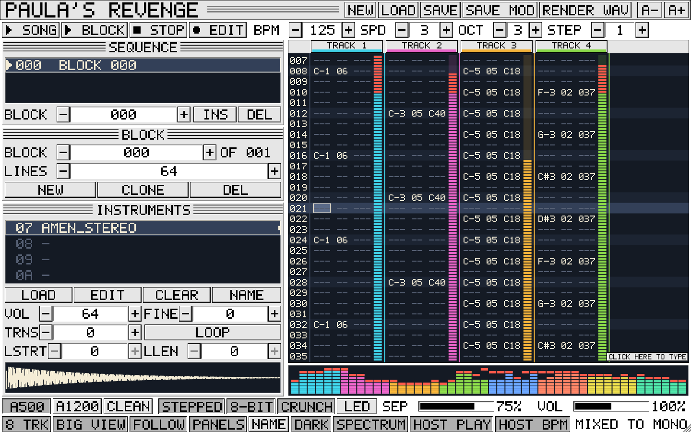

# PAULA'S REVENGE

An 8-track, Amiga-style sample tracker for jungle, drum & bass and anything that wants that crunchy 8-bit Paula sound. A **standalone app** for macOS and Windows, with a built-in mixer (EQ, insert effects — built-in or your own VST3 / AU plug-ins — and two send buses), VST3 / AU instruments, MIDI out to your hardware, effect automation from the pattern (or recorded by hand) and stem renders. Big pixel text, keyboard-driven.

It's an original program inspired by the classic Amiga trackers of the early 90s. It loads and saves ProTracker-style `.MOD` files and imports MED/OctaMED `MMD0`/`MMD1` modules.



**Manual:** [`docs/manual/index.html`](docs/manual/index.html) — the full user manual, in the same look as the app (open it in a browser), or as an A4 PDF: **[download the PDF manual](https://github.com/TwistedGenetics/Paula-s-Revenge/releases/latest/download/Paulas-Revenge-Manual.pdf)** (always the latest; it's also attached to every release). GitHub's own file page can't show a PDF this size on a phone, so use that link.

## Install (no building needed)

Every green build publishes one release with both versions, always the same version number. Open **Releases** on the right of the repo page and download from the newest one:

* **Mac:** **PaulasRevenge-macOS.zip**, then follow the `INSTALL.txt` inside: copy the app into Applications and clear macOS quarantine. Universal (Apple Silicon + Intel).
* **Windows 10 / 11 (64-bit):** **PaulasRevenge-Windows.zip**. Unzip it anywhere and run `Paula's Revenge.exe` (nothing else to install). The app isn't code-signed yet, so the first time Windows says *"Windows protected your PC"*: click **More info**, then **Run anyway**.

**On a PC:** every `Cmd` shortcut in this help is `Ctrl` (`Ctrl+S` saves, `Ctrl+Z` undoes, `Ctrl+R` captures...), and the app shows CTRL where the Mac shows CMD. Full screen is `F11`. The menus (**File**: Audio/MIDI Settings, Follow System Output, Quit; **View**: Capture, Full Screen) are in the window. Plug-ins are VST3 (Audio Units are Mac-only), and audio is **Windows Audio** (WASAPI) or DirectSound. Settings and the global chord set are kept in `%APPDATA%\Paula's Revenge`.

Since v0.8 it's a standalone app only (no VST3/AU plug-in versions of Paula's Revenge itself).

---

## Help inside the app

**HELP** (top left of the title bar, or `F1`, or `Cmd+/`) shows this README inside the app, in the same big pixel text, with the chapters listed on the left: click one to go there. The wheel, the arrow keys, `PgUp` / `PgDn` / `Space`, `Home` / `End` and the scroll bar move through it; `←` `→` go to the previous / next chapter; `Esc` (or HELP again) goes back to where you were. **OPEN PDF MANUAL** opens the illustrated PDF manual, which is built into the app too. Both always match the version you're running.

**Searching:** just type (two letters or more): the chapter list shows only the chapters with a match, the matches are marked in the text, and the status line says which one you're on (`3 OF 12`). `Enter` (or `Cmd+G`) goes to the next match, `Shift+Enter` the one before; `Esc` clears the search, `Esc` again closes HELP. Right-click the text to copy a chapter, or all of it, to paste somewhere else.

## The screen

| Area | What it does |
|---|---|
| Title bar | HELP, NEW, LOAD, SAVE, SAVE AS (native `.prv`), UNDO, REDO, **FULL VEL**, **NOTE-OFFS**, **CAPTURE**, text size `A-` / `A+`. SAVE MOD, RENDER WAV and EXPORT SAMPLES are in the **File** menu |
| Transport | Play song, play block (either one also takes you back to this main page from whatever page is open), stop, edit mode, LOOP (the marked lines), BPM, speed (ticks per line), octave, step, **FOLLOW** (the cursor moves with playback), **MIXER** (`Cmd+2`) |
| Sequence | The song order, with a scrollbar; it follows the position playing. Click a position to jump to it; drag over the names to highlight positions for CUT / COPY / PASTE / DUPLICATE / DEL / COMBINE (see Sequence tools); set which block plays there. Drag the position numbers (or ▲ ▼, or `Alt+↑/↓` in the pattern) to move the highlighted positions. CLONE IN PLACE gives this position its own copy of the block (see below). Click the section label at the right of a row (or `+ SECTION`) to start a labelled **section**; LOOP SECTION loops it, LOOP SELECTION loops the highlight (see Song sections) |
| Block | Pick, add, clone or delete blocks; set the number of lines (1–256). **X2** doubles the block's length and repeats everything in it (notes and both effect columns) in the new half; **1/2** halves it (asks first if the second half was different). NUM − / NUM + swap the block's number with its neighbour (the song still sounds the same) |
| Instruments | 63 slots with a scrollbar. LOAD opens the browser, with tabs along the top for what the instrument plays: **SAMPLES**, **SYNTHS** (the built-in SUB, REESE and GRANULAR synths), **VST / AU** (your instrument plug-ins), **MIDI OUT** (hardware) and **CV OUT** (a modular); EDIT the sample editor, **EQ/FX** the instrument's own EQ and effects, PARAMS the envelope/filter/pan page. **Delete** (or Backspace) clears the instrument picked — click it first; undo brings it back — and up / down pick the next one; CLEAR and RENAME are on its right-click too. VOL (the instrument's level, see below), finetune, transpose, loop on/off. Drag the loop markers in the little waveform (exact loop points are in the sample editor; double-click the waveform to open it). Double-click a name to rename. Alt-click to preview |
| Pattern editor | 8 tracks. The box left of track 1 shows the block you're editing (**BLK**); click it to type a block number. Click a track name to mute it, Alt/right-click to solo. Drag in the pan bar under the name to pan that track; double-click it to go back to AUTO. Under that, each track's **scope** shows its sound as it plays (click it to mute, Alt/right-click to solo; View > Track Scopes hides them), and the header lights up in the track's colour on every new note. The level meters are one colour: right-click one to choose it |
| Output strip | The machine you hear (Amiga A500 / A1200 / CLEAN or Akai S950 / S1000, see below), its options, the master **VOL** (0–200%, 100 = as it is) and an L/R output meter. Stereo separation (SEP) is a right-click on any of the machine buttons, or View → Stereo Separation... |
| Bottom row | BIG VIEW (4 tracks at a time with large text), hide/show panels, the skin, the spectrum, FX2, REC AUTO, GROOVE, **RADIO** (internet radio to sample from; lit while it plays), AUTOMATION, **LIVE** (LIVE MODE) and the status line. The song's name (top) is its file's name, set when you save or load |

The app opens with the **dark** skin (cream on blue-black, coloured tracks, level bars in each track and a spectrum strip). In the dark skin the instrument pages (PARAMS, plug-in, MIDI out) and the mixer and its effect pages are dark too, with light text. The **DARK** button on the bottom row switches to black-on-white (WORKBENCH); **SPECTRUM** hides the strip. Every spectrum — the strip, PARAMS' filter, the EQ pages — is drawn as an analyser: a smooth line at 1/12 of an octave with the fill fading away under it, a faint peak-hold line above and a light grid at 100 Hz, 1 kHz and 10 kHz.

**Skins:** WORKBENCH (black on light grey), DARK (cream on blue-black), KICKSTART 1.3 (white on the old blue, orange when pressed), HIGH CONTRAST (white on black, yellow when pressed), GLASS (deep blue glass: a gloss over every button and pane, a soft shadow inside every field, chosen glows cyan) MODERN (white and soft grey, flat with thin borders, chosen is solid blue) and STUDIO (flat greys like a modern DAW, with smooth type instead of the pixel font: numbers in JetBrains Mono, labels in Inter, both the same size and place as the pixel letters; a button that's on is filled with what it means - orange chosen, red recording, blue modulating - with dark text), NEON (deep navy, rounded, lit from above; what's on glows cyan; labels in Space Grotesk), HARDWARE (matte black and rubber-grey keys like a drum machine; what's on lights an LED along the top of its key; the pattern is an amber display; labels in Barlow Condensed) and PRISM (slate, soft and rounded, bright track colours; in the pattern every note is a bar in its track's colour that lasts until the next note or OFF, with the note in dark text on it; labels in Nunito), BLUEWAVE (a wavetable synth's charcoal and slate blue-grey: bright blue for what's on, orange for modulation, buttons lit from above), PAPER (light and clean: white panes on soft grey, blue for what's on with white text on it), VIOLET (dark purple, rounded; what's on glows lilac, teal for modulation; labels in Nunito), EMBER (warm charcoal, orange for what's on, yellow for modulation; labels in Space Grotesk), FOREST (deep green, lime for what's on; labels in Barlow Condensed), PRISM II (PRISM without the bars: every track's notes and instruments in its colour on the plain background, its effects a lighter shade of it), AURORA (near black with a soft purple and navy glow behind smoky grey panes, pill-shaped buttons, pastel mint for what's on, yellow for modulation, every track a pastel colour; labels in Inter) BOOMBOX (an 80s boombox: deep violet panels with a silver rim and a soft purple glow behind them, hot pink for what's on, orange for modulation, every track's notes in an equaliser colour - orange, pink, magenta, purple, lavender; labels in Space Grotesk), DARK II (DARK made modern: the same cream on blue-black with smooth type, rounded keys lit from above and a soft blue glow behind) and GLASS II (GLASS made modern: deep blue glass with smooth type, glossy rounded keys that glow when they're on, a sheen across the panes) and DARK III (DARK as it is — the light grey panels and keys round the cream-on-blue-black pattern — made modern: smooth type, rounded keys lit from above, soft edges instead of the Amiga bevels). Right-click **DARK**, or View > Skin, for all twenty-one; the button shows the skin's name when it isn't WORKBENCH or DARK. **CRT** in the same menu adds scanlines and darker corners (only a look: clicks go through). The skin is kept for next time.

Colour means the same thing everywhere: a button that's on has a stripe along its foot - red for recording (EDIT, REC AUTO, RECORD), orange for learning and modulating, blue for the rest - and orange marks a modulated control. Text and bevels are drawn on whole screen pixels, so they stay sharp at any size and on Retina screens.

**Command palette (Cmd+K):** type a few letters of anything - a button on screen, a page, a skin, a menu command - and Enter does it (Up/Down picks, Esc closes). Letters in order are enough: "SVAS" finds SAVE AS. Each menu command shows its shortcut beside it, so it teaches the keys as you go.

**SHOW ALL (the sequence):** the SHOW ALL button at the right of the SEQUENCE title gives the sequence the whole side (BLOCK and INSTRUMENTS fold to their titles). When the song is longer than that, the sequence spreads over the main area too, in columns, so you see the whole song at once (about 48 positions at 1440 x 900; A- fits more). Clicks, drags and highlights work in every column. Click SHOW ALL again for the pattern and the other panels.

**Folding the sidebar:** click a sidebar panel's title (SEQUENCE, BLOCK, INSTRUMENTS) to fold it to just its title, and its room goes to the others - fold SEQUENCE and BLOCK and the instrument list fills the side. Click the folded title to open it again. Right-click a folded title for **TABS** (one panel open at a time: click a title to switch) or OPEN ALL PANELS. Kept for next time.

**The lane:** the whole song as a strip over the pattern - one column per song position, a clip for each track in its section's colour (a track's own colour before the first section) with its notes drawn small inside: across is when, up is how high. Section names run along the top over the position numbers. The position you're editing is ringed, and while the song plays a playhead runs through the playing one and the lane scrolls along with it. Click a column to go to that position; the wheel scrolls it. Turn it on from the sidebar menu (right-click a folded title), View > The Lane, or Cmd+K "LANE". Kept for next time.

**Pads:** sixteen pads, one instrument each - press one to choose its instrument and play it at C of the octave (OCT); with EDIT on it's written at the cursor as a key would be, and the cursor steps on. Pad 1 is bottom left, as on a drum machine. Pads light whenever their instrument plays, on any track. **-** / **+** change the bank: A is instruments 1-16, B 17-32, C 33-48, D 49-63. With the sidebar showing they're two rows of eight under the pattern (in the spectrum's place); with the sidebar off (PANELS) they're four by four beside the pattern - either way the pattern keeps its size. Turn them on from the sidebar menu, View > Pads, or Cmd+K "PADS". Kept for next time.

**Pictures:** each sample's waveform at the right of its row in the instrument list; a track's EQ curve drawn behind its EQ button on the mixer; small icons beside HELP, LOAD and others when there's room for both (never instead of the label, never shrinking it); and on the ARRANGE page a **minimap** of the whole song under the list - each position's notes in the tracks' colours, the sections in red, a frame round what the list shows. Click or drag in it to go there.

**Live feedback:** the meters, scopes and play line move 60 times a second. While you drag a slider, a mixer fader or one of the strips' small bars, its value shows big beside it. Buttons light up under the mouse and sink when pressed.

## Right-click menus

Right-click almost anything for what you can do with it (a big-text list; `Esc` or CANCEL closes it, and each action is one undo step):

| Where | What's there |
|---|---|
| Instrument list | COPY, PASTE, DUPLICATE TO NEXT FREE, CLEAR (or the Delete key), RENAME, CHOP TO PHRASE..., LOAD SAMPLE, LOAD A BUILT-IN SYNTH (SUB, REESE, GRANULAR), LOAD A VST / AU SYNTH, MIDI OUT TO HARDWARE, CV OUT TO A MODULAR, SAMPLE (RECORD AUDIO), PLAY C-3 (Alt+click still plays it) |
| Sequence list | COPY, CUT, PASTE, DUPLICATE, DELETE, INSERT THE SAME BLOCK, INSERT A NEW BLOCK, CLONE IN PLACE, SECTION NAME, BLOCK NAME |
| Block panel (its background) | COPY / CUT / PASTE BLOCK, CLEAR BLOCK, DUPLICATE, NEW, DELETE, DOUBLE / HALVE LENGTH |
| Pattern, note column | COPY / CUT / PASTE TRACK, CLEAR THIS LINE, INSERT A LINE, DELETE THE LINE, EFFECT COMMANDS, VU METER COLOUR, SPECTRUM COLOUR |
| Pattern, effect columns | the command list (a `#xy` chord cell: the chord list); inside a highlight: BOUNCE |
| Any level meter (the bar at the right of each track, the L / R meter, the mixer's meters) | VU METER COLOUR: green, amber, cyan, red, blue, pink, cream / black, or each track's colour - one colour for all of them, kept for next time |
| The spectrum strip | SPECTRUM COLOUR: the same colours, or RAINBOW (the track colours, as it started) |
| EDIT button | STEP ENTRY NOTE-OFFS, DETECT CHORDS, CAPTURE, NOTE-OFFS, FULL VEL |
| Sample editor waveform | CUT, COPY, PASTE, DELETE, CROP, SILENCE, MAX VOL, REVERSE, FADE IN / OUT, SET LOOP, SELECT ALL |
| Mixer: a strip's name | COPY STRIP, PASTE STRIP, RESET STRIP, OPEN CHANNEL (the returns and master: RESET) |
| Mixer: an insert slot | COPY EFFECT, PASTE EFFECT, CLEAR SLOT, BYPASS ON / OFF, OPEN |
| CHORDS page slots | COPY, PASTE, CLEAR (all the picked slots), COLOUR, PLAY, RECORD CHORDS, NOTE |
| DARK button | THE SKINS, CRT |
| HELP text | COPY THIS CHAPTER, COPY ALL OF IT |

Copied instruments, strips, effects and chords stay in the app (paste them into another slot or another song); HELP text goes to the system clipboard.

## Panning and left/right balance

Every track comes out of both speakers by default. How a track is panned, in order:

1. **`8xx`** in the pattern (`800` hard left, `880` centre, `8FF` hard right). This is an absolute position now, and isn't scaled by SEP.
2. **The track's pan** (the bar under each track name). **AUTO** means "no track pan".
3. **The instrument's pan** (PARAMS page), when its AMIGA L/R button is off.
4. Otherwise **Amiga style**: tracks 1 and 4 lean left, 2 and 3 lean right, by the **SEP** amount (20% by default, 0% = all centred). Stereo samples play centred with their own stereo image.

The **L / R meter** on the right of the Paula strip shows the balance. The app only runs in stereo, and turns on both of your interface's first two outputs if an old setup had only one.

## Mixer

**MIXER** on the transport row (or `Cmd+2`) opens the mixer across the whole window; `Esc`, CLOSE or `Cmd+1` goes back to the pattern. While it's open the computer keyboard still plays the current instrument (same note keys as the pattern; `[` `]` change octave, `-` `=` change instrument; the title shows which one), so you can play while you set levels. A MIDI keyboard plays it too. These notes go through the master bus. One strip per track (8), then the two send returns and the master, each with a level meter:

| Strip part | What it does |
|---|---|
| Name | Click a track's name (or **EQ**) for its channel page |
| EQ | Lit when any EQ point is on |
| 3 insert slots | Click a slot to open its effect page. `Shift`-click bypasses / un-bypasses it (a bypassed slot is dimmed) |
| A, B | How much goes to send A / send B. `AP` / `BP` = sent pre-fader. Drag sideways; double-click = off |
| PAN | The track's pan (the same one as the bar under the track name). Double-click = AUTO |
| Fader | −INF to +6 dB, with the meter beside it (red above 0 dB). Drag the cap; `Shift` = fine; double-click = 0 dB; the wheel moves it ½ dB a notch |
| M / S | Mute / solo (the same as clicking the track names) |

**DUCK...** (top of the strips page) makes room for the kick in one go. Pick the track with the kick, then what dips under it (**EVERY OTHER TRACK**, or just one — the bass, say), then how hard: **LIGHT** (about −4 dB, just room for the kick), **MEDIUM** (about −8 dB) or **HARD** (the pump). It sets up a FOLLOWER on the kick's track turning those tracks' VOLUME down on every hit and back up over a line and a half (three lines when HARD), at the song's tempo — one undo step. It's an ordinary modulator, so MODULATION shows it to fine-tune (the status line says which). Ask again for the same track to change it or **TAKE THIS DUCK OFF**; a track that's ducking says **(DUCKING NOW)**.

**LOW-END CHECK** (top of the strips page; lit when on) opens a panel under the strips that listens to the master while the song plays — the last couple of seconds — and says in plain words, each with a lamp (green fine, amber worth a look, red fix it):
* **BASS IS MONO** / **BASS NOT MONO** / **BASS OUT OF PHASE** — below 120 Hz, are the two sides the same? Clubs and phones add them together: out of phase, the bass cancels. The fix: the bass instrument's UTILITY **MONO** `<120HZ` (or STEEP).
* **SUB LEVEL OK** / **NOT MUCH SUB** / **SUB SWAMPS THE MIX** — the sub (below 80 Hz) against everything, in dB. Swamped: turn it down, or DUCK it under the kick.
* **CLEAR LOW MIDS** / **MUDDY** — how much of the mix is 200–500 Hz. Muddy: cut there on the pads and breaks (their channel EQ).
* **NO CLIPPING** (with the peak) / **CLIPPING** — samples at full scale in the last few seconds: turn the master down.

Stopped, it says **PLAY THE SONG**. It's a guide, not a rule: a sub-heavy roller may be meant to be.

**Channel page** — the EQ: a response curve with up to **8 points** on it, and the channel's live **spectrum** behind the curve (what the track sounds like after its EQ, while it plays, smoothed to 1/6 octave with a +4.5 dB/octave tilt so a mix reads flat, and a faint peak-hold line; it stays put when you stop; **SPECTRUM** switches it off). **Right-click SPECTRUM** (or an empty part of the graph) to pick its colour: ICE, CYAN, GREEN, LIME, AMBER, ORANGE, MAGENTA or VIOLET (remembered).
* **Double-click** an empty part of the graph to add a point exactly there: below 80 Hz it's a LOW SHELF, above 10 kHz a HIGH SHELF, anywhere else a BELL. It's selected, ready to drag.
* **Drag** a point: left / right is its frequency, up / down its gain (a high- or low-pass only moves left and right; hold Shift to move up and down only). A big readout shows the frequency, gain and Q while you drag. The whole drag is one undo step.
* **Mouse wheel** over a bell sets its Q. **Right-click** a point: BELL, LOW SHELF, HIGH SHELF, HIGH-PASS, LOW-PASS, SWITCH OFF / ON, RESET GAIN, REMOVE POINT. **Delete** removes the selected point. Clicking a point that's off switches it on (an off point is drawn hollow).
* Under the graph, the selected point's controls: its type, ON, REMOVE POINT, and FREQ, GAIN and Q bars (they follow the point, and the point follows them). **EQ FLAT** removes every point. With 8 points a double-click does nothing and the status line says `EQ FULL: 8 POINTS`.
* A new channel starts with no points (flat). Songs from before v0.25 keep the bands they had switched on, where they were, and sound the same. On the right: the track's three inserts, the two sends with PRE (pre-fader) switches, and the fader. `<` `>` (or ← →) step through the tracks.

**Effect page** — **EFFECT: …** at the top opens the menu of effects in groups: **REVERB** (VAST, SPACE, ROOMS, SPRING, REVERB), **DELAY** (TAPE ECHO, DUB DELAY, BBD DELAY, MULTI-TAP, GRAIN DELAY, DELAY), **MODULATION** (ENSEMBLE, DIMENSION, FLANGER, PHASER, ROTARY, TREMOLO, FREQ SHIFTER, CHORUS), **DRIVE & CRUSH** (DRIVE), **FILTER & DYNAMICS** (FILTER, AUTO-FILTER, COMP), **PLUG-IN (VST3 / AU)** and **EMPTY**. Pick a group, then the effect. **PRESETS...** lists the effect's factory presets and yours (**MY …**); **SAVE THESE SETTINGS AS MY PRESET...** keeps the current settings under a name on this computer, for any slot in any song, and **DELETE ONE OF MY PRESETS...** removes one. Every page has BYPASS and DEFAULTS; an effect with more than 6 controls shows them in two columns. `<` `>` step through all the slots.

The effects:
* **VAST** — echoes that turn into a huge reverb. 8 delay lines feed each other: **DENSITY** spreads their lengths (at 0 you get clean repeats on the beat; turned up, a cloud), **WARP** smears every repeat a little more, **FEEDBACK** up to 100% sustains forever. **DELAY** is in ms or, with **SYNC**, a note length. **MOD RATE** / **MOD DEPTH** move the lines gently, **LOW CUT** / **HIGH CUT** shape the tail, **WIDTH** is the stereo spread. **MODE**: NEBULA (balanced), ABYSS (longer, darker, longer tail), BLOOM (swells in), DRIFT (lines that wander).
* **SPACE** — a room, plate or hall. **SIZE**, **DECAY** (0.3 to 40 seconds), **PRE-DELAY** with **PRE ECHO** (the pre-delay repeating into the reverb), **DAMP** (darker as it fades), **LOW CUT**, **MOD**, **CHARACTER** (GROUNDED, AIRY, COSMIC), **SHIMMER** (an octave up, building in the tail), **FREEZE** (holds the tail for ever and ignores new sound) and **WIDTH**.
* **TAPE ECHO** — a tape loop with three playback heads: **HEADS** picks 1, 2, 3 or a mix (head 2 is twice the TIME, head 3 three times). **FEEDBACK** goes past 100% for runaway dub echoes (the tape saturates instead of exploding). **WOW** and **FLUTTER** wobble the tape speed, **SATURATE** drives the tape, **TONE** darkens the repeats, **WEAR** adds hiss, dropouts and duller highs, **SPREAD** places the heads across the stereo field.
* **ENSEMBLE** — the bucket-brigade chorus of the classic polysynths: **MODE** I, II, I+II (fast and shallow) or STRINGS (three voices, the string-machine sound). **RATE** scales the mode's speed, **DEPTH** its swing, plus **WIDTH**, **TONE** and **NOISE** (the chip's hiss).
* **ROOMS** — a room, chamber, hall or plate (**TYPE**) with early reflections: **SIZE**, **DECAY**, **PRE-DELAY**, **EARLY** (the first reflections against the tail), **DAMP**, **LOW CUT**, **HIGH CUT**, **MOD**, **WIDTH**.
* **SPRING** — a guitar amp's spring tank: 1 to 3 **SPRINGS**, **DECAY**, **TONE**, **DRIP** (the twangy splash on hits), **DRIVE**, **LOW CUT**, **WIDTH**.
* **DUB DELAY** — the repeats go round a band-pass **FILTER** (with **RESO**) and **DRIVE**; **FEEDBACK** goes past 100%. **HOLD** loops what's in the delay untouched and lets nothing new in — switch it on, play with FILTER and TIME, switch it off. **PING** bounces between the sides, **WOBBLE** wavers the speed.
* **BBD DELAY** — an analog bucket-brigade echo (up to 1 second): the longer the **TIME**, the darker it gets, like the real chips. **MOD RATE** / **MOD DEPTH** warble it, **AGE** adds hiss and dulls it, **DRIVE**, **WIDTH**.
* **GRAIN DELAY** — **MODE** REVERSE plays each stretch of **SIZE** backwards (sync it for reversed echoes on the beat); GRAINS sprays short grains from the past. **PITCH** shifts either by −12 to +12 semitones, **SPRAY** scatters the grains in time, **DENSITY** is how many overlap, **FEEDBACK** feeds them back in.
* **MULTI-TAP** — up to 8 **TAPS** after a **TIME** step, in a **PATTERN**: STRAIGHT, DOTTED, TRIPLET, SWING, SPEED UP, SLOW DOWN or SCATTER. **DECAY** makes each quieter than the one before, **SPREAD** bounces them left and right, **FEEDBACK** repeats the whole pattern, **TONE** darkens it.
* **FLANGER** — **RATE**, **DEPTH**, **MANUAL** (the centre delay), **FEEDBACK** (negative or positive), **STEREO** (the sides sweep apart). **THRU-ZERO** holds the dry sound back so the sweep passes through it: the tape-flanging cancel.
* **PHASER** — 4, 8 or 12 **STAGES**, **RATE**, **DEPTH**, **CENTRE**, **FEEDBACK** (negative or positive), **STEREO**.
* **ROTARY** — a spinning organ speaker: a horn and a drum, each with its own speed. **FAST** switches between slow (chorale) and fast (tremolo) and both speed up or slow down as a real one does (**ACCEL** is how long it takes). **HORN** balances horn and drum, **DRIVE** the amp in front, **WIDTH** the two microphones.
* **TREMOLO** — **MODE** TREMOLO (volume), AUTO-PAN or HARMONIC (lows and highs pulse in turn). **RATE** in Hz or, with **SYNC**, a note length; **DEPTH**; **SHAPE** from sine to square (chopped); **STEREO** puts the sides out of step.
* **FREQ SHIFTER** — **MODE** SHIFT moves every frequency by the same number of Hz (−1000 to +1000, **FINE** ±10): not in tune, which is the point; with **FEEDBACK** it spirals. **STEREO** shifts the sides opposite ways. RING MOD multiplies by a tone for metallic, robotic sounds.
* **AUTO-FILTER** — a low-, band- or high-pass whose **CUTOFF** moves with an LFO (**LFO RATE**, synced or free, **LFO DEPTH** in octaves) and with the sound's own level (**ENV AMOUNT** up or down, **ENV SPEED**): envelope funk, wah, rhythmic sweeps. **RESO**, **DRIVE**.
* **DIMENSION** — the studio "space" box: 4 **MODE**s of a wide, clean stereo spread with no obvious wobble, which sums back to mono cleanly.
* **FILTER** (resonant low/band/high-pass), **DRIVE** (drive, bit crush, sample-rate reduction, tone), **COMP** (compressor, with MIX for parallel compression), **DELAY** (time in ms, or SYNC to the song's tempo from 1/32 to 1/2, dotted and triplet; feedback, tone, PING-pong), **REVERB** (size, damping, width, pre-delay) and **CHORUS**.

Every control glides to its new value (no zipper noise, so they can be automated with V and J), the saturation runs at twice the sample rate, and they're all true stereo. Songs with VAST, SPACE, TAPE ECHO or ENSEMBLE need v0.34 or later; with the others above, v0.35 or later.

**Returns** — SEND A starts with a reverb and SEND B with a delay, both fully wet; they're silent until a track sends to them. Each has three inserts, a fader, a balance and a mute. **Master** has three inserts and a fader, and then comes the machine's output stage (A500/A1200/CLEAN/S950/S1000 and their options).

**Dub throws** — a dub engineer's trick in the pattern: a single snare, vocal or stab thrown into the echo and left to ring while the rest plays on dry. Put **`!xy`** on a note's line (type `!` with Shift+1, or right-click the effect cell → **DUB THROW**):
* `x` is how much of the track goes into the echo (`1`–`F`, `F` = all of it), `y` how many lines it stays open (`0` = until the track's next note, so just that hit). `!F0` on a snare throws just that snare; `!84` throws four lines' worth at half level.
* `!0y` rides the echo's **feedback** up while the song plays (`!08` longer, `!0F` nearly endless - the classic runaway build), `!00` puts it back. It goes back by itself when playback stops.
* The throw goes into **SEND B** before the fader, on top of the track's own send, and fades in and out over a few milliseconds, so it never clicks. The echoes ring on after the throw closes.
* The first `!` you put in a song makes SEND B a **dub echo**: DUB DELAY (tempo-synced, filtered, driven, with a little wobble) into a SPRING reverb. That's one undo step of its own, and it only happens while SEND B is still as a new song has it - if you've put your own effects there, it uses those (any echo with a FEEDBACK control works with `!0y`).

**Delay compensation** — some plug-ins (lookahead limiters, linear-phase EQs, some instruments) give their sound back late. Each track is delayed just enough that every track lines up with the slowest one, sends included, so breaks stay tight. A bypassed plug-in (or one switched off from the pattern) keeps its delay, so nothing jumps mid-song. The strips page shows the total delay in its title, and a plug-in's effect page says how late it is. Plug-ins on SEND A / B and the master just add their delay at the end. Notes you play live through a sample instrument aren't delayed; live notes on a plug-in instrument go through its track, so they are.

Signal flow per track: EQ → inserts → pre-fader sends → fader → post-fader sends → master. A mixer with nothing changed (all faders at 0 dB, no EQ, no effects, no sends) is skipped, so the song sounds exactly as it did before v0.8. Everything in the mixer is saved in the song, undoable, and included in RENDER WAV. (The insert slots are built so plug-in effects can be added later.)

## Scrolling and the mouse

* The pattern fills its area from line 0 at the top. The cursor moves freely and the view only scrolls when it gets within a few lines of the top or bottom edge; at the end of a block the last line sits on the bottom row. A click moves the cursor without moving the view.
* With FOLLOW on, the cursor moves with playback but **the view doesn't scroll by itself**: the play line runs down the screen and can go off the bottom. Scroll yourself with the wheel or the arrows at the right of the pattern: **▲** / **▼** move a page (hold to keep going), **●** jumps to the play line. A new block starts at its top. When playback is stopped, the arrows move the cursor a page, and the view works as before.
* The wheel moves one line (or list row, or zoom step) per notch however fast it's spun; trackpad swipes are scaled down. The wheel doesn't wrap from the last line back to the first.
* Holding a drag past an edge (selecting notes, marking a loop, moving positions in the sequence or the arrange page) scrolls at a steady pace — about 12 lines a second, faster the further past the edge you go.
* Sliders and number boxes move relative to where you grab them, at a calm rate; hold `Shift` for fine adjustment. The mouse wheel also nudges them.

## Instrument parameters (PARAMS)

PARAMS in the instrument panel opens a page for the current instrument. Everything is off or neutral by default, so MODs and older songs sound exactly as before.

* **Volume envelope**: VOL ENVELOPE on/off, ATK, DEC, SUS, REL (1 ms – 10 s), with a picture of the shape. With the envelope on, `OFF` in the pattern (or letting go of a key) starts the release instead of cutting the note.
* **Filter**: OFF / LOW / HIGH / BAND pass, CUT (20 Hz – 20 kHz), RES, AMT (how far the filter envelope moves the cutoff, ±8 octaves), KEY (how much the cutoff follows the note). The **spectrum strip** under the page shows the instrument's own sound (40 Hz to 16 kHz, low on the left) with the **filter's curve** drawn over it, a line at the cutoff and what it is (`LOW 1.2K`) — play the instrument and watch what the filter takes away. In a tall enough window the FILTER box has its own picture too.
* **Filter envelope**: ATK, DEC, SUS, REL.
* **Pan**: AMIGA L/R follows the track layout above; switch it off and use PAN to give the instrument its own position.
* **UTILITY** (the row under PAN; also on a plug-in instrument's page): **WIDTH** 0% (mono) to 200% (wider), as mid / side; **MONO** makes everything below a frequency mono (OFF, or `<20HZ` to `<500HZ`, with a smooth 24 dB/octave crossover so nothing thins out at the split; **STEEP** makes it 48 dB/octave, so the bass is fully mono right up to the split) — the classic "mono the bass" move; **VOL** is the instrument's VOL itself, so moving either one moves the other (and undo takes them back together). It works before the instrument's own effects, on samples and VST3 / AU instruments (not MIDI out or CV out). At 100% and OFF it does nothing. Saved in the song, in renders and bounces. (With **8CH GRIT** on, a sliver of the grit lands on the paired track, as on the real thing, so a mono instrument there isn't 100% mono.)
* **Spectrum at instrument level**: while PARAMS or a plug-in instrument's page is up, the spectrum strip under it shows just that instrument's sound (after its UTILITY and its own effects), marked `INSTRUMENT 01 ONLY`. Editing one of the instrument's own effects in the mixer shows it there too, along the bottom.
* **HOLD TO PLAY**, or play the computer keyboard, to hear it. RESET ALL puts everything back. Double-click any slider for its default.
* **ON** (bottom left) switches the instrument off and on. While it's off its notes don't play (anything sounding fades out over 5 ms, so there's no click), and the instrument list shows it dimmed with `OFF`. To switch it from the pattern, pick a track in the **TRACK** box, press **LEARN A (V)** or **LEARN B (J)**, then click ON: that track's `Vxx` / `Jxx` becomes the instrument's `ON/OFF` (`00` = off, `01`–`FF` = on).
* **PLUG-IN / MIDI OUT...** plays this instrument with a VST3 / AU instrument, with your hardware over MIDI, or with a modular over CV (see below).
* **PITCH** (±48 semitones, the same as TRNS in the instrument panel) and **FINE** (±100 cents) tune the sample. **TUNE TO C** finds the sample's pitch and sets them so `C-3` plays a C (the nearest one, so it moves 6 semitones at most); the status line says what it heard. Drums with no clear pitch are left alone.
* **BEAT SYNC** (like Renoise's): the sample (START to END) lasts **LINES** lines at `C-3`, at whatever the tempo and speed are — it's sped up or slowed down (repitched) to fit, live, so it follows BPM / SPD changes and `Fxx`. Other notes play it higher or lower as usual. Switching it on suggests a sensible number of lines for the sample's length. **STRETCH...** opens the sample editor's time stretch set to the same number of lines, to make it fit at its own pitch instead (PREVIEW, then APPLY; BEAT SYNC can stay on).
* **KEEP PITCH** (under LINES): BEAT SYNC stretches the sample instead of repitching it, with the old-sampler stretch (see Time stretch) — the break stays at its own pitch and keeps that grainy, metallic 90s sound. It's made again whenever the BPM, SPD or LINES change, and **the original sample is kept**: switch KEEP PITCH off and it's back exactly as it was, and songs save the original (the stretch is made again when they load). **Right-click KEEP PITCH** for **CLASSIC** (the Akai S-series sound, the default) or **AKAIZER** (smoother grains). **SEMI** (−24 to +24) moves the pitch without changing the length — pitch a break up and keep it in time, without the chipmunk. Changes in the song's tempo while it plays (`Fxx`) are followed by repitching a little until the next stretch. Editing the stretched sample in the sample editor keeps the stretch as the sample (KEEP PITCH goes off). On the BREAK page, **KEEP PITCH** next to FIT TO TEMPO does the same when it chops.
* **EQ** and **FX** (the row across the page, above PAN): the instrument's own EQ and its own effects (see Instrument EQ and effects). **EQ** is lit when the instrument has EQ points switched on.

Envelopes and filters run per note on top of the Paula sound. On a VST3 / AU instrument they work on what the plug-in plays (see Plug-in instruments). They're saved in `.prv` songs and Live sets. A MOD can't hold them (SAVE MOD says so).

## Instrument EQ and effects

Every instrument — a sample or a VST3 / AU instrument — has **its own EQ** and **three insert slots of its own**, the same as a mixer strip's: any built-in effect (VAST, SPACE, TAPE ECHO, ENSEMBLE, filter, drive, compressor, delay, reverb, chorus) or a VST3 / AU plug-in. **EQ/FX** on the instruments panel (next to LOAD and EDIT) opens them for the instrument picked (a plug-in instrument's page has them on its own rows too).

* **EQ/FX** opens the instrument's **EQ AND EFFECTS** page: the same EQ graph as a mixer track's — up to 8 points, double-click to add one, drag to move, the wheel for Q, right-click for its type (BELL, LOW / HIGH SHELF, HIGH / LOW-PASS), REMOVE or SWITCH OFF, **EQ FLAT** for none — with the instrument's own spectrum behind it. Its 3 effects are on the right (**BUILT-IN EFFECTS**; click one to set it), and **IN THIS ORDER** shows how the sound goes: the sample or plug-in, its filter and envelopes, UTILITY, this EQ, these effects, then its mixer track. **BACK** returns to the instrument.
* The instrument's EQ is saved in the song (and its changes are undo steps of that instrument), in renders and bounces. It isn't used on MIDI out or CV out instruments.
* Click a slot to open it on the mixer's effect page (type, settings, knobs, LEARN, plug-in window). **BACK** returns to the instrument. Right-click a slot for OPEN, BYPASS, COPY, PASTE and CLEAR. A lit slot is on; a slot that's bypassed isn't lit.
* The instrument's sound goes through its effects first, then into the strip of the track it plays on (EQ, the track's inserts, sends, fader). Every note of the instrument goes through the one chain, so a reverb tail or a delay carries on across notes and tracks; the chain's output goes to the track of the instrument's **latest** note.
* The effects belong to the instrument: they're saved in the song (and Live sets), are undo steps, and go with it when you COPY / PASTE / DUPLICATE the instrument. CLEAR on the instrument clears them too. RENDER WAV and bouncing include them.
* A plug-in's own delay (latency) on an instrument slot isn't compensated.

## Arrange page

**ARRANGE** in the sequence panel opens the song order full size, each position with a picture of its block's notes:

* Drag over positions to highlight them (or click one and Shift-click another); drag the highlight to move it (a red line shows where it will land).
* ▲ MOVE / ▼ MOVE (or `Alt+↑/↓`), COPY, CUT, PASTE, DUPLICATE (`Cmd+D`), DELETE — the same highlight and clipboard as the sequence panel.
* INSERT adds the BLOCK number after the cursor; SET makes the selected positions play that block.
* `Cmd+Z` / `Cmd+Shift+Z` undo and redo; double-click a position or press Enter to go back to the pattern.

**Instrument VOL** is a level for the whole instrument, on top of each note's own volume. `Cxx` still sets a note's volume, so you can write hats with `C20` on every other one for the groove and then pull all the hats down with VOL without touching the pattern. (MOD and MED files load with their instrument volumes written onto the notes as `Cxx` in the second effect column, so they sound exactly as before; SAVE MOD writes each `Cxx` at the level it actually plays at.)

## Selecting notes and effects with the mouse

Drag across the pattern to select notes and effects: the selection snaps to whole fields (note + instrument, FX1, FX2) and can span tracks. Shift-click selects from the cursor to the click; `Cmd+A` selects the whole block.

* `Cmd+C` / `Cmd+X` copy / cut the selection, `Cmd+V` pastes it at the cursor (each part goes back into the same kind of field, so effects land in effect columns), `Delete` clears it. The pasted part stays selected.
* Without a selection, `Cmd+C/X/V` still copy a whole track (add `Shift` for the whole block).
* A plain click moves the cursor and drops the selection. It's all undoable.

## Bouncing highlighted notes to a sample

Highlight some notes (drag over them; it can cover several tracks), then right-click inside the highlight — or press `Cmd+B` — and pick:

* **NO FX** — just the instruments' sound (with their UTILITY and own EQ), before their own effects and the tracks' mixer strips. Use it when the new sample will play through the same effects.
* **INSTRUMENT FX ONLY** — through the instruments' own inserts (see Instrument EQ and effects), but not the mixer.
* **MIXER FX ONLY** — after the tracks' strips (EQ, inserts and fader), plus what they send to SEND A / B, so a reverb or delay tail is in it; the instruments' own effects are left out.
* **ALL FX** — both: the instruments' own effects, then the mixer.

The master's inserts and the Paula / Akai output stage are never in it. The new instrument's name says which (`BOUNCE T1`, `BOUNCE+IFX`, `BOUNCE+MFX`, `BOUNCE+FX`).

It plays just those lines of just those tracks, from the first highlighted line at the tempo and speed set there. Plug-in instruments are included; MIDI-out instruments can't be (they're hardware). After the last line it records on until the sound has died away (up to 10 seconds), so tails aren't cut. Plug-in delay is taken off the start.

The result is a new instrument in the first empty slot, named like `BOUNCE T1-2 000-015` (`BOUNCE+FX` with FX), at 44.1 kHz, stereo when it's stereo. `C-3` plays it exactly as recorded. It becomes the current instrument. Nothing else changes: the pattern and the instruments that played it stay as they are. Undo removes it.

### AND THEN? (resampling)

Straight after a bounce it asks what to do with the new sample (each choice is one undo step; **KEEP IT AS IT IS** leaves it alone):

* **SLICE IT ON THE BREAK PAGE** — opens the BREAK page with it chopped at its hits, ready to play from the pads or rearrange.
* **MAKE IT A GRANULAR** — the instrument becomes a GRANULAR synth whose grains come from the bounce (SOURCE: SAMPLE, the same slot), and the ENGINE page opens: play it, scan it with POSITION, freeze it.
* **CRUNCH: AMIGA 8-BIT / SP-1200 (GRITTY) / MPC60 (WARM)** — re-samples it through that old sampler's converter: Amiga 8-bit at 16.7 kHz, SP-1200 12-bit at 26 kHz with a little drive, MPC60 12-bit at 40 kHz. The pitch and timing stay the same (its slices and loop move with it); the grit and the dull top end are in the sample itself.
* **REVERSE IT** — backwards.
* **STRETCH IT TO FIT A NUMBER OF LINES** — opens the sample editor's STRETCH, set to the nearest whole number of beats at the song's tempo; change LINES, PREVIEW, APPLY.

## Playing a block

While a block plays (▶ BLOCK, `Space`), picking another block — in the sequence, the BLOCK box, or the BLK corner — carries playback straight over to it **on the same line**, without stopping, so you can audition blocks against each other in time. (A shorter block wraps the line round.)

## Looping part of a block

Drag down the **line numbers** to mark some lines (or Shift-click a line number to mark from the cursor to there; `Cmd+[` / `Cmd+]` set the start / end at the cursor). The marked lines turn red and playback goes round them: `Space` starts at the first marked line, and song playback also loops there once it reaches that block. `Bxx`/`Dxx` jumps inside the loop are ignored so it keeps going. **LOOP** on the transport row turns it off and on again; marking new lines turns it on.

## Undo and redo

One history covers everything: notes and effects, block lengths, the sequence and block numbers, instrument settings and sound shaping, sample edits, loop points and slices, and song settings (BPM, speed, name, tracks, pans). `Cmd+Z` / `Cmd+Shift+Z` work on every page, and so do the **UNDO** / **REDO** buttons in the title bar (the sample editor and arrange page have their own buttons too). The status line says what was undone, e.g. `UNDO: TRANSPOSE TRACK +1`. It keeps the last 200 steps; loading or starting a song clears it.

## Sequence tools

* **Add a position**: **ADD** puts a new position straight after the selected one, playing the same block; change which block it plays with BLOCK − / + (any existing block). **NEW** makes a new, empty block (as long as the selected one) and puts it in a new position straight after the selected one, ready to fill. The arrange page's INSERT and SET do the same with the block number you pick there.
* **Highlight positions**: drag over them in the list (it scrolls by itself past the ends), or Shift-click to stretch the highlight. `Cmd+A` highlights the whole song. The arrange page shows the same highlight.
* **Highlighting**: drag over the names (anywhere right of the position numbers) to highlight positions — starting inside a highlight starts a new one — or click one and Shift-click another. The list scrolls as you drag past an edge, and follows the song while it plays.
* **CUT** (`Cmd+X`), **COPY** (`Cmd+C`), **PASTE** (`Cmd+V`, goes in after the highlight), **DUPLICATE** (`Cmd+D`, a copy straight after the highlight, which then gets highlighted) and **DEL** (`Delete`) work on the highlighted positions, or on the one selected.
* **COMBINE INTO ONE BLOCK** (right-click a highlight): the highlighted positions' blocks, one after another, become one new block (named after the first) in their place — 4 positions of 64 lines make one 256-line block. Up to 256 lines; the old blocks stay as they were for other positions. Sections that started inside the highlight go. One undo step.
* **LOOP SELECTION** (the button, or right-click): song play loops the highlighted positions, marked down the left edge. Press it again (or LOOP SECTION) to stop. The sequence panel and the arrange page share one clipboard: copy in one, paste in the other. Section dividers move with the music.
* The keys work after clicking in the list; any other key (notes, Space, undo) goes straight on to the pattern.
* **Move positions**: drag the highlight (or the selected position) by its **position numbers** (the hand pointer shows there) to a new place, press ▲ / ▼, or use `Alt+↑` / `Alt+↓` in the pattern. (Section dividers stay where they are when you move positions.)
* **CLONE IN PLACE**: if position 1 plays block 2, CLONE IN PLACE copies block 2 into the **next free block** and points position 1 at it. The next free block is the lowest-numbered block that's empty and not used anywhere in the song, or else a new block at the end. No other block numbers change and the song order keeps its length. Now you can change the copy without touching the other places block 2 is used. The status line says which block it used.
* **NUM − / NUM +** (Block panel): swap the current block's number with the one before/after.
* **Block names**: double-click a position (or right-click → **BLOCK NAME...**) to name the block it plays (`AMEN CHOP`, `REESE`…). The name takes the place of the word BLOCK in the sequence list — `000  AMEN CHOP  003  DROP` — with a gap before the block number (which never changes) and a gap before the section name. A name too long for its space scrolls along on the playing, highlighted or pointed-at row. Every position playing that block shows it, and the BLOCK panel's title shows the current block's name. Saved in the song, undoable, copied by CLONE.
* UNDO / REDO (`Cmd+Z` / `Cmd+Shift+Z`) undo and redo all of these.

## Song sections

Mark the parts of a song (intro, drop, break…) with dividers in the sequence:

* **Click at the right of a row** in the sequence list (`+ SECTION` appears when you point there) to start a section at that position and name it. A line appears above the row with the name on the right. Click the name again to rename it or **Remove** it.
* A section runs from its divider to the next one (positions before the first divider count as one too).
* **LOOP SECTION** makes song play loop the section of the selected position. Pick a position in another section and playback goes there when the current block finishes, so you can jam between parts. The looped section is marked down the left edge.
* The **arrange page** shows the same dividers and names, has SECTION (add / rename / remove at the selection) and LOOP SECTION buttons, and clicking the name area at the right of a row works there too. Inserting, deleting, cutting and pasting positions moves the dividers with the music.
* Sections are saved in the song (`.prv`) and are undoable.

## Saving and your samples

**The song's name is its file's name**: SAVE AS `amen roller.prv` and the song is called `AMEN ROLLER` (shown at the top); load a `.prv` and it takes that file's name. It's also in the window's title bar. A new song is `UNTITLED` until it's saved. MODs keep the name inside them until you save them as `.prv`.

**SAVE** writes straight to the song's file with no window (the status line says where); the first save asks for a name. Saving happens **in the background**: the pattern and the music carry on while a big song is written (the status line says SAVING..., then SAVED), and the file is only replaced once the new one is complete. If the file was changed since you opened it — by your other computer through a shared folder — SAVE asks first: **SAVE A COPY** (with this computer's name in it) or **REPLACE IT**. **SAVE AS** always asks, so you can keep versions (`tune v1.prv`, `tune v2.prv`…). The save folder and the song's file are remembered, the next time too. `Cmd+S` saves, `Cmd+Shift+S` is SAVE AS. **SAVE*** with a star (and a `*` after the song name) means there are unsaved changes.

**Autosave and crash recovery** (the app): every two minutes, when something has changed, a copy of the song goes into the app's own folder (written in the background, so the music doesn't stutter; the one before is kept too). If the app doesn't close properly — a crash, a plug-in taking it down, the power going — it asks next time: **RECOVER** the song (as it was at the last autosave, still pointing at its own file and marked unsaved, so SAVE puts it back where it belongs) or **START AS NORMAL** (the autosave is kept until the next one). A normal quit never asks. The folder: `~/Library/Application Support/Paula's Revenge/Autosave` on a Mac, `%APPDATA%\Paula's Revenge\Autosave` on a PC.

The window's title shows the song, a `*` for unsaved changes, and the block you're editing — `[BLOCK 003: AMEN CHOP]`.

v0.6 also fixes LOAD for `.prv` songs: earlier versions mistook a saved song for an old SoundTracker module and loaded rubbish. Songs inside Live sets were never affected, and old `.prv` files load correctly now.

Songs are self-contained: SAVE (`.prv`) stores every sample inside the song, stereo included, and a Live set stores the whole song with its samples. You can delete or move the original WAVs. **EXPORT SAMPLES** writes every instrument that has a sample to a folder you choose as `01 NAME.wav`, `02 NAME.wav`… (16-bit, stereo kept, at the rate that plays them at C-3).

## Sharing songs between computers (Mac and PC)

Use a folder that your computers keep in step — **Dropbox**, **iCloud Drive**, **OneDrive** or Google Drive:

* **File → Shared Folder...** lists the synced folders it finds on this computer (or **CHOOSE ANOTHER FOLDER...**). Pick the same one on each computer, once; the songs go in `Paula's Revenge/Songs` inside it.
* **File → Save to Shared Folder** puts the song there; **File → Open from Shared Folder...** opens one. SAVE AS starts there too. Songs are self-contained (every sample is inside), so nothing else needs copying.
* **Plug-ins** are found on the other computer by their name and ID, wherever they're installed. The same plug-in in the same format (**VST3 on both** — install the VST3 on the Mac too, not only the AU) keeps its sound and settings; if only the other format is there (an AU on the Mac, the VST3 on the PC) it loads with its own default settings, and the log says so. A plug-in that isn't installed shows `!NAME` and keeps its settings for when it is.
* Let the sync finish before opening a song on the other computer. If a song won't open straight after it was saved elsewhere, it may still be syncing: wait a moment and try again. If both computers changed the same song, SAVE asks before replacing the other one's version (see Saving).

## Diagnostics (dropouts and other problems)

The app keeps a log of anything that could make the sound drop out: every audio block that took too long (and whether it waited for a page changing the song), the audio driver's own dropout count, the window stalling, saves and loads (with how long they took), the radio running dry or reconnecting, plug-ins that wouldn't load, and the audio device in use (its sample rate and buffer size).

* **Help → Save Diagnostics Report...** writes it all to a text file on your desktop — send that file in. **Help → Show the Log Folder** opens where the log is kept (`~/Library/Logs/Paula's Revenge` on a Mac, `%APPDATA%\Paula's Revenge\Logs` on a PC).
* The report starts with the counts for this session: blocks too slow (each one is a dropout), nearly too slow, the driver's dropouts, window stalls. A larger buffer in Audio/MIDI Settings (512 or 1024 samples) gives the computer more room.

## The standalone app window

The app uses the normal Mac window: **red** quits, **yellow** minimises to the Dock, **green** goes full screen. The app remembers its window size and position.

* **File:** New, Load… (`Cmd+O`), Save (`Cmd+S`), Save As… (`Shift+Cmd+S`), **Save MOD…**, **Render WAV…**, **Export Samples…**, **Open from Shared Folder…**, **Save to Shared Folder**, **Shared Folder…**, Audio/MIDI Settings… (`Cmd+,`); on a PC also Follow System Output and Exit.
* **View:** Capture What I Played (`Cmd+R`), Sample Audio… (`Cmd+4`), **Record Note-Offs** and **Full Velocity** (ticked when on), Toggle Full Screen (`Ctrl+Cmd+F`; F11 on a PC), and on a Mac Follow System Output.
* The Mac's app menu has Audio/MIDI Settings, Follow System Output and **Quit** (`Cmd+Q`).
* **Help:** **Save Diagnostics Report…** and **Show the Log Folder** (see Diagnostics).

**Headphones (FOLLOW SYSTEM OUTPUT):** the app plays through whatever output your Mac (or PC) is using, and moves with it: plug in headphones, connect AirPods or another Bluetooth set, or plug in a USB interface that the computer switches to, and the sound goes there straight away (with a quick fade, so no click); unplug them and it goes back. The status line says where the sound went (`OUTPUT: EXTERNAL HEADPHONES`). It keeps your sample rate and buffer size when the new output can do them. **Follow System Output (Headphones)** in the app menu (next to Audio/MIDI Settings; on a PC in the File menu) turns it on and off; it's on to start with. Choosing a different device by hand in Audio/MIDI Settings (an audio interface you always want, say) turns it off, so your choice stays — the status line says so.

## Sample browser

LOAD in the instrument panel opens a browser in place of the pattern. Every sample you highlight **plays straight away** (turn AUTO PLAY off to stop that), with its rate, length, mono/stereo and a waveform shown underneath.

* **Click the waveform** to play from that point (drag to scrub).
* **Play it at different pitches** with the computer keys (same layout as the pattern, `C-3` on `Z` at octave 3 = as recorded, `[` `]` change octave) or a MIDI keyboard (MIDI 60 = as recorded).
* Samples load at their own rate, so they sound exactly as recorded. To lower the rate, use RATE / RESAMPLE in the sample editor.

| Key | Action |
|---|---|
| `↑` `↓` / `PgUp` `PgDn` | Move (and hear) the next sample |
| `→` / `Enter` on a folder | Open it · `←` or `Backspace` goes up |
| `Enter` / double-click | Load into the current instrument |
| `Space` | Play / stop (on every page: Space plays and records, or stops and switches EDIT off; Return plays or stops) |
| Note keys | Play the sample at that pitch |
| `Alt` + a letter | Jump to the next name starting with it |
| `Esc` | Close |

Shortcut buttons cover Home, Music, Desktop, Downloads, Documents and Drives; FINDER… opens the normal Mac file dialog.

**Favourite folders**: the row under DOWNLOADS / DOCUMENTS / DRIVES / FINDER… has four buttons for your own folders. Click an empty one (SET FAV 1–4) to pick a folder; after that it shows the folder's name and one click goes there. `Shift`-click changes it, `Alt`-click clears it. They're remembered on this computer, whatever song is loaded. If a favourite's drive isn't plugged in, the status line says so.

## Sampling (recording audio)

Record audio straight into the selected instrument: from an audio interface, the mic or line-in, or from the app's own output (**RESAMPLE**).

* **Open it:** `Cmd+4` (`Ctrl+4` on a PC), **Sample Audio...** in the View menu, right-click an instrument → **SAMPLE (RECORD AUDIO)...**, or click an empty instrument's **NO SAMPLE - CLICK TO RECORD**. `Cmd+4` again (or Esc, or CLOSE) goes back.
* **SOURCE:** **INPUT** records the audio input chosen in Audio/MIDI Settings (the button at the bottom right of the page opens them); **RADIO** records the internet radio as it comes in (see Internet radio); **RESAMPLE** records everything the app plays — play the song or a block, or jam, and record what comes out, the classic way to build breaks and stabs. **MONITOR** lets you hear the input through the app (off to start with: with a mic, use headphones or it feeds back). The first time on a Mac, macOS asks whether Paula's Revenge may use the microphone: say OK, or there's only silence (System Settings → Privacy & Security → Microphone changes it later). On a PC, if it only records silence, allow desktop apps to use the microphone in Windows Settings → Privacy & security → Microphone.
* **CHANNELS:** STEREO, MONO (left and right mixed), LEFT or RIGHT — what goes into the instrument when you keep the take.
* **TRIGGER:** **MANUAL** records from the moment you press RECORD. **THRESHOLD**: RECORD arms it, and it starts when the sound goes over the THRESHOLD level (the red line on the meter), keeping the 20 ms before so the attack isn't cut. **WITH PLAYBACK**: RECORD arms it, and it records from when the song or block starts to when it stops — perfect for resampling exactly one block.
* **INPUT GAIN** (−24 to +24 dB) sets the level; the big L / R meter shows it, with a peak hold and a **CLIP** light. The clock shows how long you've recorded, up to 5 minutes.
* **RECORD** (or `R`) starts / arms it; **STOP** (or RECORD again) ends it. Armed and stopped before anything came in: nothing is recorded. You can go to another page while it records; the take waits on the SAMPLE page.
* **The take** shows as a waveform. **KEEP** (`Enter`) puts it in the instrument (one undo step) as `SAMPLE 05` and so on; **AGAIN** (`Backspace`) throws it away and records again. **TRIM SILENCE** cuts quiet at both ends and **NORMALISE** makes the loudest point full level; both are on to start with.
* **SAMPLER:** how the sound gets in. **CLEAN** (the default) is your interface as it is. The other two sample the way the old machines did — and you hear it while you sample (with MONITOR on), so what you keep is exactly what you heard:
  * **AMIGA**: 8-bit, at **8363 / 16726 / 22050 / 28867 Hz**, with no anti-alias filter — so high sounds fold back down as aliasing, the grit of the old Amiga samplers.
  * **S950**: 12-bit, at **7.5K / 10K / 15K / 22K / 24K / 32K / 40K / 48K**, through the S950's 6-pole anti-alias filter, which follows the rate (so 15K sounds dull and warm, not aliased).
  * **8 BIT / 12 BIT** pick the bits for either (an S950 at 8 bits, an Amiga at 12).
  * **INPUT DRIVE** (0 to +24 dB) overloads the sampler's input, as people did on the S950: its input goes soft and fat, then hits the converter's ceiling (the CLIP lights show it). On AMIGA it just clips hard.
  * The take is recorded at the sampler's rate and bits, and kept on those bits after NORMALISE.
* **AMIGA RATE** (CLEAN only): NONE keeps the recording's own rate (44.1 / 48 kHz…). 8363, 16726, 22050 or 28867 Hz resamples the take when you keep it; it still plays at the pitch you recorded.
* Then it's like any other sample: EDIT for the sample editor (slice, loop, rate), and it's saved inside the song. Your settings on the page are remembered.

## Internet radio

**RADIO** (bottom row, or `Cmd+5`) opens stations from all over the world to listen to and sample from — straight into the sampler, no effects. The stations come from [Radio Browser](https://www.radio-browser.info), a free community directory; it needs an internet connection.

* **GENRE**: jungle, drum and bass, breakbeat, hardcore, UK garage, dub, reggae, techno, house, jazz, funk, soul, hip hop, classical, world… (52 of them). **COUNTRY**: every country with stations, the busiest first. **Type** anywhere on the page to search by name or genre, then `Enter`. **STARRED** and **RECENT** are your starred stations and the last 30 you played.
* Stations that were working at the directory's last check are listed, the most played first, with their country, format and bit rate: **MP3**, **AAC** and **AAC+** (HE-AAC, good sound at low bit rates), and **HLS** — the way big broadcasters such as the BBC stream, a playlist of short pieces that keeps updating (in MPEG transport streams, fMP4 or plain AAC / MP3). AAC is decoded by the computer's own decoder (macOS's or Windows'). Ogg Vorbis, Opus, FLAC and encrypted (DRM) streams aren't played yet; if a station turns out to be one, the page says so. The last lists are saved, so the page opens straight away (and still shows them offline).
* **Double-click** a station (or `Enter`, or **PLAY**) to play it; **STOP** stops it. Right-click one (or **STAR**) to star it. NOW PLAYING shows the station, the track the station says is playing, and what it's doing: CONNECTING, BUFFERING (it gathers 3 seconds first, so a slow connection doesn't stutter), PLAYING, RECONNECTING 2/5 (a dropped stream is tried again by itself, waiting a little longer each time, up to 5 times) or FAILED and why.
* **VOL** is the radio's own level. The radio goes **straight to the output**: not through the mixer, the instruments' effects or the Amiga / Akai sound, and never into RENDER WAV or bounces. It keeps playing on the other pages (RADIO stays lit); the song plays over it.
* **GRAB BUFFER**: **5**, **10**, **20** or **30** seconds (remembered). The radio always keeps that much of what it just played. **GRAB** puts it in the **first empty instrument**, named after the station, exactly as it came off the stream — stereo, at the app's rate, not trimmed or normalised — **stops the radio**, and opens it in the sample editor to cut and slice (one undo step). The bar shows how much it holds: grab 6 seconds into a 20-second buffer and you get those 6. Changing the length keeps what it holds, up to the new length.
* For longer takes, or the AMIGA / S950 sampler, use the **SAMPLE** page with **RADIO** as the source.
* **Streams are copyrighted** — sample for your own sketches, and clear samples before releasing anything with them in.

## Sample rates

Each instrument has a **RATE**: the speed (Hz) it plays at on C-3. Samples load at their own rate (a 44.1 kHz WAV plays at 44100 on C-3, so it sounds as recorded). Rates are set in the sample editor:

* **RATE** (drag, use +/−, or double-click to type), **PRESET** steps through 8363 / 11025 / 16574 / 22050 / 32000 / 44100 / 48000. This leaves the sample data alone, so a lower rate plays lower and slower. The status line says how far it moves the pitch, e.g. `RATE 44100 > 22050 HZ: DOWN 12 ST (C-3 PLAYS AS C-2)`, and the header keeps showing the total, e.g. `22050 HZ (-12.0 ST)`. (The shift in semitones is 12 × log₂(new rate ÷ old rate).)
* **RESAMPLE** converts the data to the TO rate while keeping the pitch: use a low rate (11025, 8000…) for lo-fi grit, with **RAW** for no anti-alias filtering, the rough old-sampler way.

The rate is shown on the instrument's waveform, saved in songs, used for EXPORT SAMPLES, and converted for SAVE MOD.

## Time stretch (Akai style)

**STRETCH** in the sample editor opens the old-sampler time stretch, the warbly, metallic jungle stretch, for the selection or the whole sample:

* **CLASSIC**: the Akai sound, matched sample-for-sample to recordings of the real thing. The output is built from fixed-length cycles. Each cycle starts reading the source at the point the output has reached (so slices repeat when stretching and get skipped when squashing), and it fades in over two-thirds of the cycle while the previous slice carries on and fades out. The long, linear blend gives the smooth, phasey, metallic buzz of 90s jungle stretches.
* **REVISED**: cleaner. Each join is lined up by waveform shape (within 5% of a cycle) and crossfaded over 30% of a cycle.
* **HARD**: no lining up and no blend, so every join can click. Rougher than real hardware.
* **AKAIZER**: the method of Ben Burchett's Akaizer v1.2 (2006), rebuilt line for line and checked sample-for-sample against that routine. The sample is cut into grains of 2 × CYCLE samples, each shaped with a half-sine window, laid down at the grain rate and added up, clipping to 16 bits a grain at a time — the overlaps give it its own granular, slightly chorused sound.
  * **CYCLE** here is in the sample's own samples, as in the original (try 800).
  * **FREQ LINKED** (on): grains per second = 41000 ÷ CYCLE, the original's own constant. Turn it off to set **FREQ** (20–2050) by hand.
  * **STEREO QUIRK** (on, stereo samples): processes left and right interleaved like the original, so odd grain spacings swap the sides between grains. Off: each side separately with the same grains.
  * **SEMI / CENTS** first repitch the sample, then the grains stretch it to the length you asked for — the jungle trick of pitching a break up and stretching it back, in one go.
* **LOOP BPM → TO BPM** and **SET TIME**: sets TIME % to turn a loop at one tempo into another (136 → 170 = 80%).
* **TIME %** (25–2000%), **SEMI** and **CENTS** (pitch, independent of time), **CYCLE** (20–2000, default 1000; in 44.1 kHz samples like Akaizer, converted for the sample's own rate). A shorter cycle gives a faster, more metallic buzz; a longer one gives more robotic, echoey repeats.
* **FIT TO LINES** sets TIME % so the selection lasts that many lines at the song's speed and BPM.
* **PREVIEW** to hear it, **APPLY** to keep it (undoable).

The controls follow Akaizer (CLASSIC/REVISED, time factor, cycle length, transpose). The Akai firmware isn't open, so CLASSIC was measured instead: an Amen break and recordings of it stretched ×2 and ×4 on the real unit (one played back +12 and +24 semitones). Tracing every slice of the recordings back to the original showed fixed cycles, a constant jump back at every join (no searching for a better join point), and a straight-line crossfade lasting 2/3 of the cycle. Rendered with the same settings, CLASSIC matches those recordings to within 19–24 dB, about as close as the recording itself allows; the old splice methods managed 2–5 dB.

## Sample editor

EDIT in the instrument panel (or double-click the little waveform) opens a full-size editor. Stereo samples show left and right separately.

* **Select:** drag in the waveform, Shift-click to extend, double-click or SEL ALL for everything. Click once to place the cursor (where PASTE inserts). **Grab either end of a selection** (the pointer changes to ↔) to move just that end; clicking inside a selection keeps it.
* **Play it from the keyboard:** the computer keys (same layout as the pattern, `[` `]` for octave) and a MIDI keyboard play the sample at the key's pitch through the full instrument sound, several notes at once, with a playhead for each. **SEL KEYS** makes them play only the selection (looped when LOOP is on).
* **Zoom:** mouse wheel or ZOOM +/-, FIT SEL, FIT ALL. Click or drag the overview strip to move around. Zoomed right in, you see each sample as a step, the way Paula plays it.
* **DRAW:** draw the waveform with the mouse.
* **Edit:** CUT, COPY, PASTE, DELETE, CROP, SILENCE, REVERSE, MAX VOL (normalise), VOL −/+ (3 dB), FADE IN, FADE OUT, TO MONO. Edits work on the selection, or the whole sample if nothing is selected. Loop points, START / END and slices move with the audio when you cut, paste, resample or stretch.
* **TOOLS...**: GAIN (any dB), NORMALISE, REMOVE DC, TRIM SILENCE (both ends), INSERT SILENCE (at the cursor), CROSSFADE LOOP (blends the end of the loop into what comes before its start, so the jump back is smooth), PITCH (± semitones, resampled: higher is shorter), SWAP LEFT / RIGHT, START / END from the selection or back to the whole sample, and SAVE SAMPLE. Each is an undo step.
* **SAVE...** writes the sample to a WAV wherever you choose (16-bit, stereo kept, at the rate C-3 plays it at, so it sounds the same anywhere). The folder is remembered.
* **START / END:** the green **[** and **]** handles at the middle of the waveform set the part that plays — drag them in and the rest is shaded and silent, but nothing is deleted (drag them out again for all of it). They're separate from the loop's S / E handles; a loop is cut at END. `9xx` offsets count from START, and SAVE MOD writes just START to END. Saved in the song, undoable.
* **Loop:** **LOOP** turns the instrument's loop on (the selection, or the whole sample) and off. Drag the **S** and **E** handles at the top of the waveform to move the start and end; you hear the loop while you drag. LOOP / TO type exact values, SET LOOP loops the selection. **PING-PONG** plays the loop forwards then backwards instead of jumping back to the start (saved in songs; SAVE MOD stores it as a normal loop).
* **Play:** PLAY plays from the cursor, ▶ SEL plays just the selection, REPEAT loops whatever's playing.
* Keys: `Space` stops whatever is playing (the song too); when nothing is, it plays the sample, `Cmd+X/C/V`, `Cmd+A`, `Delete`, `Cmd+Z` / `Cmd+Shift+Z`, `←` `→` scroll, `↑` `↓` zoom, `Esc` close.
* UNDO/REDO share the one history with every other page.


**Loop handles**: the **S** and **E** handles at the top of the waveform set the loop start and end. With no loop they wait at the two ends of the sample ("DRAG S OR E TO LOOP"); drag either one in and the loop switches on. While you drag a handle the loop plays so you can hear the join. Exact numbers go in START / END below; LOOP switches it off again.
## Stems (splitting a sample)

**TOOLS → SPLIT INTO STEMS...** in the sample editor splits the instrument's sample into **DRUMS**, **BASS**, **OTHER** and **VOCALS** — four new instruments in the first empty slots (`AMEN BREAK DRUMS`, `AMEN BREAK BASS`…), stereo at 44.1 kHz, ready to slice, loop and play. It uses **Demucs v4** (Meta AI Research's hybrid transformer, the best open separator), running on your computer — nothing is uploaded.

* **BEST** runs the four fine-tuned models (each one the specialist for its stem): the cleanest split, about four times slower. **FAST** runs one model, for a quick listen or a rough idea.
* The models download **once**, the first time you use each (FAST about 175 MB, BEST about 700 MB), from this project's GitHub releases, checked against their SHA-256; they're kept in the app's folder (`Stem Models`).
* It works in the background: a box shows how far it's got and about how long is left; the music and the other pages carry on, and **CANCEL** stops it. How long it takes depends on the computer's processor: as a guide, FAST takes about as long as the sample lasts (a bit less on a fast computer, a few times longer on an older or smaller one), and BEST about four times as long — a 30-second break: about half a minute FAST, two minutes or so BEST. The box tells you as it goes.
* The four stems add back up to the original. Each is one undo step. Long samples (whole songs) work too; they just take longer.
* The log (Help → Save Diagnostics Report) notes each split and how long it took.

## Groove and break tools

* **GROOVE** (bottom row; lit when on): the song's feel. Pick one, then how much (25, 50, 66, 75 or 100%). Notes on some lines play a little late — the pattern itself isn't changed, it's applied as the song plays (and in renders and bounces):
  * **SWING 16THS** — every second line late (at 100%, two thirds of a line: a triplet shuffle; 50% is a light swing).
  * **SWING 8THS** — lines 2 and 6 of every 8 late.
  * **LAZY BREAK** — a laid-back break: the beats on time, everything between dragging a little.
  * **PUSHED HATS** — the off 16ths on tracks 2, 4, 6, 8 a touch late.
  * **HUMANISE** — a small drift per line and track (the same every time, so it doesn't wander).
  * A note with its own `Mxx`, `EDx` or a slide keeps its timing. Saved in the song; undo takes it back.
* **CHOP TO PHRASE...** (right-click an instrument): the break cut up — **BY ITS HITS (AUTO)**, **ITS OWN SLICES**, or **4 / 8 / 16 / 32 / 64 EQUAL SLICES** — and written into a **new phrase** of the instrument, every hit a note of it (`C-3` = hit 1, SLICE TO KEYS on), each on the line where it falls, at enough lines a beat (LPB) that every hit has a line. TRANSPOSE is off, so any note on the instrument plays the chopped break (with other phrases already there, `@xx` picks it). The PHRASES page opens on it, to re-order the hits. The BREAK page's **TO PHRASE** does the same with its slices. One undo step.
* **CHOP TO PATTERN** (right-click an instrument): a break, sliced — by its hits, when it has no slices yet — and laid out as notes on the cursor's track of the current block, each slice on the line where it falls in the break (over the block's lines, or BEAT SYNC's LINES when that's set). SLICE TO KEYS goes on, so `C-3` is slice 1, `C#3` slice 2… Two undo steps: the notes, then the slicing.
* **Right-click a highlight** for the break tools (as well as BOUNCE and the effect commands):
  * **REVERSE THE LINES** — the highlighted lines last first.
  * **STUTTER** — the first quarter of the highlight over and over to its end.
  * **RATCHET** — every note gets a roll that speeds up across the highlight (`R40` at the start down to `R10` at the end), in a free effect column (an occupied one is kept).
  * **RE-SEQUENCE THE SLICES** — the slice notes shuffled: the rhythm stays, which slice plays changes (a slice 1 on the downbeat stays put). Again for another order; undo goes back.

## Conditions and FILL

A short block can play differently each time round, like the conditional steps on Elektron boxes:

* **`?xy`** in an effect column: the step plays only on pass **x** of every **y** — `?12` the 1st time of every 2, `?22` the 2nd, `?14`…`?44` one time in four, `?48` the 4th of every 8. A block's passes count from when play starts: each time it starts again (looping, the song coming back to it, another position playing it) is the next pass.
* **`?01`** plays only in a **FILL**, **`?02`** only when not in one, **`?03`** only the first time the block plays, **`?04`** every time but the first.
* **FILL**: hold **F2** while it plays (the corner of the pattern turns red), or **Shift+F2** to latch it on and off; the BREAK page has a **FILL** button too. Put a snare roll on `?01` and the kick it replaces on `?02`, and F2 drops the fill in.
* **Highlight notes and right-click → CONDITION (WHICH PASSES PLAY)...** for the usual ones (1st / 2nd of 2, 1st–4th of 4, 4th / 8th of 8, FILL, NOT FILL, FIRST, NOT FIRST, NONE). It goes in a free effect column, or replaces a condition already there. Type `?` (Shift+/) in an effect column to write one by hand.
* `Kxx` (chance) works with it: a step with both plays on its pass, xx/FF of the time.

## The BREAK page

**Cmd+6** (or right-click an instrument → **BREAK PAGE...**, or Cmd+K → PAGE: BREAK) opens a page for a break, start to finish. Again (or **CLOSE**, or Esc) goes back.

* **The instrument** (− / +): the break. The waveform shows its slices, each tinted and tagged with what it is: **K** kick (red), **S** snare (orange), **H** hat (blue), **O** anything else - worked out from each hit's first 60 ms (how much low end, how noisy, how loud). Click a slice to hear it; **right-click it to say what it really is** when it guessed wrong.
* **AUTO** finds the hits (**SENS** − / + for quieter ones); **EVEN 16** cuts it into 16ths (per bar). **BARS** (1, 2 or 4): how long the break is.
* **The markers** (where each slice starts) are yours to fix: **drag** one left or right to move it (it can't pass its neighbours; the arrow keys nudge the picked one, Shift for more). **Double-click** the wave to **add** one there - it lands on the nearest zero crossing so the slice starts without a click. **Double-click** a marker, **Alt-click** it, or pick it and press **Delete** to take it away. **Right-click** has ADD A MARKER HERE / DELETE MARKER too. The first marker always stays at the start; the kinds are worked out again for the new slices, and every change is an undo step. (Slices are numbered left to right, so adding or deleting one changes which slice the notes after it play.)
* **MAKE BLOCK**: a new block after the current position, the break chopped onto **TRACK** (each slice where it falls, the break repeated to the block's end). **CHOP HERE** does it on the current block instead. **FIT TO TEMPO** (on to start with) sets BEAT SYNC so the break plays in time at any BPM; with **KEEP PITCH** too, it's stretched to fit instead of repitched (see BEAT SYNC). **PLAY** / **STOP** (or Space) play the block.
* **RE-EDIT** the chopped break: **SHUFFLE** (the rhythm stays, which slice plays changes; again for another), **GHOST ROLL** (the last quarter becomes a snare roll, quiet to loud), **HALF-TIME**, **DOUBLE-TIME**. **TO PHRASE**: the break's slices into a new phrase of the instrument, each hit a note (see CHOP TO PHRASE).
* **REBUILD** it from its own kicks, snares and hats, 16 steps a bar: **CLASSIC '94** (the cut-up amen: the kick pushed, a ghost snare before the second half, a snare on the last 16th), **ROLLER**, **TWO-STEP**, **HALF-STEP**. Ghost snares go in quiet (`C14`).
* **4 VARIATIONS**: four new blocks after the current one, each a different rebuild with different hits, the last ending in a ghost roll - the makings of an arrangement in one click.
* **BREAK LAB** (the **LAB** row): jungle edits written for you, on the track the break is on.
  * **STYLE** (click it for the next one): **'94 ROLLERS** (busy and rolling, lots of ghost snares, hats pushed a touch late), **'96 TECHSTEP** (tight and sparse, the kick skipping, hats cut short), **AMEN CHOPS** (the amen cut up: reversed snares, pitched-down hits, stutters), **DRILL'N'BASS** (chaos: buzzing rolls, stutters, pitch everywhere), **'93 HARDCORE** (busy breakbeats under the stabs: snare rolls into every drop, hits pitched UP), **RAGGA** (the amen doubled up under the MC: double kicks, lots of ghosts, snare rolls, swung hats), **LIQUID** (a smooth two-step: few edits, the hats flowing and swung, nothing to jar).
  * **WILD** `-` / `+`: how many edits (0 = just the groove, 100 = everything).
  * **EDIT ME**: a whole new edit of the break - a groove from the STYLE, then ghost snares, rolls (`Rxy`), reversed hits (`U01`), pitch drops (`Ixx`), stutters (the hit again, cut short with `ECx`), hats cut short, a gap before the drop, now and then a half-time bar. Every 2nd bar (and the last) is a fill, so it gets busier going into the next phrase. Press it again for another; each is different.
  * **MUTATE**: changes a few things about what's there (more the wilder) - a ghost added, a roll, a reverse, a hit swapped for another of its kind, moved a step, or taken out - and keeps the rest. Press it a few times to let the edit evolve.
  * **RE-ROLL BAR**: writes just one bar again - a new groove from the STYLE and its own edits - and leaves the other bars exactly as they are. **Click a row of the grid** (a row is a bar) to pick the bar; it's outlined (the last bar until you pick one). Keep pressing until that bar's right; each press is one undo step.
  * In the grid at the bottom, an edited hit shows its edits after it: **R** a roll, **<** reversed, **P** pitched, **X** cut short.
  * It's all ordinary notes and commands in the pattern, so every hit can be changed afterwards, and each press is one undo step.
* The grid at the bottom is the block's track, 16 lines a row (a bar), each note tinted by kind with its slice number. Everything is one undo step.

## Slicing

**SLICE** in the sample editor opens the slicer:

* **AUTO** finds the hits (drum hits, notes) by jumps in loudness; **SENS** (1–100) sets how quiet a hit it will catch. **EVEN** cuts **COUNT** (2–64) equal slices.
* The slices show as numbered tabs along the bottom of the waveform. Drag a tab to move that slice point, double-click the waveform to add one, Alt-click a tab to remove it (or ADD AT CURSOR / REMOVE / CLEAR ALL). Click a tab to select and hear that slice.
* **SLICE TO KEYS**: notes play slices instead of the whole sample: `C-3` = slice 1, `C#3` = slice 2, `D-3` = slice 3 and so on, each at its own pitch and stopping at the end of its slice. This works in patterns, from the computer keys and from MIDI. Every note plays a slice: past the last one they wrap round to slice 1 again, and below `C-3` they count back from the last (with 8 slices, `B-2` is slice 8 and `C-2` slice 5) — so a note typed in the wrong octave is never silent. To pitch one hit up or down, add `Ixx` to that note (`I8C` = an octave up, `I7B` = 5 semitones down).
* Without SLICE TO KEYS, `Sxx` plays slice xx+1 of the instrument's slices (`S00` = slice 1). Instruments with no slice points still split into 16 equal parts, as before.

## Stereo samples

Stereo files stay stereo. A stereo sample plays with its own stereo image, centred, instead of following the Amiga left/right track layout (`8xx` still pans it). Mono samples behave exactly as before. Stereo is saved in `.prv` songs; SAVE MOD mixes stereo samples down to mono because the MOD format can't hold stereo. TO MONO in the sample editor converts one yourself.

Every song has **8 tracks** (a 4-channel MOD or an older 4-track song fills tracks 1–4). **BIG VIEW** is on by default so the pattern text is large: it shows 4 tracks at a time, with a **TRACKS 5-8 ▶** tab beside them (in a small window just **5-8 ▶**); click it for tracks 5–8, and **◀ TRACKS 1-4** takes you back. Tabbing the cursor past track 4 flips the view too. Turn BIG VIEW off, or hide the panels, to see all 8 tracks at once.

## LIVE MODE

**LIVE** (bottom row, or `Cmd+7`) is for playing the song live: launching blocks in time, playing slices, and throwing effects over the whole mix.

* **PADS** - 16 big pads, also on the keys `1 2 3 4`, `Q W E R`, `A S D F`, `Z X C V` (four rows of four, as on the screen).
  * **BLOCKS**: each pad is a block (`-` / `+` for the next 16). Stopped, a pad starts its block playing; playing, it's next - it takes over **AT** the next bar (16 lines), beat (4 lines), line, or at once (click **AT:** to change it), and loops until you launch another. The playing pad is lit; the one waiting blinks.
  * **SLICES**: each pad plays the current instrument's slices (C-3 = slice 1), or its notes up from C-3 if it has none. With **EDIT** on while the song plays, what you play goes into the pattern on the cursor's track, on the line playing.
* **REC ARRANGE**: press it, launch blocks, press it again - the blocks you played, in order (and every time one looped round), become the song's **sequence**. One undo brings the old sequence back. A quick way to jam out an arrangement.
* **Held effects** on the whole mix - hold the button (or its key) and let go to stop. Every one fades in and out, so nothing clicks:
  * **REPEAT 1/4**, **1/8**, **1/16** and **STUTTER 1/32** (keys `5 6 7 8`): the next slice of that length is caught and repeats, in time with the tempo.
  * **TAPE STOP** (`T`): the mix slows to a stop, pitch and all; let go and it spins back up.
  * **FILTER DOWN** (`G`) sweeps a low-pass down while held, **FILTER UP** (`B`) a high-pass up; let go and it opens again.
* **PLAY** / **STOP** (or `Space`), **VISUALS** (below), **CLOSE** (or `Esc`).

## VISUALS

**VISUALS** (`Cmd+8`, or the button on the LIVE page) fills the whole window with a demoscene show in time with the song - for live sets, or a screen recording to go with a release. Copper bars roll through the top, a starfield rushes forward on the beat, each track has its own oscilloscope (it flashes on every note), and a sine scroller runs along the bottom with the song's name, tempo and block. **Tab** (or the buttons at the top) changes the scene: **ALL**, **COPPER**, **STARS**, **SCOPES**. The buttons hide when the mouse is still. Space / Return play and stop as usual; `Esc` or `Cmd+8` goes back.

## Keys

| Key | Action |
|---|---|
| `Z S X D C V G B H N J M` | Notes, lower octave (`, L . ; /` continue upwards) |
| `Q 2 W 3 E R 5 T 6 Y 7 U I 9 O 0 P` | Notes, upper octave |
| `1` | Note off |
| `0–9 A–F` | Hex entry in the instrument / command columns |
| `Space` | **Play and record**: plays the block (from the loop start when a loop is marked) with EDIT switched on; press again to stop, and EDIT goes off · `Shift+Space` the song |
| `Esc` or `\` | Edit mode on/off (`\` is the key next to Return on a UK Mac keyboard) |
| `Return` | **Play / stop** without touching EDIT: the block · `Shift+Return` the song · `Cmd+Return` the block from the cursor line |
| Arrows | Move · `Shift+↑/↓` 4 lines · `Shift+←/→` track |
| `Tab` / `Shift+Tab` | Next / previous track |
| `PgUp` / `PgDn`, `Home` / `End` | Jump |
| `[` `]` | Octave down / up — on every page (PARAMS, plug-in, MIDI out, sample editor, CHORDS, SAMPLE, mixer), also with a plug-in's own window in front |
| `-` `=` | Previous / next instrument |
| `Delete` (⌫) | Clear the selection, or the field under the cursor |
| `Shift+Delete` | Remove the line (pulls the track up) |
| `Alt+Delete` | Insert a blank line (pushes the track down) |
| `Cmd+C / X / V` | Copy / cut / paste the mouse selection, or the track · add `Shift` for the whole block |
| `Cmd+A` | Select the whole block |
| `Cmd+B` | Bounce the highlighted notes to a new instrument (asks NO FX, INSTRUMENT FX ONLY, MIXER FX ONLY or ALL FX) |
| `Cmd+↑ / ↓` | Transpose track a semitone · add `Shift` for an octave |
| `Cmd+Z` / `Cmd+Shift+Z` | Undo / redo (everywhere) |
| `Cmd+[` / `Cmd+]` | Loop start / end at the cursor line |
| `Cmd+S` / `Cmd+Shift+S` | Save / save as |
| `Cmd+2` / `Cmd+1` | Mixer / pattern |
| `Cmd+3` | CHORDS: the chord table (again to go back) |
| `Cmd+4` | SAMPLE: record audio into the instrument (again to go back) |
| `Cmd+5` | INTERNET RADIO (again to go back) |
| `Cmd+6` | The BREAK page (again to go back) |
| `Cmd+7` | LIVE MODE (again to go back) |
| `Cmd+8` | VISUALS, the whole window (again, or `Esc`, to go back) |
| `F2` (hold) / `Shift+F2` | FILL while held / latched on or off |
| `F4` | **HOLD KEYS** on / off: notes stay on after their keys come up (play one again to stop it) |
| `Cmd+F` | FOLLOW on / off (the view moves with playback) |
| `Cmd+R` | CAPTURE: what you just played goes into the pattern |
| `Cmd+O` | Load a song |
| `F1` / `Cmd+/` | HELP: this manual, inside the app |

A MIDI keyboard plays the current instrument, and records notes at the cursor when edit mode is on. MIDI 60 = `C-3`.

**STOP** pressed while already stopped is a **panic**: every MIDI-out instrument sends note-offs and All Notes Off.

## Recording, note-offs and CAPTURE

* With **EDIT** on, notes from a MIDI keyboard or the laptop keys go in at the cursor (while playing with FOLLOW on, on the line that's playing).
* **HOLD KEYS** (`F4`, or HOLD KEYS in the `Cmd+K` palette): a note you play stays on after its key comes up; play the same note again to stop it, and `F4` again stops them all. It's for laptops: while a key is held, macOS ignores the trackpad (so your palm can't move the pointer as you type) — which is why the mouse won't move while you hold a note. With HOLD KEYS your hands are free; an external mouse isn't affected either way.
* **Note-offs:** on a plug-in or MIDI-out instrument, letting go of a key while the song or block plays writes `OFF` on the line playing at that moment (the next line if it's still the note's own line), so held sounds stop where you stopped them. It never writes over another note.
  * **Legato:** if you let go of a key as (or just after) the next one goes down, no `OFF` is written — the next note ends the old one by itself. So the OFF never lands on top of the next note, and the next note isn't pushed onto another track. The same goes for CAPTURE.
  * **NOTE-OFFS** in the title bar (also right-click EDIT, and the View menu) switches note-off recording off altogether: live, step entry and CAPTURE then write notes only. It's remembered. In step entry (stopped) that's off to start with, because the OFF would land where your next note goes: right-click **EDIT** and switch **STEP ENTRY NOTE-OFFS** on if you want them.
* **CAPTURE** (like Ableton's Capture MIDI): the app always listens to what you play, even with EDIT off, and keeps the last two minutes. Liked what you just noodled? Press **CAPTURE** in the title bar (or `Cmd+R`, or right-click EDIT, or the View menu) and it goes into the pattern as one undo step:
  * played while the song or block was playing: each note on the line where you played it, in the block that was playing, with `Mxx` micro-moves for notes that were well off the beat. **One take is one time round**: each time playback goes back to the start (the end of the song, a looping block, the loop lines) a new take begins, so loops never pile up on each other. CAPTURE takes the latest time round that had notes in it: play on the 2nd time round, let it go round 5 more times without playing, and CAPTURE still writes the 2nd. A note held over the wrap gets its `OFF` where you let go, early in the block, so it rings over the loop as played;
  * played while stopped: from the cursor, at the song's BPM and speed, the first note on the cursor line (the notes since your last pause of more than 4 seconds).
  * Notes go on the cursor's track; chords that match the chord table go in as one note + `#xy` (see below), other notes played together spread across the next free tracks. It never writes over a note (it moves along, or skips and says how many). Plug-in and MIDI-out notes get their note-offs. After a capture it starts listening afresh.
* **FOLLOW INSTRUMENT** (on to start with; right-click EDIT, or the View menu): clicking a note in the pattern — its note, instrument number or effect columns — picks its instrument in the INSTRUMENTS list (scrolling to it). A cell without an instrument number uses the last one above it on that track; clicking an empty cell changes nothing. It works in both halves (tracks 1–4 / 5–8). It's remembered.
* **FULL VEL** (title bar; also right-click EDIT and the View menu): ignores how hard you hit the keys on a MIDI keyboard — every note plays and records at full velocity (127). Off: the keyboard's velocity is used. It's remembered.
* **Chords you play** (DETECT CHORDS, on to start with): on a plug-in or MIDI-out instrument, notes pressed together (within 60 ms) that match a slot in the song's chord table go in as **one note, the root, with `#xy`** on one track — when recording with EDIT on, and when CAPTURE writes them in. See Chords.

## Effect commands

**Right-click an effect cell** in the pattern (FX1, or FX2 when it's shown) for a list of every command with what it does (a cell holding a chord, `#xy`, gives the chord list instead). Click one (or use the arrows and Enter; typing a command's letter jumps to it, and `E` again steps through the E commands) and it goes into that cell with a useful starting value — or the value already there, if it was the same command — and the cursor lands on the value so you can type over it. `Esc` closes the list. It's one undo step.

Same numbering as ProTracker, so MOD files load straight in.

| Cmd | Effect |
|---|---|
| `#xy` | **Chord**: plays chord slot `xy` from the song's chord table, held, on plug-in / MIDI-out instruments (on a sample instrument, just the note). Type `#` with Shift+3; first in the right-click list. See Chords |
| `?xy` | **Condition**: the step plays only on pass `x` of every `y` times its block plays (`?12` the 1st of every 2, `?44` the 4th of every 4). `?01` only in a FILL (hold **F2**), `?02` not in a FILL, `?03` only the first time, `?04` every time but the first. Highlight notes and right-click → **CONDITION...** for the usual ones |
| `@xx` | **Phrase**: the note plays the instrument's phrase `xx` (`@01`–`@10`); `@00` plays its sample, not a phrase. See Phrases |
| `!xy` | **Dub throw**: throws this track into the dub echo on SEND B - `x` how much (`1`–`F`), `y` for how many lines (`0` = until the track's next note). `!0y` rides the echo's feedback up (`!0F` nearly endless, `!00` back to its own setting). Type `!` with Shift+1. See Dub throws |
| `0xy` | Arpeggio (+x, +y semitones) |
| `1xx` / `2xx` | Slide pitch up / down |
| `3xx` | Slide to note |
| `4xy` | Vibrato (speed x, depth y) |
| `5xy` | Slide to note + volume slide |
| `6xy` | Vibrato + volume slide |
| `7xy` | Tremolo |
| `8xx` | Pan (00 left – 80 centre – FF right) |
| `9xx` | Sample offset (xx × 256) |
| `Axy` | Volume slide (x up / y down) |
| `Bxx` | Jump to sequence position |
| `Cxx` | Set volume (00–40 hex) |
| `Dxx` | Next block, start at line xx (decimal) |
| `E0x` | LED filter: `E00` on, `E01` off |
| `E1x` / `E2x` | Fine slide up / down |
| `E4x` / `E7x` | Vibrato / tremolo waveform |
| `E5x` | Set finetune |
| `E6x` | Loop: `E60` set start, `E6x` repeat x times |
| `E8x` | Coarse pan |
| `E9x` | Retrigger every x ticks |
| `EAx` / `EBx` | Fine volume up / down |
| `ECx` | Cut note at tick x |
| `EDx` | Delay note by x ticks |
| `EEx` | Delay the line by x lines |
| `Fxx` | `01–1F` speed, `20–FF` BPM, `00` stop |

### Extra commands (G–Z)

Inspired by the Polyend Tracker's step FX. Type the letter in an effect column, then two hex digits. Put the cursor on any command to see what it does in the help strip under the pattern.

| Cmd | Effect |
|---|---|
| `Gxx` | Glide to the note over xx ticks |
| `Hxx` | High-pass filter, cutoff xx (`00` 20 Hz – `FF` 20 kHz) |
| `Ixx` | Transpose just this note: `80` = none, `8C` = +12, `74` = −12 (±48 semitones). Handy for pitching single slices |
| `Kxx` | Chance: the step plays xx/FF of the time |
| `Lxx` | Low-pass filter, cutoff xx |
| `Mxx` | Micro-move: `01–7F` late by xx/128 of a line, `81–FF` early by (xx−80)/128 (early works inside a block, not across into the next) |
| `Nxx` | Note length: release after xx ticks |
| `Oxx` | Overdrive amount |
| `Pxx` | Start at xx/256 of the sample |
| `Qxx` | Filter resonance |
| `Rxy` | Roll: retrigger every x ticks; y `1–7` quieter, `9–F` louder each time |
| `Sxx` | Play slice xx+1 of the instrument's slice points, or of 16 equal parts if it has none (stops at the slice end) |
| `Txx` | Micro-tune: `80` = 0, each step = 1 cent |
| `U01` / `U00` | Play backwards / forwards |
| `Wxx` | Band-pass filter, cutoff xx |
| `Xxy` | Randomise: x `0` note ±y semitones, `1` volume ±y×4, `2` pan ±y×16, `3` start up to y/16 |
| `Zxx` | Bit crush to xx bits (`01–0F`) |
| `Vxx` | AUTO A: sets the track's first automation knob (see Automation); an ON/OFF knob: `00` off, `01`–`FF` on |
| `Jxx` | AUTO B: sets the track's second automation knob |
| `Yxx` | Knob glide: the next knob change on this track slides there over xx ticks |

Every track has a **second effect column** so a note can carry two effects; **FX2** on the bottom row shows or hides it (it starts hidden so the pattern text stays big). SAVE MOD keeps only one 0–F command per note and tells you when something was dropped.

## The Paula sound (and the Akais)

| Control | What it does |
|---|---|
| A500 | The A500 (also the A600 and A2000): a 4.42 kHz output filter — warm and dull |
| A1200 | The A1200: a much brighter output, about −3 dB around 14 kHz and −4.4 dB at the top, as measured |
| A4000 | The A4000: about 4.6 kHz, falling a little faster towards 20 kHz, as measured |
| CLEAN | Paula's playback with no output filtering at all |
| S950 | Akai S950: 12-bit, stepped variable-rate playback, its 6-pole voice filter (see below) |
| S1000 | Akai S1000: 16-bit, interpolated playback, clean 44.1 kHz-style output (see below) |
| STEPPED | Paula's stepped (sample-and-hold) playback, exactly as the chip makes it (off = smooth interpolation) — see "How the Paula modes work" |
| 8-BIT | Samples are played at 8-bit resolution |
| 8CH GRIT | OctaMED's 8-channel sound on all 8 tracks: the real Amiga has 4 channels, so 8-channel trackers mixed two tracks into each one (1+5, 2+6, 3+7, 4+8) at half level and squashed the result back to 8 bits. 8CH GRIT does that squashing, then brings the level back up — the grit without the quieter mix. On to start with on the Amiga models; not on CLEAN or the Akais. Every track plays at full level whether it's on or off, and a safety limiter on the output stops eight loud tracks clipping (it holds its level for a moment rather than following each wave, so a loud sub comes through clean instead of buzzing) |
| LED | The "LED" low-pass filter (12 dB/oct Butterworth at 3.2 kHz), on at the start of the song (commands `E00`/`E01` switch it while playing) |
| SEP | (Right-click a machine button, or View → Stereo Separation...) How far tracks lean to the Amiga sides (tracks 1, 4, 5, 8 left; 2, 3, 6, 7 right): 0% (mono), 10, 20 (the default), 35, 50, 75 or 100% (the full Amiga split). Track pans, instrument pans and `8xx` ignore it |
| VOL | The master volume, after everything (0–200%, 100 = as it is). Click − / + or drag or wheel it |

For breaks, load the break, put `C-3` on line 0 and use `9xx` sample offsets to jump around it, or slice it (see Slicing).

### How the Paula modes work

Based on Henryk Richter's measurements in *Amiga Paula vs. System Theory*, with the band-limited step method of OpenMPT and Antti S. Lankila:

* **The staircase, without false notes.** Paula holds each sample until the next one, so its output is a staircase, and the staircase's copies of the sound (images) go far above hearing. Played straight at the computer's rate, those copies fold back down as out-of-tune tones. With STEPPED on, every change of level is added as a *band-limited step* instead: everything a real Paula puts out below 20 kHz — its own images included, which is a big part of the sound of low-pitched samples — is there at its true level, and nothing folds back. It sounds the same at 44.1, 48 or 96 kHz.
* **Volume below 64.** At volume 64 a real Paula changes level exactly when the next sample is due. At 63 and below it works on a fixed 55.4 kHz grid instead (its volume is made of short pulses in that grid), so each change waits for the next grid point. That adds a faint extra grit — small distortion products that come and go with the pitch — on everything that isn't at full volume. The A500, A1200 and A4000 modes do this; CLEAN doesn't.
* **The output filters** are the real models': the A500/A600/A2000's 4.42 kHz RC filter (100 nF, 360 Ω), the A1200's and A4000's measured responses, and the LED filter as a 3.2 kHz Butterworth. The A600 sounds like the A500, so it has no separate button.

### The Akai modes

These model the playback side of the two samplers behind so much 90s jungle. What's known about the hardware, and what the model does with it:

* **S950** — 12-bit samples and a variable sample rate up to 48 kHz ([Wikipedia](https://en.wikipedia.org/wiki/Akai_S900), [polynominal.com](https://www.polynominal.com/akai-s950/)). Like the S900 it plays samples back at a variable rate rather than interpolating (the S1000 review below contrasts the two). Its filter is a 6th-order Butterworth switched-capacitor low-pass with no resonance ([ALM's MUM M8, a recreation of it](https://www.juno.co.uk/products/alm-busy-circuits-alm-mum-m8-akais-s950/679163-01)). The model: sample data cut to 12 bits, stepped (sample-and-hold) playback at each voice's own rate, so pitched-down samples keep their grit and steps, and the 6-pole Butterworth low-pass at its open setting (16 kHz, an estimate; the real one is set per sample) plus output coupling. STEPPED, 8-BIT, 8CH GRIT and LED are Amiga features and switch off in this mode.
* **S1000** — 16-bit, 44.1 kHz, pitched with an interpolation algorithm that a 1988 review found "extremely clean" and brighter than variable-rate playback; its filter is an 18 dB/octave low-pass with no resonance ([Music Technology, Dec 1988](https://www.muzines.co.uk/articles/akai-s1000/2303)). The model: full 16-bit data, interpolated playback and a steep 8th-order reconstruction filter at 19.5 kHz. The per-sample filter isn't part of the mode (use the instrument's PARAMS filter).

Neither mode alters the samples; switch back to A500/A1200/A4000/CLEAN any time. For the full old-sampler sound, also lower the sample's rate (RESAMPLE, with RAW for no filtering).

## Rendering

**RENDER WAV** asks **SONG** or **STEMS**:

* **SONG** writes the song once through as a 24-bit stereo WAV, mixer and all.
* **STEMS** makes a folder next to the name you pick (`<name> STEMS`) with one 24-bit WAV per used track (after its EQ, inserts and fader), SEND A, SEND B and the master: `01 TRACK 1.wav` … `09 SEND A.wav`, `10 SEND B.wav`, `11 MASTER.wav`. Every file starts at the same moment and is the same length, so they line up when you drop them into Ableton. (The machine's output stage — A500 filter, LED and so on — is only on the master.)
* After the song ends, the render carries on until everything has been quiet (below −90 dB) for a second, up to 20 seconds, so reverb and delay tails aren't cut off.
* Plug-in delay is taken off the start, so the render starts on the beat.
* MIDI-out instruments play hardware, so they can't be in a WAV: the render finishes without them and the status line says which ones were left out. (Record the hardware back in, or sample it.)

## Plug-in effects (VST3 / AU)

(On a PC: VST3 only.)

Every insert slot in the mixer (tracks, SEND A / B and the master) can hold one of your own effect plug-ins:

* On a slot's effect page press **PLUG-IN...**. The first time, it looks for the plug-ins on your Mac in the background (only effects are listed here; instruments are chosen from PARAMS); **RESCAN** looks again after you install more.
* **Finding one**: just type — the list narrows to plug-ins with every word in their name, maker or format (`VALHALLA`, `U-HE ZEB`, `AU`); Backspace takes a letter off, Esc clears it. **Favourites**: right-click a plug-in (or highlight it and press **FAVOURITE**) to star it — starred ones are marked `*` and listed first, and **FAVOURITES ONLY** shows just those. The same goes for the instrument list (PLUG-IN / MIDI OUT... → VST3 / AU), and the stars are remembered on this computer. Each plug-in is looked at in a separate, hidden copy of the app, so one that crashes or hangs while being looked at can't take Paula's Revenge down — it's just listed as skipped (RESCAN gives it another try).
* Double-click a plug-in to load it. **OPEN PLUG-IN WINDOW** shows its own controls. BYPASS works as for the built-in effects; DEFAULTS starts the plug-in from its own default settings.
* The plug-in's settings are saved in the song (and in undo steps when you change the slot), and RENDER WAV includes it. Plug-ins get the song's tempo and whether it's playing, so synced delays follow the song.
* The mixer strip shows the plug-in's name. If a song uses a plug-in this computer doesn't have, the slot shows `!NAME` and MISSING, the audio passes through untouched, and the plug-in's settings stay in the song for when it's back.
* Changes made inside a plug-in's own window aren't separate undo steps. Plug-in latency is compensated (see Mixer).

## Modulation

**MODULATION** on the mixer's strips page opens 16 modulators. Each has a **SOURCE** that moves, and up to 8 **TARGETS** it moves — any control of a built-in effect, a plug-in effect's parameter, or a track's **VOLUME**, **SEND A** or **SEND B** — each by its own **AMOUNT** (−100% to +100%; negative turns it the other way).

The sources (click **SOURCE: …**):
* **LFO** — **SHAPE** (SINE, TRIANGLE, SAW UP, SAW DOWN, SQUARE, RANDOM S&H), **RATE** in Hz or, with **SYNC**, a note length from 1/32 to 4 BARS (locked to the song position, so it's the same every time the song plays), **RETRIG** (starts again on each note from **NOTES FROM**), **PHASE**.
* **FOLLOWER** — the level of a **TRACK** (**ATTACK**, **RELEASE**, **GAIN**). Point it at another track's VOLUME and it's sidechain ducking: a new FOLLOWER → VOLUME target is set to −100% for you.
* **STEPPER** — 16 steps you draw with the mouse, played at **RATE** (in time with the song), **STEPS** long, with **GLIDE** between them and **RETRIG**.
* **RANDOM** — a new value every **RATE** (synced or free), stepped or **SMOOTH**.
* **KEY** — how high the notes are, from **LOW NOTE** to **HIGH NOTE**; **VELOCITY** — how loud. Both follow **NOTES FROM** (a track, or ANY TRACK — the keys you play count too).
* **MACRO** — one **VALUE** knob for as many targets as you like, each with its own amount. **AUTO A (V)** / **AUTO B (J)** give it to a track's automation knob, so `Vxx` / `Jxx` in the pattern turn it.

Adding targets: **ADD TARGET...** lists a track's VOLUME and SENDS and every effect in the song, then its controls. Or open an effect page, press **MODULATE**, and move the control you want — the selected modulator gets it (for a plug-in, move it in the plug-in's window). Click a target's name to **TURN IT THE OTHER WAY**, **GO TO THE EFFECT** or **REMOVE THIS TARGET**; double-click AMOUNT for +50%. **CLEAR** empties a modulator.

A modulated control shows an orange band on its slider for the range it moves in and a line where it is right now. The sliders keep the value you set; modulation moves the sound around it. The list on the left shows each modulator's source and how many targets it has, with a live meter, and **NOW** shows the selected one. Everything is saved in the song (songs with modulation need v0.36 or later) and is undoable; VOLUME and SENDS glide smoothly, and switches (SYNC, PING and the like) flip when they're pushed past the middle.

## Automation (V, J and Y)

Each track has two automation knobs, **AUTO A** and **AUTO B**. Point one at any control of an insert effect and the pattern can move it:

* Open an insert's effect page in the mixer. Pick the track in the **TRACK** box, press **LEARN AUTO A (V)** (or B), then move the control you want — on a built-in effect drag its slider, on a plug-in move the knob in its own window. The first control that moves is learned, and the status line says what it is. Press LEARN again to cancel.
* The knob can control an effect on any track, a send bus or the master, not just its own track.
* In the pattern, `V00`–`VFF` sets AUTO A (`00` = the control's lowest, `FF` = its highest) and `Jxx` sets AUTO B. The value holds until the next one.
* Put `Yxx` on a line before (or on the same line as) a `V` or `J` and the change glides over xx ticks instead of jumping.
* The channel page shows what each knob controls under **AUTOMATION KNOBS**, with CLEAR buttons, and the strip's EQ button reads `EQ  AB` when a knob is set. Right-click the effect column, or put the cursor on a `V` or `J`, and the list and the help strip name the learned control.
* **Switching an effect on and off**: press LEARN AUTO A (or B), then click the effect's **BYPASS** button instead of moving a control. The knob is learned as `ON/OFF`: `V00` switches the effect off and `V01`–`VFF` switch it on, whatever its BYPASS button says. This works for built-in effects and plug-ins on any track, send bus or the master.
* **Recording by hand (REC AUTO)**: switch on **REC AUTO** on the bottom row, turn EDIT on and play the song or block. Moving a learned control then writes its command on the line that's playing: AUTO A writes `Vxx`, AUTO B `Jxx`, and a plug-in or MIDI-out instrument's own knobs write `Lxx` / `Qxx` / `Hxx` / `Wxx` on the track that's playing that instrument. A learned control can be a built-in effect's slider, a knob in a plug-in's own window, or a MIDI-out instrument's SEND bars. It goes in the first effect column if that's empty (or already holds the same letter), otherwise in the second (FX2 shows it). If both hold other commands, that line is skipped (never overwritten) and the status line says so. Each line gets at most one value per knob, and a value the same as the last one written isn't written again. Values the pattern itself plays back aren't recorded again. Everything recorded in one pass (until you stop) is one undo step. Nothing is written when EDIT is off. (ON/OFF knobs aren't recorded: type `V00` / `V01`.)
* Knobs are saved in the song and are undo steps. Built-in effects go back to their slider settings when automation stops. On/off switching starts again from the BYPASS and ON buttons each time the song or block starts or stops, and clicking BYPASS (or ON) takes back control from the pattern.

## Automation envelopes (drawn)

**AUTOMATION** on the bottom row opens the envelope panel under the pattern, in place of the spectrum (drag its top edge to make it taller or shorter). It shows the current block, and follows the block and track you're on.

* **Left:** the current track's controls — VOLUME, SEND A, SEND B, every control of its three inserts, the current instrument's own inserts (and a plug-in instrument's parameters), and any MACRO modulators. `*` marks the ones with an envelope in this block. Type to search (Backspace, Esc clears); **AUTOMATED ONLY** shows just the ones with envelopes.
* **Right:** the selected control's envelope across the block, a line per row, beats and bars marked. While the block plays, a line moves across it.
* **Double-click** to add a point (snapped), **double-click a point** to remove it, **drag** a point to move it (it can't pass its neighbours; hold Shift to leave the snap). A readout shows the line and the real value (Hz, ms, dB…). **Delete** removes the selected point.
* **POINTS** holds each value until the next point (steps), **LINES** goes straight between them, **CURVES** bends them: drag a line up or down to bend it.
* **DRAW**: drag across the graph to paint a point on every line (beat, or quarter-line with snap off). **LINE**: drag a straight ramp — the points under it are replaced by its two ends.
* **SNAP: LINES / BEATS / OFF**, **COPY** / **PASTE** (between controls and blocks) and **CLEAR** (the envelope).

Envelopes belong to their block: a block played twice plays its envelopes twice, and DOUBLE / HALVE take them along. Before the first point the control sits at the first point's value, after the last at the last's. When the block stops (or the next block has no envelope for that control) the control goes back to its own setting. They're undoable, saved in the song (v0.37 or later), and used by RENDER. An envelope and `V` / `J` on the same control: the latest wins.

## Phrases

A phrase is a little pattern stored with an instrument: when the instrument's note plays, the phrase plays instead of the sample — like Renoise's phrases. An instrument can have up to **16**.

**PHRASES...** (at the bottom of the left side of an instrument's PARAMS page) turns the page over to its phrases; **SOUND** turns it back. The button reads **PHRASES 2** when it has two.

* **The list** (left): each phrase's number, the keys that play it, its length, and LOOP if it loops. Click one to pick it. **ADD** makes a new, empty 16-line phrase, **CLONE** a copy of the one picked, **DEL** deletes it (the ones after it move up). Right-click a phrase for **EDIT IT IN THE PATTERN**, **MOVE UP / DOWN**, **ALL KEYS**, the **TRACK** of its block, **ANOTHER BLOCK...** (a track of any block can be a phrase) and **DELETE**.
* **The phrase** (right): written in the pattern editor itself, showing just the phrase's track — everything the pattern does works here: note keys, `1` for OFF, hex digits, the command list (right-click an effect cell), **STEP**, **Shift-click or drag to highlight**, `Delete` on a highlight, copy / cut / paste (`Cmd+C` / `X` / `V`), transpose, insert / delete line, undo. EDIT is always on here; the octave and STEP are the pattern's. Write it from **C-3**: the note played moves it up or down. A note with no instrument plays this instrument's sample; one with another instrument plays that one. Notes, `Cxx` volume and the commands a note takes when it starts (`9xx`, `Ixx`, `Pxx`, `Sxx`…) all work.
* **LOW KEY / HIGH KEY**: the notes that play this phrase. A note plays the **first** phrase in the list that holds it; a note no phrase holds plays the sample. So C-0 to B-3 can play a bass riff and C-4 up an arpeggio.
* **LINES**: its length. **LPB**: its speed in lines a beat — **4** is the song's own, **2** half as fast, **8** twice as fast (1 to 32).
* **LOOP** with **START** and **END**: it plays to END, then goes round from START until the next note or OFF. Off, it plays once.
* **TRANSPOSE**: on, its notes move with the note played (C-3 = as written); off, they play as written whatever note starts it.
* **PLAY** hears the phrase (from C-3), with the song stopped or playing; the line playing lights up — in the song too.

**`@xx`** in an effect column picks the phrase a note plays: `@01` the first, `@02` the second… up to `@10` (16); **`@00`** plays the sample, no phrase. Without `@`, the keys decide.

A phrase stops at its end (unless it loops), on the track's next note, or on OFF. Phrases are saved in the song (v0.38 or later; more than one, keys, LPB, the loop's START / END and TRANSPOSE need v0.52 or later).

## Instrument macros

An instrument's **EQ AND EFFECTS** page has **MACROS**: four knobs, **MACRO 1–4**. **TARGETS...** next to one adds controls from the instrument's own inserts (up to 4 a knob: pick the insert, then the control); clicking a target there lets you **TURN IT THE OTHER WAY** or **REMOVE IT**. Turning the knob moves all its targets together, each from where its own slider is set (an orange ring shows on the effect's page). Envelopes can move them too (they're in the AUTOMATION list as `I01 MACRO 1`…), and so can `V` / `J`. Saved in the song (v0.38 or later).

## Resampling in one step

**Shift+Cmd+B** (or **RESAMPLE** at the bottom of the bounce menu, Cmd+B) records the highlighted lines and tracks — or, with nothing highlighted, the whole block — with all their effects, into the first empty instrument, and gets it ready to play: cut to exactly that many lines, sliced a beat a slice (a line a slice when it's under 8 lines), notes play the slices (C-3 the first, C#3 the next…), and BEAT SYNC'd so it stays in time at any tempo.

## Following a MIDI clock

**View → Follow MIDI Clock** makes another app or a drum machine lead: the tempo follows the clock on the MIDI input (24 a beat; a steady average, so a jittery clock still gives a steady tempo), **Start** plays the song from the top, **Continue** carries on from the last Song Position Pointer, **Stop** stops. Turn on the MIDI input device in Audio/MIDI Settings. The status line shows the tempo it's following. (Ableton Link isn't built in: its free licence is the GPL.)

## Built-in synths: SUB, REESE, RAVE and GRANULAR

### SUB

**SUB** is a sub bass synth built into Paula's Revenge. Pick an instrument, press **LOAD** → the **SYNTHS** tab (or right-click the instrument → **LOAD A BUILT-IN SYNTH (SUB, REESE, RAVE, GRANULAR)...**) and pick SUB. The instrument becomes SUB and its page opens; **EDIT** opens the page again later.

It never clicks when notes overlap or follow each other: its oscillator is never restarted (a new note only moves its pitch), its envelope carries on from where it is instead of starting from silence, and anything that has to start afresh starts where the wave crosses zero or fades in.

* **MODE**: **LEGATO** — one note at a time; a note played while another is still held slides to it without a new attack (glide only then). **ALWAYS** — one note at a time, always gliding. **OFF** — one note at a time, every note gets a new attack (still without a click). **POLY** — up to 8 notes at once.
* **GLIDE**: how long a slide takes.
* **OSCILLATOR**: **SHAPE** goes from a pure sine to a rounder, brighter wave; **OCTAVE** and **FINE** tune it. **OSC 2** adds a second sine (its level, and **INTERVAL**: an octave up, a fifth up, both, or an octave down). **NOISE** adds a short burst of noise at the start of a note (**NOISE DEC**), for a click-like attack you choose.
* **808 DROP**: each note starts higher (**DROP**, in semitones) and drops to its pitch over **DROP TIME**, like an 808 kick-bass.
* **DRIVE**: saturation, **TAPE** (soft) or **TUBE** (warmer, uneven). **TONE** is a low-pass after it, to keep the drive dark.
* **ENVELOPE**: **ATTACK**, **DECAY**, **SUSTAIN**, **RELEASE**. **VELOCITY** — how much the velocity (`Cxx`) changes the level.
* **BEAT** (in the OSCILLATOR box) makes one note sound like two held together, so the sub swells and dips (the beating of two notes) without playing two keys. Choose:
  * **BEAT ST** — the whole sound again, **BEAT ST** semitones up (−12 to +12; +1 to start), at the same level: exactly what holding that second key too sounds like (in POLY), wobble and all. Like two keys, the wobble follows the note — faster up the keyboard (a semitone over a low A beats about 3 times a second; an octave higher, 6) — and it glides with LEGATO.
  * **BEAT HZ** — a copy of the oscillator **BEAT RATE** Hz higher (0.1 to 10 Hz): the same wobble speed on every note, for a steady pulse.
  * **OFF** — no BEAT.
  **BEAT AMT** is how strong the second one is (100% = as loud as the first: with BEAT HZ the dips go right down to nothing). **BEAT WAIT** is a delay before the beat comes in (0 to 4 seconds): each note starts as a plain, steady sub, then the wobble swells in after that long — and again from each new attack (0 = straight away, as before). Only the controls for the BEAT chosen are shown; when they don't all fit, SUB splits onto two tabs, **SOUND** and **OSC 2 + DRIVE**. Switching it, even mid-note, never clicks, and it works in every MODE. Right-click the BEAT buttons to put them on a knob and switch BEAT from the pattern. (Songs from before v0.72 keep their BEAT as BEAT HZ.)
* **LEVEL**: the synth's output level.

Click a control and drag, or use the buttons. **Right-click** a control to make it one of the instrument's knobs (`L`, `Q`, `H`, `W`) or the track's AUTO A / B, so the pattern can move it. Hold **▶ HOLD TO PLAY**, or play the computer or MIDI keyboard, to hear it. **OUTPUT & KNOBS...** opens the same page a plug-in instrument has (OUTPUT, BEND, ON, the filter and envelopes, EQ / FX, chords) — everything in Plug-in instruments below works for SUB too. Its settings are saved in the song and every change is an undo step.

### REESE

**REESE** is the reese and hoover bass: detuned saws drifting against each other so the phasing never sits still, or the hoover's hollow pulse-saws swooping up into each note. It's click-free like SUB (the oscillators never restart, the envelope carries on from where it is), so it pairs with SUB for a mid bass over a clean sub. Load it from LOAD → **SYNTHS** → REESE. Its controls are on two tabs: **SOUND** and **HOOVER + FILTER**.

* **MODE** and **GLIDE**: as on SUB (LEGATO, ALWAYS, OFF, POLY - up to 6 notes).
* **OSCILLATORS**: **TYPE** **REESE** (saws) or **HOOVER** (pulse-saws, a square sub). **VOICES** (1-7 oscillators), **DETUNE** (cents between the outermost two - more is wider and faster phasing), **SPREAD** (how far they're spread left and right), **OCTAVE**, **SUB** (an octave below: a sine, or a square on HOOVER). REESE's sine sub is added after the filter, so the resonance and the filter sweep never ring on it.
* **MOVEMENT**: **MOVE** breathes the detune wider and narrower at **MOVE RATE**, so the reese keeps moving.
* **HOOVER**: **BEND** - each note swoops up from this many semitones below over **BEND TIME** (works on REESE too). **PWM** and **PWM RATE** move the pulse width (HOOVER).
* **FILTER**: a 24 dB low-pass - **CUTOFF**, **RES**, **ENV AMT** (how far each note opens it, or closes it below 0) and **ENV DECAY**. **WOBBLE**: an LFO on the cutoff (**WOB RATE**, **WOBBLE** amount) for wobble and growl.
* **DRIVE**: saturation; **CHORUS**: the wide, swirling chorus the hoover needs.
* **ENVELOPE** and **OUTPUT** (VELOCITY, LEVEL).

Right-click, HOLD TO PLAY, OUTPUT & KNOBS..., saving and undo work as on SUB. Knobs and automation make a slow `WOBBLE` or `CUTOFF` ride easy.

### RAVE

**RAVE** is the jungle and hardcore keys — the sounds over the breaks rather than under them. Load it from LOAD → **SYNTHS** → RAVE and pick a sound; every control is set for it, and you can change any of them afterwards (TYPE too).

* **STAB** — the rave chord stab: three detuned saws over a square an octave down, the filter snapping shut. CHORD starts on MINOR, so one key plays the whole chord.
* **PAD** — five wide saws drifting against each other, slow in and slow out: the rolling, atmospheric side of jungle.
* **ORGAN** — drawbar organ with a click at the front: house and hardcore organ stabs and basslines.
* **BLEEP** — a sine with a touch of its third harmonic, and an echo: bleep-and-bass tones.
* **BELL** — FM electric piano / bell, bright at the start and mellowing as it rings: the soulful, Rhodes-y side.
* **HOOVER** — the hoover stab: three chorused pulse-saws swooping up into each note, a square under them.
* **MENTASM** — the scream: pulse-saws an octave apart falling into each note, the pulse width racing.
* **PIANO** — the rave / house piano stab: two strings a note, the brightness dying away as it rings, a thump of the hammer.
* **BELGIAN** — the Belgian techno stab: a saw and a square an octave up, driven hard, CHORD on 5TH so one key plays the fifth.

The controls:

* **SOUND**: **TYPE** (any of the nine); **CHORD** (OFF, MINOR, MAJOR, MIN 7, MAJ 7, 5TH, SUS 4, OCT) — one key plays the chord, the old rave chord-memory trick, at the level of one note; **DETUNE**; **OCTAVE**.
* **FILTER**: a 12 dB low-pass — **CUTOFF**, **RES**, **ENV AMT** (how far each note opens it) and **ENV DECAY**.
* **ENVELOPE**: ATTACK, DECAY, SUSTAIN, RELEASE.
* **SPACE**: **CHORUS**, and **ECHO** — a stereo ping-pong echo, each repeat a little darker — with **ECHO TIME**.
* **OUTPUT**: VELOCITY, LEVEL.

Up to 16 notes at once; when it's full, the oldest fades out in a few milliseconds instead of cutting off. Right-click, HOLD TO PLAY, OUTPUT & KNOBS..., saving and undo work as on SUB.

### GRANULAR

**GRANULAR** plays a sound as a cloud of tiny overlapping pieces ("grains"), so it can hold one moment of a sound for ever, smear it into a pad, stretch it, or scatter it into glitter. Load it like SUB (LOAD → **SYNTHS** → GRANULAR). Notes play it at their pitch (`C-3` plays the sound at its own pitch), up to 6 at once.

* **SOURCE** — what the grains are cut from. **TABLE**: one of 8 built-in sounds that change from start to end (**SINE**, **SAW** dark to bright, **SQUARE** to thin pulse, **VOCAL** through the vowels A E I O U, **BELL** ringing away, **GLASS**, **NOISE** dark to bright, **CHOIR**). **SAMPLE**: a sample of its own — press **LOAD SAMPLE...** (under the SOURCE box) and pick one in the sample browser just as you load any sample (or press LOAD on the instruments panel → SAMPLES with GRANULAR picked); it stays GRANULAR, takes its grains from that sample and keeps it in the song — or any other instrument's sample: set **SAMPLE** to its number. **RECORDING**: the audio input, live — it keeps the last 8 seconds of what comes in (set the input in the audio settings, as for SAMPLE recording).
* Across the top, next to the SOURCE box, is the sound itself, with a line at **POSITION** and a thin line where the grains are reading now. **Click or drag on it** to set POSITION. Under it, two tabs show the rest of the controls: **GRAINS** (GRAINS, PITCH, ENVELOPE, OUTPUT) and **LFOS + FILTER** (LFO 1, LFO 2, ENV MOD, FILTER).
* **GRAINS**: **POSITION** — where in the sound they come from. **SCAN** — moves the position on as the note plays (100% = at the sound's own speed, so it plays through it; less stretches it; minus goes backwards). **SIZE** — how long each grain is. **DENSITY** — how many grains a second. **SPRAY** — scatters where (and when) each grain starts. **FREEZE** — holds the position where it is (and, on RECORDING, stops taking in new sound, so you can play what was caught).
* **PITCH**: **PITCH** (semitones), **SPREAD** (each grain a random amount out of tune — shimmer and clusters), **REVERSE** (how many grains play backwards), **STEREO** (how far apart left and right the grains are spread).
* **ENVELOPE**: ATTACK, DECAY, SUSTAIN, RELEASE — slow ones make pads.
* **LFO 1** (a sine) and **LFO 2** (a triangle): **RATE**, **AMT** and **TO** — POSITION, SIZE, DENSITY, SPRAY, PITCH, STEREO, CUTOFF or LEVEL. **ENV MOD**: the envelope moves one too (**ENV AMT** can be minus).
* **FILTER**: **CUTOFF** and **RES** (a resonant low-pass), **DIFFUSE** (smears the grains into a wash).
* **LEVEL**.

On TABLE, grains of the same note line up with each other, so with SPRAY and SPREAD at 0 a note is a clean, steady tone; turn them up to break it apart. Right-click, HOLD TO PLAY, OUTPUT & KNOBS..., saving and undo work as on SUB.

## Plug-in instruments (VST3 / AU)

(On a PC: VST3 only.)

Any instrument slot can play one of your instrument plug-ins instead of a sample:

* Pick the instrument, press **LOAD** and the **VST / AU** tab (or right-click the instrument → **LOAD A VST / AU SYNTH...**), and double-click a plug-in in the list — type to search; RESCAN looks again after you install more. (PARAMS → **PLUG-IN / MIDI OUT...** gets there too.) The instrument list shows a note sign in front of the name.
* **EDIT** (or OPEN PLUG-IN WINDOW) opens the plug-in's own window. **CHANGE PLUG-IN...** swaps it, **BACK TO A SAMPLE** turns the slot back into a normal sample instrument.
* **FILTER AND ENVELOPES...** opens the PARAMS page for the plug-in: the same **VOL ENVELOPE**, **FILTER** (low / high / band-pass, cutoff, resonance, KEY) and **FILTER ENVELOPE** as a sample has, on the plug-in's sound. They start with each note the song or your keyboard plays on it (from where they are, so there's no click) and release when its last note ends — use VOL ENVELOPE to give a pad a slow fade-in or a drone a release, or the filter envelope for a pluck on any synth. **BACK TO THE PLUG-IN** returns. The button is lit, and the text next to it says what's on (`VOL ENV + LOW 2.0K`), while any of them is on. (They play with the plug-in as a whole, so with several notes at once they follow the newest one.)
* **EQ** and **FX** on its bottom rows: its own EQ and effects (see Instrument EQ and effects).
* **OUTPUT** picks the mixer strip it plays into. **AUTO** means the track that played its latest note, so that track's EQ, inserts and sends apply — the same in the song, in RENDER WAV and when you bounce a highlighted part.
* Each instrument is one copy of the plug-in. Notes play with the instrument's VOL, `Cxx` sets the velocity, a new note on a track ends that track's previous note, and note-off, `ECx`, `EDx`, `Nxx`, `Kxx`, `Mxx`, `E9x` and `Rxy` work. Commands that only make sense for samples (offsets, slices, loops, filters and so on) are ignored.
* Pitch commands (`1`, `2`, `3`, `4`, `0`, finetune, `Txx`, `Gxx`) are sent as pitch bend. Set **BEND** to the plug-in's own bend range in semitones (2 by default) so they land in tune.
* **ON** (next to BEND) switches the instrument off and on: while it's off, its notes are silent. To switch it from the pattern, press LEARN next to a knob (`L`, `Q`, `H` or `W`, or LEARN AUTO A / B), then click **ON**: that knob becomes the instrument's `ON/OFF`, with `00` = off and `01`–`FF` = on. It's saved in the song.
* **Chords**: `#xy` on a note's line plays chord slot `xy` from the song's chord table, held (`#01` = slot 01, a minor chord to start with). See **Chords** below. **CHORDS...** (bottom row) opens the chord table.
* A plug-in instrument's own delay is compensated: the samples on its track wait for it.
* Four knobs of the plug-in's own can be learned on its page (**LEARN** next to `L`, `Q`, `H` and `W`). On that instrument's notes, `Lxx`, `Qxx`, `Hxx` and `Wxx` then set those knobs instead of the filters, and `Yxx` makes them glide. `Oxx` sends the mod wheel (MIDI CC 1). The track's AUTO A / B can be learned here too.
* The computer keyboard and a MIDI keyboard play it live, on the pattern, the mixer and its own page — also while the plug-in's own window is in front, so you can play and tweak the sound without clicking back. (Text boxes inside the plug-in still get your typing; Esc and Tab stay with the plug-in.)
* Its settings are saved in the song, changes made on its page are undo steps, and RENDER WAV includes it. If a song uses a plug-in this computer doesn't have, the instrument shows `!NAME`, plays nothing and keeps its settings for when the plug-in is back.

## Chords

A plug-in or MIDI-out instrument plays a whole chord from one note: put **`#xy`** on the note's line and it plays **chord slot `xy`** from the song's **chord table**, held. The note you type is the chord's root: `C-3` with `#01` (slot 01 = MIN) plays C, D#, G. A slot can hold up to 8 notes, below the root as well as above it, and an inversion doesn't play the root at the bottom (`C-3` with MAJ INV 1 plays E, G, C above). The chord ends like a note does: the next note on the track, note-off, `ECx` or `Nxx`. Pitch commands bend the whole chord. On a sample instrument `#xy` plays just the note. `0xy` is the ordinary arpeggio everywhere.

* **Putting a chord in:** right-click the effect cell and click **`#  CHORD`** at the top of the list (it says what it does): `#` goes in and the song's chord list opens straight away — click a chord (or arrows and Enter; type a slot number to jump) and `#xy` is set. Cancel it and the cell keeps `#01` (the first filled slot). Or type `#` (Shift+3, the same key on a UK keyboard where it shows £) and then the slot number.
* **Playing one in:** with EDIT on (or for CAPTURE), play the chord on a MIDI keyboard or the laptop keys. If the notes match a slot in the song's table, they go in as the root note plus `#xy` on one track, and the status line says which (`CHORD MIN7 (#03) ON A-2`).
  * Inversions and spread voicings match their own slots (MAJ INV 1, MIN7 DROP 2...). If no slot has exactly the notes you played, a slot with the same note names in another octave is used, and the status line says the voicing may differ.
  * When two slots have the same notes (C6 and Am7), the one whose root is your lowest note wins, then the one starting on the first key you pressed, then the lower slot.
  * The notes go in as you play them; the moment they make a chord they're rewritten as one, still one undo step. The cursor moves on once for the chord in step entry. The chord's OFF goes on the line where you let go of its last key.
  * `#` goes in the first effect column, or the second if the first already has a command. If both are taken, the notes go in one by one and the status line says so.
  * Only plug-in and MIDI-out instruments (a sample plays just the root). Notes rolled slower than 60 ms stay separate notes. Turn it off with right-click **EDIT** → **DETECT CHORDS**; it's remembered.
* **Changing one:** right-click a `#xy` cell for the chord list. **EDIT CHORDS...** opens the CHORDS page on that slot, **EFFECT COMMANDS...** the usual list. Moving through the list with the arrow keys or the mouse plays each chord on the cell's note with the track's instrument (AUDITION); clicking picks it.
* **Colours in the pattern:** a `#xy` is drawn in its slot's group colour (see below), so chord groups stand out while you write.
* **The CHORDS page** (`Cmd+3`, or **CHORDS...** on the instrument's page): the slots 01–FF on the left, the chord database on the right. Click a slot, then double-click a chord (or Enter) to put it in the slot. The category buttons (MAJOR, MINOR, DOM, SUS, DIM, AUG, OTHER) narrow the list, and typing searches it (`MIN7`, `SUS4`, `DROP 2`, `7B9` for 7♭9; Backspace and Esc clear it). **PLAY** (or Space) plays the chord on `C-3` with the current instrument, **CLEAR SLOT** (Delete) empties a slot (its `#xy` then plays just the note). Right-click a slot for COPY, PASTE, CLEAR, COLOUR, PLAY, RECORD CHORDS and NOTE. Shift+↑/↓ moves through the slots.
* **The slot list** has fixed columns: `#`, NAME (a long name is shortened with `..`) and NOTE, so the notes line up. The selected slot's notes (`+0 +3 +7`), colour and full note are on the line under the lists.
* **AUDITION** (top right, on to start with, remembered): clicking a slot or a chord in the database plays it with the current instrument while you hold the mouse, rooted on **the last key you played** (MIDI keyboard or laptop keys; C of the octave before you've played any). Moving through either list with the arrow keys plays each one briefly.
* **Recording your own chords:** click the slot to start at, press **RECORD CHORD** above the slot list (it stays down), then play chord after chord on a MIDI keyboard or the laptop keys, letting go between them. Each chord goes into the selected slot and the selection moves on to the **next empty slot**, so nothing is written over; the status line counts them. Click RECORD CHORD again (or Esc) to stop. The notes you held become the slot's chord (up to 8; with more, the lowest 8). If they're one of the database's chords it takes that name and root (E G C becomes MAJ INV 1, so typing `C-3` with it plays your E G C); anything else is called USER and is measured from your lowest note. One note on its own isn't a chord and is ignored. While recording, the MIDI keyboard doesn't write into the pattern, and the laptop keys don't type into the search. Each chord is an undo step.
* **Notes on slots:** **double-click a slot's NOTE column** (or right-click → NOTE...) and type a note of your own right there, up to 24 characters, such as `VERSE PROG 1`; Enter keeps it, Esc doesn't. It shows in the slot list's NOTE column, in the chord list over the pattern and in the help line for a `#xy`, and it stays with the slot when you change its chord. Notes are saved in the song and in the global set.
* **Colour groups:** pick several slots by dragging down the list, Shift+click (a range) or Cmd+click (one at a time), then **COLOUR** (or right-click → COLOUR...) and one of 8 colours (RED, ORANGE, YELLOW, GREEN, CYAN, BLUE, PURPLE, PINK) or NONE. The colour shows as a stripe left of the slot number, in the chord list over the pattern, and on the `#xy` in the pattern itself. COPY, PASTE and CLEAR work on all the picked slots. Colours are saved in the song and in the global set.
* **The database**: 116 chord types — major, minor, dominant, suspended, diminished, augmented and more, from the tonal music library's list (which comes from Wikibooks' complete list of chord patterns) — each as written (ROOT), in every inversion (INV 1, INV 2...), as DROP 2 and DROP 3 voicings for four-note chords and OPEN for triads: 638 voicings. The flat sign is drawn as ♭ (MIN7♭5).
* **Each song has its own table**, saved in the song. **The global set** is the table every new song (and every MOD or old song without a table) starts with; it's kept on this computer. Changing a song's chords doesn't change the global set, and changing the global set doesn't change any song — so a saved song always plays its own chords, whatever the global set is now.
* **THIS SONG / GLOBAL SET** (top right) picks which table you're editing. **SAVE AS GLOBAL SET** makes the song's table the global set (it asks first); **USE GLOBAL SET** gives the song the global set (undo takes it back). Slots marked `*` differ between the two, and the line under the lists says how the song's chords compare with the global set.
* Loading a song tells you how its chords compare with the global set (for example `SLOTS 05 1F DIFFER FROM THE GLOBAL SET`); it plays its own either way.
* Older songs are converted when they load, so they sound the same: v0.13 songs' chords (`0xy` on an instrument that had CHORD on) become `#xy`; v0.11 songs' interval chords (`0xy` = x and y semitones up) each get a slot with the same notes, as `#xy`.
* Changes to the song's table are undo steps.

## MIDI out (hardware)

An instrument slot can play your hardware — the MPC, a microKORG, an NTS-1 — over MIDI instead of a sample:

* Pick the instrument, press **LOAD** and the **MIDI OUT** tab (or right-click the instrument → **MIDI OUT TO HARDWARE...**), and double-click a MIDI output in the list (RESCAN looks again after you plug one in). The instrument takes the device's name and shows a note sign in the list. EDIT (or PARAMS) opens its page again.
* **CHANNEL** (1–16) and **BEND** (the hardware's pitch bend range, so pitch commands land in tune).
* It plays exactly like a plug-in instrument: note on/off, `Cxx` velocity, a new note ends the track's previous one, pitch commands as pitch bend, `Oxx` the mod wheel, and `E9x`, `ECx`, `EDx`, `Nxx`, `Kxx`, `Mxx` and `Rxy` work. Chords (`#xy`) and **ON** work as above. The computer keyboard and a MIDI keyboard play it live.
* **KNOB L / Q / H / W**: the CC each one sends (74, 71, 73 and 10 to start with). `Lxx`, `Qxx`, `Hxx`, `Wxx` on its notes send them (`00`–`FF` → 0–127), and `Yxx` glides them. **LEARN CC** takes the CC number from the next knob you turn on a MIDI controller. Each knob's **SEND** bar sends that CC straight away; with REC AUTO it's recorded, and LEARN AUTO A / B can learn it (or the ON button) for the track's `V` / `J`.
* **DELAY** (−50 to +200 ms) lines the hardware up with the audio: positive values send the MIDI later; negative values make all the audio later instead (through the delay compensation).
* **SEND MIDI CLOCK**: sends 24-a-beat MIDI clock plus start / stop / continue and song position to that device, following BPM and SPD changes (4 lines = a beat), so the MPC One / microKORG 2 / NTS-1 follow the song. If two instruments use one device, only the first sends the clock.
* Messages are timed from the audio and sent by the device's own thread at the moment the audio is heard.
* STOP sends note-offs for everything sounding plus All Notes Off on its channels. **PANIC** on its page (or STOP while already stopped) does that for every MIDI output.
* All its settings are saved in the song and changes are undo steps. If the device isn't connected, the instrument shows `!NAME`, sends nothing and keeps its settings; CHANGE DEVICE... and the same device again reconnects it.

### GEAR: a synth's controls by name

**GEAR: NONE** (under CHANGE DEVICE...) says what synth is on the other end: **MICROKORG 2**, **NTS-1 MKII**, **NTS-1 MKII + ROLLERS** (the NTS-1 with your Rollers oscillator loaded), **DREADBOX ARTEMIS**, **ACCESS VIRUS TI**, **DREADBOX TYPHON**, **KORG M1 / M1R (SINGLE)** or **(DOUBLE)**, or **ROLAND JV-1080** (and the AKAI S1000 / S950 editors, below). Then:
* The knobs get that synth's usual four (microKORG 2: FILTER CUTOFF, RESONANCE, FILTER EG INTENSITY, AMP EG RELEASE; NTS-1: CUTOFF, RESONANCE, OSC A, OSC B; with Rollers: CUTOFF, BLEND, DETUNE, PITCH DROP; Artemis: LPF CUTOFF, RESONANCE, EG AMOUNT, VCA RELEASE; Virus: FILTER 1 CUTOFF, RESONANCE, EG AMOUNT, OSC 1 SHAPE). Click a knob's name to pick another: a part (FILTER, AMP EG, DELAY…), then the control, each shown with what it sends. **A CC NUMBER INSTEAD** goes back to a number (and LEARN CC).
* Each control is sent the way that synth wants it: the microKORG 2's CCs, the NTS-1's 14-bit CC pairs (finer steps), its TYPE switches on the values Korg lists, and Rollers' own controls (SUB SHAPE, PITCH DROP, DROP TIME, VOICES, DRIFT RATE, DRIVE, CRUNCH, MODE) as NRPNs. On the NTS-1 switch on **MIDI RX SHORT MESSAGE** (and **MIDI NRPN** for Rollers) in its global settings; on the Artemis, **CC IN**; on the Virus, its MIDI CONTROL **PAGE A** to **CONTROLLER DATA**. The Virus's switches (filter modes, waves, LFO shapes, chorus type) go as their position, so 1/8 is the first filter mode.
* **ALL CONTROLS...** shows every control of the synth, a page per part, as bars that send as you move them — for sound design from the tracker. (What you send isn't saved: the synth keeps it.)
* **Every control can be automated:** the AUTOMATION panel's list has all of the GEAR's controls by name (as `I03 FILTER: CUTOFF` and so on), so a lane drawn on any of them sends it to the synth as the block plays — sweeps, steps, the lot. Only changes are sent (a slow sweep doesn't flood the MIDI cable). The knobs' four also work from the pattern (`LXX`, `QXX`, `HXX`, `WXX`).
* **Dreadbox Typhon:** its CC list for firmware 3 (the numbers changed from firmware 1): oscillators, both filters, both envelopes, the three effects, the three modulators (their parameters, where they go and the custom slots), the sequencer's length, division, probability and swing. Set **MIDI CC: ENABLED** in its menu.
* **Korg M1 / M1R:** Korg's own PARAMETER CHANGE messages (System Exclusive) — oscillators, pitch EGs, VDF (filter) and VDA (amp) with their envelopes, velocity and key tracking, both MGs, aftertouch, joystick, effect types. A **SINGLE** program and a **DOUBLE** one number their pages differently, so pick the one that matches the program (DOUBLE adds OSC 2 and its VDF 2 / VDA 2). The M1 must be in **EDIT PROGRAM**, its global channel this instrument's CHANNEL, and System Exclusive enabled in its MIDI filter.
* **Roland JV-1080:** Roland's DT1 messages to the patch being played (the temporary patch): the patch's level, pan, portamento, EFX, chorus and reverb; filter, both envelopes, pitch, LFOs, level and pan on all four tones at once; and each tone on its own (on/off, wave, cutoff, resonance, level, pan, coarse tune). It must be in PATCH mode with its unit number 17 (the default) and System Exclusive reception on.
* **Behringer TD-3:** its filter, envelope and accent knobs are analog with no MIDI control, so there's no GEAR page for it — it plays from the pattern as a MIDI-out instrument (notes, and its own accent and slide).
* The numbers come from the makers' own documents (the microKORG 2 Owner's Manual's MIDI chart, the NTS-1 mkII MIDI Implementation, the Artemis Product Manual v1.20, the Typhon manual for firmware 3, the M1's System Exclusive tables, the JV-1080's parameter address map); the Virus TI's are its **PAGE A** (about 90 controls: oscillators, mixer, both filters, envelopes, LFOs, unison, chorus, delay, reverb), from the midi.guide chart, since Access's manuals leave the list to their website. Its PAGE B and C controls (sent as poly pressure and SysEx) aren't in yet. Units loaded into the microKORG 2 (oscillators and effects) have no MIDI messages in Korg's chart, so they're set on the synth. Rollers on the NTS-1 is untested on hardware: if a control lands wrong, that's worth reporting.
* RENDER WAV writes its voltages into their own files (see CV out below).

### AKAI S1000 EDITOR

**GEAR: AKAI S1000** on a MIDI-out instrument, then **S1000 EDITOR...**, edits the sampler itself over System Exclusive:
* Connect both ways: this instrument's MIDI output to the S1000's MIDI IN, and the S1000's MIDI OUT to a MIDI input switched on in Settings. The S1000's exclusive channel (its MIDI page) must be this instrument's **CHANNEL** minus one (CHANNEL 1 = exclusive channel 0, the S1000's default).
* **GET PROGRAMS** asks the S1000 what's in its memory; **PROGRAM:** picks one, and its settings and every keygroup are read.
* **PROGRAM** edits the program's own settings, by part: PROGRAM (loudness, polyphony, priority, stereo level, pan, output), RANGE (play range, octave shift, tune), MODULATION (velocity, key and pressure to loudness, bend range...), LFO, LFO KEYS, PAN LFO, VOICES (crossfade, coherence, reassign, soft pedal).
* **KEYGROUP** (with **KG** for which one) edits a keygroup: KEYS (range, tune, velocity crossfade, attack hold), FILTER (cutoff and what moves it), AMP ENV and FILTER ENV (with their velocity and key modifiers, and env to pitch), and its four velocity **ZONES** (velocity range, tune, loudness, filter, pan, PLAY mode; the line at the top names the zone's sample).
* A change goes to the S1000 at once. The S1000 only takes whole blocks, so the program's (or keygroup's) block is sent back - at most every 80 ms while you drag. Nothing is saved on the S1000's disk: save there as usual.
* If nothing comes back it says **NO ANSWER**: check the two cables, the MIDI input in Settings and the exclusive channel.
* The layout comes from Akai's S1000 MIDI Exclusive Communication document (as transcribed for the lakai project).

### AKAI S950 EDITOR

**GEAR: AKAI S950**, then **S950 EDITOR...**, does the same for an S950 (or an S900: the S950 speaks its protocol, from Akai's "MIDI System Exclusive Data Format for S900"):
* Connect both ways, as for the S1000. Its MIDI channel (the S950's MIDI page) must match this instrument's **CHANNEL**.
* **GET PROGRAMS** reads the S950's catalogue (its programs; GET A SAMPLE... lists its samples); **PROGRAM:** reads that program and all its keygroups in one go.
* **PROGRAM** has the program's own settings (KEY TILT, POSITIONAL XFADE). **KEYGROUP** (with **KG**) has KEYS (range, velocity switch, MIDI channel offset, transpose on/off, one shot), AMP ENV, VELOCITY (to attack, release, loudness, filter; release velocity from note-off or note-on), FILTER (key track, envelope amount and its ADSR), PITCH WARP, LFO (rate, depth, delay, aftertouch, mod wheel, desync), CROSSFADE, and the SOFT and LOUD samples' tune, filter and loudness. The line at the top names the keygroup's soft and loud samples.
* The S950 only takes a program whole, so every change sends the program and all its keygroups (at most every 150 ms while you drag) - and, as Akai's document says, the program it receives becomes the selected one. Save on the S950 as usual.

### Samples over MIDI (S950 and S1000)

Both editors have **SEND A SAMPLE...** and **GET A SAMPLE...** (under GET PROGRAMS), to move sounds between this song and the sampler without re-sampling the audio:

* **SEND A SAMPLE...** lists this song's samples, each with how long it'll take, and sends the one you pick to the sampler as a **new** sample, with its name, rate and loop (a ping-pong loop as alternating on the S950). Stereo samples are mixed to mono; above 48 kHz a sample is brought down to 44.1 kHz first. If the sampler already has a sample with that name, the new one gets `-2` (and so on) on the end, so nothing is replaced.
* **GET A SAMPLE...** lists the sampler's samples; the one you pick comes into **the first free instrument** here (no sample, not a synth or MIDI out) with its name, rate and loop. Undo takes it out again.
* **It's slow - that's MIDI.** MIDI moves about 3,000 bytes a second, so a second of 44.1 kHz sound takes roughly 45 seconds to the S1000 and 30 to the S950. The info line counts it up; **STOP** stops it.
* **The S950** (and S900) speaks Akai's sample dump from before the MIDI standard, in 12 bits: the whole sample goes as one message, then its name and loop. Its reception of that is switched on for you first (Akai's 'SECRE' message). While a sample comes from the S950, answers (ACKs) go back every 40 ms in case it waits for them.
* **The S1000** takes the sample's header first (it makes the sample), then the sound as standard MIDI sample dump packets in 16 bits; each packet waits for the S1000's answer, and one it says was damaged is sent again. If no answers come at all, it carries on without them, at MIDI's pace.
* Connect both ways, as for the editors. The formats come from Akai's own documents (the S900's System Exclusive format, and the S1000's as transcribed for lakai) and the MIDI Sample Dump Standard; this hasn't been tried on a real S950 or S1000 yet, so if a transfer goes wrong, say what the sampler showed.

## CV out to a modular (ES-9)

With a **DC-coupled** audio interface — an Expert Sleepers **ES-9** or anything that can put out steady voltages — Paula's Revenge plays and clocks a Eurorack modular, like Ableton's CV Tools.

* **Setting up:** choose the interface in Audio/MIDI Settings. With more than 2 outputs the app switches them all on (up to 16), in order, so "output 5" in the app is the interface's output 5. Outputs **1–2 are the music**; CV goes on **3–16**. (Keep all its outputs and inputs on in Audio/MIDI Settings, or the numbers move.) Ordinary interfaces block DC: CV won't work through them.
* **A CV OUT instrument:** **LOAD** → the **CV OUT** tab (it asks first), or right-click the instrument → **CV OUT TO A MODULAR...** (or PARAMS → PLUG-IN / MIDI OUT...). Its page sets **PITCH OUT** (1 V / octave, `C-3` = 0 V), **GATE OUT**, **VEL OUT** (velocity / `Cxx` as 0 V to the gate level) and **MOD OUT** (the `Lxx` knob as a voltage), **FULL SCALE** (the volts the interface puts out at full level; 10 V for the ES-9), **GATE** (the gate's level), **OCTAVE** and **BEND** (the range pitch commands bend over).
* Notes in the pattern (and the computer keys or a MIDI keyboard on its page) play the modular: mono, the newest note wins, a released key goes back to one still held (legato), and a new note while the gate is open closes it for 2 ms so envelopes start again. `OFF` closes the gate; slides, vibrato and chords' root bend the pitch CV. It plays in step with the song, sample by sample.
* **TUNER and AUTO-TUNE:** set **INPUT** to the interface input the oscillator comes back on. **TUNER** holds `C-3`'s voltage with the gate open and shows the pitch it hears (note, cents, a needle): tune the oscillator to a C. **AUTO-TUNE** then steps the pitch CV from −2.5 V to +2.5 V, measures the pitch at each step (about 10 seconds; leave the oscillator alone) and makes a **map**: from then on every note is sent at the voltage that plays it in tune, even on an oscillator that isn't exactly 1 V / octave (or the interface's own scaling). The page shows how far each measured point is from 1 V / octave. The map is saved in the song with the instrument (and copied with it); **MAP...** loads a map AUTO-TUNE made before (each is kept on this computer under the instrument's name, so name the CV OUT instrument after the synth — `MOOG`, `PLAITS` — before AUTO-TUNE), or CLEAR MAP goes back to plain 1 V / octave.
* **CV SOURCES...** (on the page; saved in the song): up to 8 voltages of the song's own, each on an output:
  * **CLOCK** — pulses while playing (PULSES/BEAT: 4 = 16ths, 24 = 24 ppqn), **RESET** — a pulse as play starts, **RUN** — high while playing (all at LEVEL);
  * **LFO** — sine, triangle, saw, square or random, BEATS a cycle in step with the song, DEPTH and CENTRE;
  * **ENVELOPE** — attack, decay, sustain, release (ms), started by each note on its TRACK and released by OFF, up to PEAK;
  * **KNOB** — a track's `Vxx` (AUTO A) or `Jxx` (AUTO B) from the pattern as a voltage between BOTTOM and TOP (`Yxx` glides it) — automation for the modular.
  * **FULL SCALE** at the top is the interface's (10 V for the ES-9).
  * **CV DELAY** (beside it, −100 to +100 ms): lines the modular up with the music. Positive: the voltages go later. Negative: the music on outputs 1–2 goes later instead — for a modular you hear back through the interface's inputs, which arrives late. Saved in the song.
* **RENDER WAV** writes the CV too: one 32-bit float WAV per output the song uses, next to the render (or in the stems folder) — `song CV OUT 3.wav`, `song CV OUT 4.wav`… — the same length as the audio, 1.0 = the interface's full scale. Play them back out of the ES-9 from a DAW and the modular plays the song.
* **Safety:** the voltages are clamped to the interface's range; STOP closes every gate and drops RUN, and STOP twice (panic) also releases a tuner or AUTO-TUNE voltage.

## Credits

Paula's measured behaviour and filters come from Henryk Richter's *Amiga Paula vs. System Theory*; the band-limited steps follow OpenMPT's Paula emulation and Antti S. Lankila's work. The chord database's chord types come from the [tonal](https://github.com/tonaljs/tonal) music library (MIT licence, see `third_party/tonal`), whose list comes from Wikibooks' *Complete List of Chord Patterns*. Stems use [Demucs v4](https://github.com/facebookresearch/demucs) (MIT, Meta AI Research), converted to ONNX after [demucs.onnx](https://github.com/sevagh/demucs.onnx), and [ONNX Runtime](https://onnxruntime.ai) (MIT, Microsoft). MP3 decoding is [minimp3](https://github.com/lieff/minimp3) (CC0, see `third_party/minimp3`), AAC the computer's own decoder (Apple AudioToolbox / Microsoft Media Foundation); the radio stations come from the [Radio Browser](https://www.radio-browser.info) community directory. The voicings are worked out from them by `Tests/tools/make_chord_db.py`.

## Files

* `.prv` — Paula's Revenge song with samples (compressed). Format version 13 has chords as `#xy` (v12: the song's own chord table; v11: CHORD, MIDI-out instruments and switching sample instruments off; v10: a plug-in instrument switched off; v9: plug-in instruments and automation knobs; v8: plug-in effects; v7: the mixer; v6: song sections; v5: ping-pong loops and slices; v4: second effect column, G–Z commands and sample rates; v3: envelopes/filters/pans); older `.prv` files still load.
* `Resources/icon.svg` — the app icon (a 90s monitor showing tracker rows); `icon_small.svg` is the simplified version used at 16–32 px.
* `.mod` — load 4/6/8-channel MODs (M.K., xCHN, 15-sample SoundTracker). SAVE MOD writes `M.K.` when only tracks 1–4 have anything in them, `8CHN` otherwise (64 lines per block, 31 instruments, 128 KB per sample — anything beyond that is reported in the status line).
* MED / OctaMED — `MMD0` and `MMD1` modules import with their blocks, sequence, samples, names and finetune. Synth/hybrid instruments and MED-only commands aren't supported; tempos of old 8-channel-mode songs are converted as closely as possible.

## Building

Release builds can be signed and notarised automatically: see [docs/SIGNING.md](docs/SIGNING.md) for the certificates and the GitHub secrets.

Actions does this on every push to `main`. Locally:

```sh
cmake -S . -B build -DCMAKE_BUILD_TYPE=Release
cmake --build build -j
./build/prv_engine_test
```

The tracker engine (`Source/engine`) is plain C++ with no JUCE dependency; `Tests/EngineTest.cpp` checks rendering, pitch, MOD round-trips, MED import and loader robustness.
