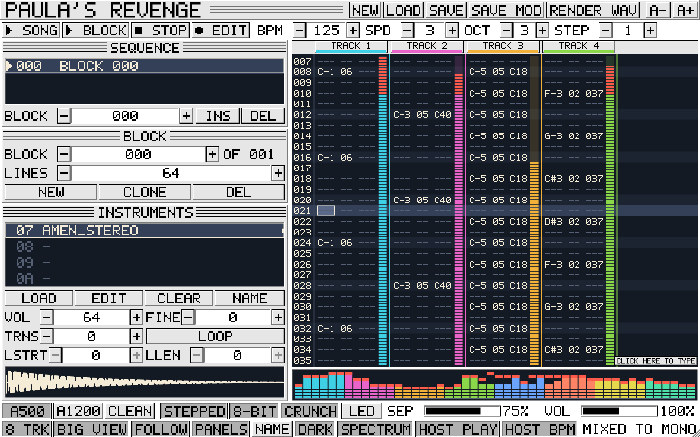

# PAULA'S REVENGE

An 8-track, Amiga-style sample tracker for jungle, drum & bass and anything that wants that crunchy 8-bit Paula sound. A **standalone app** for macOS, with a built-in mixer (EQ, insert effects — built-in or your own VST3 / AU plug-ins — and two send buses), VST3 / AU instruments, MIDI out to your hardware, effect automation from the pattern (or recorded by hand) and stem renders. Big pixel text, keyboard-driven.

It's an original program inspired by the classic Amiga trackers of the early 90s. It loads and saves ProTracker-style `.MOD` files and imports MED/OctaMED `MMD0`/`MMD1` modules.



**Manual:** [`docs/manual/index.html`](docs/manual/index.html) — the full user manual, in the same look as the app (open it in a browser), or as an A4 PDF: [`Paulas Revenge Manual.pdf`](<docs/manual/Paulas Revenge Manual.pdf>).

## Install (no building needed)

Every green build publishes a release. Open **Releases** on the right of the
repo page, download **PaulasRevenge-macOS.zip** from the newest one, and
follow the `INSTALL.txt` inside: copy the app into Applications and clear
macOS quarantine. Builds are universal (Apple Silicon + Intel).

Since v0.8 it's a standalone app only (no VST3/AU plug-in versions).

---

## Help inside the app

**HELP** (top left of the title bar, or `F1`, or `Cmd+/`) shows this README inside the app, in the same big pixel text, with the chapters listed on the left: click one to go there. The wheel, the arrow keys, `PgUp` / `PgDn` / `Space`, `Home` / `End` and the scroll bar move through it; `←` `→` go to the previous / next chapter; `Esc` (or HELP again) goes back to where you were. **OPEN PDF MANUAL** opens the illustrated PDF manual, which is built into the app too. Both always match the version you're running.

**Searching:** just type (two letters or more): the chapter list shows only the chapters with a match, the matches are marked in the text, and the status line says which one you're on (`3 OF 12`). `Enter` (or `Cmd+G`) goes to the next match, `Shift+Enter` the one before; `Esc` clears the search, `Esc` again closes HELP. Right-click the text to copy a chapter, or all of it, to paste somewhere else.

## The screen

| Area | What it does |
|---|---|
| Title bar | HELP, NEW, LOAD, SAVE, SAVE AS (native `.prv`), UNDO, REDO, SAVE MOD, RENDER WAV, EXPORT SAMPLES, text size `A-` / `A+` |
| Transport | Play song, play block, stop, edit mode, LOOP (the marked lines), BPM, speed (ticks per line), octave, step |
| Sequence | The song order, with a scrollbar. Click a position to jump to it; drag over positions to highlight them for CUT / COPY / PASTE / DUP / DEL (see Sequence tools); set which block plays there. ▲ ▼ (or `Alt+↑/↓` in the pattern, or drag) move the selected positions. CLONE IN PLACE gives this position its own copy of the block (see below). Click at the right of a row to start a labelled **section** there; LOOP SECTION loops it (see Song sections) |
| Block | Pick, add, clone or delete blocks; set the number of lines (1–256). **X2** doubles the block's length and repeats everything in it (notes and both effect columns) in the new half; **1/2** halves it (asks first if the second half was different). NUM − / NUM + swap the block's number with its neighbour (the song still sounds the same) |
| Instruments | 63 slots with a scrollbar. LOAD opens the sample browser, EDIT the sample editor, PARAMS the envelope/filter/pan page. VOL (the instrument's level, see below), finetune, transpose, loop on/off. Drag the loop markers in the little waveform (exact loop points are in the sample editor; double-click the waveform to open it). Double-click a name to rename. Alt-click to preview |
| Pattern editor | 8 tracks. The box left of track 1 shows the block you're editing (**BLK**); click it to type a block number. Click a track name to mute it, Alt/right-click to solo. Drag in the pan bar under the name to pan that track; double-click it to go back to AUTO. The VU meters are one colour: right-click one to choose it |
| Output strip | The machine you hear (Amiga A500 / A1200 / CLEAN or Akai S950 / S1000, see below), its options, an L/R output meter, and under it stereo separation and volume |
| Bottom row | 4 or 8 tracks, BIG VIEW (4 tracks at a time with large text), follow playback, hide/show panels, song name, **MIXER** (`Cmd+2`) |

The app opens with the **dark** skin (cream on blue-black, coloured tracks, level bars in each track and a spectrum strip). In the dark skin the instrument pages (PARAMS, plug-in, MIDI out) and the mixer and its effect pages are dark too, with light text. The **DARK** button on the bottom row switches to black-on-white; **SPECTRUM** hides the strip.

## Right-click menus

Right-click almost anything for what you can do with it (a big-text list; `Esc` or CANCEL closes it, and each action is one undo step):

| Where | What's there |
|---|---|
| Instrument list | COPY, PASTE, DUPLICATE TO NEXT FREE, CLEAR, RENAME, LOAD SAMPLE, PLAY C-3 (Alt+click still plays it) |
| Sequence list | COPY, CUT, PASTE, DUPLICATE, DELETE, INSERT THE SAME BLOCK, INSERT A NEW BLOCK, CLONE IN PLACE, SECTION NAME |
| Block panel (its background) | COPY / CUT / PASTE BLOCK, CLEAR BLOCK, DUPLICATE, NEW, DELETE, DOUBLE / HALVE LENGTH |
| Pattern, note column | COPY / CUT / PASTE TRACK, CLEAR THIS LINE, INSERT A LINE, DELETE THE LINE, EFFECT COMMANDS |
| Pattern, effect columns | the command list (a `#xy` chord cell: the chord list); inside a highlight: BOUNCE |
| Pattern, VU meters | the meters' colour |
| EDIT button | STEP ENTRY NOTE-OFFS, DETECT CHORDS, CAPTURE |
| Sample editor waveform | CUT, COPY, PASTE, DELETE, CROP, SILENCE, MAX VOL, REVERSE, FADE IN / OUT, SET LOOP, SELECT ALL |
| Mixer: a strip's name | COPY STRIP, PASTE STRIP, RESET STRIP, OPEN CHANNEL (the returns and master: RESET) |
| Mixer: an insert slot | COPY EFFECT, PASTE EFFECT, CLEAR SLOT, BYPASS ON / OFF, OPEN |
| CHORDS page slots | COPY, PASTE, CLEAR, PLAY |
| HELP text | COPY THIS CHAPTER, COPY ALL OF IT |

Copied instruments, strips, effects and chords stay in the app (paste them into another slot or another song); HELP text goes to the Mac's clipboard.

## Panning and left/right balance

Every track comes out of both speakers by default. How a track is panned, in order:

1. **`8xx`** in the pattern (`800` hard left, `880` centre, `8FF` hard right). This is an absolute position now, and isn't scaled by SEP.
2. **The track's pan** (the bar under each track name). **AUTO** means "no track pan".
3. **The instrument's pan** (PARAMS page), when its AMIGA L/R button is off.
4. Otherwise **Amiga style**: tracks 1 and 4 lean left, 2 and 3 lean right, by the **SEP** amount (20% by default, 0% = all centred). Stereo samples play centred with their own stereo image.

The **L / R meter** on the right of the Paula strip shows the balance. The app only runs in stereo, and turns on both of your interface's first two outputs if an old setup had only one.

## Mixer

**MIXER** on the bottom row (or `Cmd+2`) opens the mixer across the whole window; `Esc`, CLOSE or `Cmd+1` goes back to the pattern. While it's open the computer keyboard still plays the current instrument (same note keys as the pattern; `[` `]` change octave, `-` `=` change instrument; the title shows which one), so you can play while you set levels. A MIDI keyboard plays it too. These notes go through the master bus. One strip per track (4 or 8), then the two send returns and the master, each with a level meter:

| Strip part | What it does |
|---|---|
| Name | Click a track's name (or **EQ**) for its channel page |
| EQ | Lit when any EQ band is on |
| 3 insert slots | Click a slot to open its effect page. `Shift`-click bypasses / un-bypasses it (a bypassed slot is dimmed) |
| A, B | How much goes to send A / send B. `AP` / `BP` = sent pre-fader. Drag sideways; double-click = off |
| PAN | The track's pan (the same one as the bar under the track name). Double-click = AUTO |
| Fader | −INF to +6 dB, with the meter beside it (red above 0 dB). Drag the cap; `Shift` = fine; double-click = 0 dB; the wheel moves it ½ dB a notch |
| M / S | Mute / solo (the same as clicking the track names) |

**Channel page** — a response curve and five EQ bands: HIGH-PASS, LOW SHELF, MID 1, MID 2 (bells with Q) and HIGH SHELF. Click a band's name to switch it on; moving one of its bars switches it on too. EQ FLAT resets them. On the right: the track's three inserts, the two sends with PRE (pre-fader) switches, and the fader. `<` `>` (or ← →) step through the tracks.

**Effect page** — pick the slot's effect: FILTER (resonant low/band/high-pass), DRIVE (drive, bit crush, sample-rate reduction, tone), COMP (compressor, with MIX for parallel compression), DELAY (time in ms, or SYNC to the song's tempo from 1/32 to 1/2, dotted and triplet; feedback, tone, PING-pong), REVERB (size, damping, width, pre-delay) and CHORUS. Every page has BYPASS and DEFAULTS. `<` `>` step through all the slots.

**Returns** — SEND A starts with a reverb and SEND B with a delay, both fully wet; they're silent until a track sends to them. Each has three inserts, a fader, a balance and a mute. **Master** has three inserts and a fader, and then comes the machine's output stage (A500/A1200/CLEAN/S950/S1000 and their options).

**Delay compensation** — some plug-ins (lookahead limiters, linear-phase EQs, some instruments) give their sound back late. Each track is delayed just enough that every track lines up with the slowest one, sends included, so breaks stay tight. A bypassed plug-in (or one switched off from the pattern) keeps its delay, so nothing jumps mid-song. The strips page shows the total delay in its title, and a plug-in's effect page says how late it is. Plug-ins on SEND A / B and the master just add their delay at the end. Notes you play live through a sample instrument aren't delayed; live notes on a plug-in instrument go through its track, so they are.

Signal flow per track: EQ → inserts → pre-fader sends → fader → post-fader sends → master. A mixer with nothing changed (all faders at 0 dB, no EQ, no effects, no sends) is skipped, so the song sounds exactly as it did before v0.8. Everything in the mixer is saved in the song, undoable, and included in RENDER WAV. (The insert slots are built so plug-in effects can be added later.)

## Scrolling and the mouse

* The pattern fills its area from line 0 at the top. The cursor moves freely and the view only scrolls when it gets within a few lines of the top or bottom edge; at the end of a block the last line sits on the bottom row. A click moves the cursor without moving the view.
* With FOLLOW on, the view glides along with playback, the playing line about 40% of the way down.
* The wheel moves one line (or list row, or zoom step) per notch however fast it's spun; trackpad swipes are scaled down. The wheel doesn't wrap from the last line back to the first.
* Holding a drag past an edge (selecting notes, marking a loop, moving positions in the sequence or the arrange page) scrolls at a steady pace — about 12 lines a second, faster the further past the edge you go.
* Sliders and number boxes move relative to where you grab them, at a calm rate; hold `Shift` for fine adjustment. The mouse wheel also nudges them.

## Instrument parameters (PARAMS)

PARAMS in the instrument panel opens a page for the current instrument. Everything is off or neutral by default, so MODs and older songs sound exactly as before.

* **Volume envelope**: VOL ENVELOPE on/off, ATK, DEC, SUS, REL (1 ms – 10 s), with a picture of the shape. With the envelope on, `OFF` in the pattern (or letting go of a key) starts the release instead of cutting the note.
* **Filter**: OFF / LOW / HIGH / BAND pass, CUT (20 Hz – 20 kHz), RES, AMT (how far the filter envelope moves the cutoff, ±8 octaves), KEY (how much the cutoff follows the note).
* **Filter envelope**: ATK, DEC, SUS, REL.
* **Pan**: AMIGA L/R follows the track layout above; switch it off and use PAN to give the instrument its own position.
* **HOLD TO PLAY**, or play the computer keyboard, to hear it. RESET ALL puts everything back. Double-click any slider for its default.
* **ON** (bottom left) switches the instrument off and on. While it's off its notes don't play (anything sounding fades out over 5 ms, so there's no click), and the instrument list shows it dimmed with `OFF`. To switch it from the pattern, pick a track in the **TRACK** box, press **LEARN A (V)** or **LEARN B (J)**, then click ON: that track's `Vxx` / `Jxx` becomes the instrument's `ON/OFF` (`00` = off, `01`–`FF` = on).
* **PLUG-IN / MIDI OUT...** plays this instrument with a VST3 / AU instrument or with your hardware instead of the sample (see below).

Envelopes and filters run per note on top of the Paula sound. They're saved in `.prv` songs and Live sets. A MOD can't hold them (SAVE MOD says so).

## Arrange page

**ARRANGE** in the sequence panel opens the song order full size, each position with a picture of its block's notes:

* Drag over positions to highlight them (or click one and Shift-click another); drag the highlight to move it (a red line shows where it will land).
* ▲ MOVE / ▼ MOVE (or `Alt+↑/↓`), COPY, CUT, PASTE, DUPLICATE (`Cmd+D`), DELETE — the same highlight and clipboard as the sequence panel.
* INSERT adds the BLOCK number after the cursor; SET makes the selected positions play that block.
* `Cmd+Z` / `Cmd+Shift+Z` undo and redo; double-click a position or press Enter to go back to the pattern.

**Instrument VOL** is a level for the whole instrument, on top of each note's own volume. `Cxx` still sets a note's volume, so you can write hats with `C20` on every other one for the groove and then pull all the hats down with VOL without touching the pattern. (MOD and MED files load with their instrument volumes written onto the notes as `Cxx` in the second effect column, so they sound exactly as before; SAVE MOD writes each `Cxx` at the level it actually plays at.)

## Selecting notes and effects with the mouse

Drag across the pattern to select notes and effects: the selection snaps to whole fields (note + instrument, FX1, FX2) and can span tracks. Shift-click selects from the cursor to the click; `Cmd+A` selects the whole block.

* `Cmd+C` / `Cmd+X` copy / cut the selection, `Cmd+V` pastes it at the cursor (each part goes back into the same kind of field, so effects land in effect columns), `Delete` clears it. The pasted part stays selected.
* Without a selection, `Cmd+C/X/V` still copy a whole track (add `Shift` for the whole block).
* A plain click moves the cursor and drops the selection. It's all undoable.

## Bouncing highlighted notes to a sample

Highlight some notes (drag over them; it can cover several tracks), then right-click inside the highlight — or press `Cmd+B` — and pick:

* **BOUNCE DRY (NO FX)** — just the instruments' sound, before the tracks' mixer strips. Use it when the new sample will play through a strip with the same effects.
* **BOUNCE WITH FX** — after the tracks' strips (EQ, inserts and fader), plus what they send to SEND A / B, so a reverb or delay tail is in it. The master's inserts and the Paula / Akai output stage aren't.

It plays just those lines of just those tracks, from the first highlighted line at the tempo and speed set there. Plug-in instruments are included; MIDI-out instruments can't be (they're hardware). After the last line it records on until the sound has died away (up to 10 seconds), so tails aren't cut. Plug-in delay is taken off the start.

The result is a new instrument in the first empty slot, named like `BOUNCE T1-2 000-015` (`BOUNCE+FX` with FX), at 44.1 kHz, stereo when it's stereo. `C-3` plays it exactly as recorded. It becomes the current instrument. Nothing else changes: the pattern and the instruments that played it stay as they are. Undo removes it.

## Playing a block

While a block plays (▶ BLOCK, `Space`), picking another block — in the sequence, the BLOCK box, or the BLK corner — carries playback straight over to it **on the same line**, without stopping, so you can audition blocks against each other in time. (A shorter block wraps the line round.)

## Looping part of a block

Drag down the **line numbers** to mark some lines (or Shift-click a line number to mark from the cursor to there; `Cmd+[` / `Cmd+]` set the start / end at the cursor). The marked lines turn red and playback goes round them: `Space` starts at the first marked line, and song playback also loops there once it reaches that block. `Bxx`/`Dxx` jumps inside the loop are ignored so it keeps going. **LOOP** on the transport row turns it off and on again; marking new lines turns it on.

## Undo and redo

One history covers everything: notes and effects, block lengths, the sequence and block numbers, instrument settings and sound shaping, sample edits, loop points and slices, and song settings (BPM, speed, name, tracks, pans). `Cmd+Z` / `Cmd+Shift+Z` work on every page, and so do the **UNDO** / **REDO** buttons in the title bar (the sample editor and arrange page have their own buttons too). The status line says what was undone, e.g. `UNDO: TRANSPOSE TRACK +1`. It keeps the last 200 steps; loading or starting a song clears it.

## Sequence tools

* **Add a position**: **ADD** puts a new position straight after the selected one, playing the same block; change which block it plays with BLOCK − / + (any existing block). **NEW** makes a new, empty block (as long as the selected one) and puts it in a new position straight after the selected one, ready to fill. The arrange page's INSERT and SET do the same with the block number you pick there.
* **Highlight positions**: drag over them in the list (it scrolls by itself past the ends), or Shift-click to stretch the highlight. `Cmd+A` highlights the whole song. The arrange page shows the same highlight.
* **CUT** (`Cmd+X`), **COPY** (`Cmd+C`), **PASTE** (`Cmd+V`, goes in after the highlight), **DUP** (`Cmd+D`, a copy straight after the highlight, which then gets highlighted) and **DEL** (`Delete`) work on the highlighted positions, or on the one selected. DUP sits on the bottom row. The sequence panel and the arrange page share one clipboard: copy in one, paste in the other. Section dividers move with the music.
* The keys work after clicking in the list; any other key (notes, Space, undo) goes straight on to the pattern.
* **Move positions**: drag the highlight (or the selected position) to a new place, press ▲ / ▼, or use `Alt+↑` / `Alt+↓` in the pattern. (Section dividers stay where they are when you move positions.)
* **CLONE IN PLACE**: if position 1 plays block 2, CLONE IN PLACE copies block 2 into the **next free block** and points position 1 at it. The next free block is the lowest-numbered block that's empty and not used anywhere in the song, or else a new block at the end. No other block numbers change and the song order keeps its length. Now you can change the copy without touching the other places block 2 is used. The status line says which block it used.
* **NUM − / NUM +** (Block panel): swap the current block's number with the one before/after.
* UNDO / REDO (`Cmd+Z` / `Cmd+Shift+Z`) undo and redo all of these.

## Song sections

Mark the parts of a song (intro, drop, break…) with dividers in the sequence:

* **Click at the right of a row** in the sequence list (`+ SECTION` appears when you point there) to start a section at that position and name it. A line appears above the row with the name on the right. Click the name again to rename it or **Remove** it.
* A section runs from its divider to the next one (positions before the first divider count as one too).
* **LOOP SECTION** makes song play loop the section of the selected position. Pick a position in another section and playback goes there when the current block finishes, so you can jam between parts. The looped section is marked down the left edge.
* The **arrange page** shows the same dividers and names, has SECTION (add / rename / remove at the selection) and LOOP SECTION buttons, and clicking the name area at the right of a row works there too. Inserting, deleting, cutting and pasting positions moves the dividers with the music.
* Sections are saved in the song (`.prv`) and are undoable.

## Saving and your samples

**SAVE** writes straight to the song's file with no window (the status line says where); the first save asks for a name. **SAVE AS** always asks, so you can keep versions (`tune v1.prv`, `tune v2.prv`…). The save folder and the song's file are remembered, the next time too. `Cmd+S` saves, `Cmd+Shift+S` is SAVE AS. **SAVE*** with a star (and a `*` after the song name) means there are unsaved changes.

v0.6 also fixes LOAD for `.prv` songs: earlier versions mistook a saved song for an old SoundTracker module and loaded rubbish. Songs inside Live sets were never affected, and old `.prv` files load correctly now.

Songs are self-contained: SAVE (`.prv`) stores every sample inside the song, stereo included, and a Live set stores the whole song with its samples. You can delete or move the original WAVs. **EXPORT SAMPLES** writes every instrument that has a sample to a folder you choose as `01 NAME.wav`, `02 NAME.wav`… (16-bit, stereo kept, at the rate that plays them at C-3).

## The standalone app window

The app uses the normal Mac window: **red** quits, **yellow** minimises to the Dock, **green** goes full screen. The menus have **Audio/MIDI Settings…** (`Cmd+,`), **Toggle Full Screen** (`Ctrl+Cmd+F`) and **Quit** (`Cmd+Q`). The app remembers its window size and position.

**Headphones (FOLLOW MAC OUTPUT):** the app plays through whatever output your Mac is using, and moves with it: plug in headphones, connect AirPods or another Bluetooth set, or plug in a USB interface that the Mac switches to, and the sound goes there straight away (with a quick fade, so no click); unplug them and it goes back. The status line says where the sound went (`OUTPUT: EXTERNAL HEADPHONES`). It keeps your sample rate and buffer size when the new output can do them. **Follow Mac Output (Headphones)** in the app menu (next to Audio/MIDI Settings) turns it on and off; it's on to start with. Choosing a different device by hand in Audio/MIDI Settings (an audio interface you always want, say) turns it off, so your choice stays — the status line says so.

## Sample browser

LOAD in the instrument panel opens a browser in place of the pattern. Every sample you highlight **plays straight away** (turn AUTO PLAY off to stop that), with its rate, length, mono/stereo and a waveform shown underneath.

* **Click the waveform** to play from that point (drag to scrub).
* **Play it at different pitches** with the computer keys (same layout as the pattern, `C-3` on `Z` at octave 3 = as recorded, `[` `]` change octave) or a MIDI keyboard (MIDI 60 = as recorded).
* Samples load at their own rate, so they sound exactly as recorded. To lower the rate, use RATE / RESAMPLE in the sample editor.

| Key | Action |
|---|---|
| `↑` `↓` / `PgUp` `PgDn` | Move (and hear) the next sample |
| `→` / `Enter` on a folder | Open it · `←` or `Backspace` goes up |
| `Enter` / double-click | Load into the current instrument |
| `Space` | Play / stop |
| Note keys | Play the sample at that pitch |
| `Alt` + a letter | Jump to the next name starting with it |
| `Esc` | Close |

Shortcut buttons cover Home, Music, Desktop, Downloads, Documents and Drives; FINDER… opens the normal Mac file dialog.

**Favourite folders**: the row under DOWNLOADS / DOCUMENTS / DRIVES / FINDER… has four buttons for your own folders. Click an empty one (SET FAV 1–4) to pick a folder; after that it shows the folder's name and one click goes there. `Shift`-click changes it, `Alt`-click clears it. They're remembered on this computer, whatever song is loaded. If a favourite's drive isn't plugged in, the status line says so.

## Sample rates

Each instrument has a **RATE**: the speed (Hz) it plays at on C-3. Samples load at their own rate (a 44.1 kHz WAV plays at 44100 on C-3, so it sounds as recorded). Rates are set in the sample editor:

* **RATE** (drag, use +/−, or double-click to type), **PRESET** steps through 8363 / 11025 / 16574 / 22050 / 32000 / 44100 / 48000. This leaves the sample data alone, so a lower rate plays lower and slower. The status line says how far it moves the pitch, e.g. `RATE 44100 > 22050 HZ: DOWN 12 ST (C-3 PLAYS AS C-2)`, and the header keeps showing the total, e.g. `22050 HZ (-12.0 ST)`. (The shift in semitones is 12 × log₂(new rate ÷ old rate).)
* **RESAMPLE** converts the data to the TO rate while keeping the pitch: use a low rate (11025, 8000…) for lo-fi grit, with **RAW** for no anti-alias filtering, the rough old-sampler way.

The rate is shown on the instrument's waveform, saved in songs, used for EXPORT SAMPLES, and converted for SAVE MOD.

## Time stretch (Akai style)

**STRETCH** in the sample editor opens the old-sampler time stretch, the warbly, metallic jungle stretch, for the selection or the whole sample:

* **CLASSIC**: the Akai sound, matched sample-for-sample to recordings of the real thing. The output is built from fixed-length cycles. Each cycle starts reading the source at the point the output has reached (so slices repeat when stretching and get skipped when squashing), and it fades in over two-thirds of the cycle while the previous slice carries on and fades out. The long, linear blend gives the smooth, phasey, metallic buzz of 90s jungle stretches.
* **REVISED**: cleaner. Each join is lined up by waveform shape (within 5% of a cycle) and crossfaded over 30% of a cycle.
* **HARD**: no lining up and no blend, so every join can click. Rougher than real hardware.
* **AKAIZER**: the method of Ben Burchett's Akaizer v1.2 (2006), rebuilt line for line and checked sample-for-sample against that routine. The sample is cut into grains of 2 × CYCLE samples, each shaped with a half-sine window, laid down at the grain rate and added up, clipping to 16 bits a grain at a time — the overlaps give it its own granular, slightly chorused sound.
  * **CYCLE** here is in the sample's own samples, as in the original (try 800).
  * **FREQ LINKED** (on): grains per second = 41000 ÷ CYCLE, the original's own constant. Turn it off to set **FREQ** (20–2050) by hand.
  * **STEREO QUIRK** (on, stereo samples): processes left and right interleaved like the original, so odd grain spacings swap the sides between grains. Off: each side separately with the same grains.
  * **SEMI / CENTS** first repitch the sample, then the grains stretch it to the length you asked for — the jungle trick of pitching a break up and stretching it back, in one go.
* **LOOP BPM → TO BPM** and **SET TIME**: sets TIME % to turn a loop at one tempo into another (136 → 170 = 80%).
* **TIME %** (25–2000%), **SEMI** and **CENTS** (pitch, independent of time), **CYCLE** (20–2000, default 1000; in 44.1 kHz samples like Akaizer, converted for the sample's own rate). A shorter cycle gives a faster, more metallic buzz; a longer one gives more robotic, echoey repeats.
* **FIT TO LINES** sets TIME % so the selection lasts that many lines at the song's speed and BPM.
* **PREVIEW** to hear it, **APPLY** to keep it (undoable).

The controls follow Akaizer (CLASSIC/REVISED, time factor, cycle length, transpose). The Akai firmware isn't open, so CLASSIC was measured instead: an Amen break and recordings of it stretched ×2 and ×4 on the real unit (one played back +12 and +24 semitones). Tracing every slice of the recordings back to the original showed fixed cycles, a constant jump back at every join (no searching for a better join point), and a straight-line crossfade lasting 2/3 of the cycle. Rendered with the same settings, CLASSIC matches those recordings to within 19–24 dB, about as close as the recording itself allows; the old splice methods managed 2–5 dB.

## Sample editor

EDIT in the instrument panel (or double-click the little waveform) opens a full-size editor. Stereo samples show left and right separately.

* **Select:** drag in the waveform, Shift-click to extend, double-click or SEL ALL for everything. Click once to place the cursor (where PASTE inserts). **Grab either end of a selection** (the pointer changes to ↔) to move just that end; clicking inside a selection keeps it.
* **Play it from the keyboard:** the computer keys (same layout as the pattern, `[` `]` for octave) and a MIDI keyboard play the sample at the key's pitch through the full instrument sound, several notes at once, with a playhead for each. **SEL KEYS** makes them play only the selection (looped when LOOP is on).
* **Zoom:** mouse wheel or ZOOM +/-, FIT SEL, FIT ALL. Click or drag the overview strip to move around. Zoomed right in, you see each sample as a step, the way Paula plays it.
* **DRAW:** draw the waveform with the mouse.
* **Edit:** CUT, COPY, PASTE, DELETE, CROP, SILENCE, REVERSE, MAX VOL (normalise), VOL −/+ (3 dB), FADE IN, FADE OUT, TO MONO. Edits work on the selection, or the whole sample if nothing is selected. Loop points and slices move with the audio when you cut, paste, resample or stretch.
* **Loop:** **LOOP** turns the instrument's loop on (the selection, or the whole sample) and off. Drag the **S** and **E** handles at the top of the waveform to move the start and end; you hear the loop while you drag. START / END type exact values, SET LOOP loops the selection. **PING-PONG** plays the loop forwards then backwards instead of jumping back to the start (saved in songs; SAVE MOD stores it as a normal loop).
* **Play:** PLAY plays from the cursor, ▶ SEL plays just the selection, REPEAT loops whatever's playing.
* Keys: `Space` play/stop, `Cmd+X/C/V`, `Cmd+A`, `Delete`, `Cmd+Z` / `Cmd+Shift+Z`, `←` `→` scroll, `↑` `↓` zoom, `Esc` close.
* UNDO/REDO share the one history with every other page.


**Loop handles**: the **S** and **E** handles at the top of the waveform set the loop start and end. With no loop they wait at the two ends of the sample ("DRAG S OR E TO LOOP"); drag either one in and the loop switches on. While you drag a handle the loop plays so you can hear the join. Exact numbers go in START / END below; LOOP switches it off again.
## Slicing

**SLICE** in the sample editor opens the slicer:

* **AUTO** finds the hits (drum hits, notes) by jumps in loudness; **SENS** (1–100) sets how quiet a hit it will catch. **EVEN** cuts **COUNT** (2–64) equal slices.
* The slices show as numbered tabs along the bottom of the waveform. Drag a tab to move that slice point, double-click the waveform to add one, Alt-click a tab to remove it (or ADD AT CURSOR / REMOVE / CLEAR ALL). Click a tab to select and hear that slice.
* **SLICE TO KEYS**: notes play slices instead of the whole sample: `C-3` = slice 1, `C#3` = slice 2, `D-3` = slice 3 and so on, each at its own pitch and stopping at the end of its slice. This works in patterns, from the computer keys and from MIDI. To pitch one hit up or down, add `Ixx` to that note (`I8C` = an octave up, `I7B` = 5 semitones down).
* Without SLICE TO KEYS, `Sxx` plays slice xx+1 of the instrument's slices (`S00` = slice 1). Instruments with no slice points still split into 16 equal parts, as before.

## Stereo samples

Stereo files stay stereo. A stereo sample plays with its own stereo image, centred, instead of following the Amiga left/right track layout (`8xx` still pans it). Mono samples behave exactly as before. Stereo is saved in `.prv` songs; SAVE MOD mixes stereo samples down to mono because the MOD format can't hold stereo. TO MONO in the sample editor converts one yourself.

**BIG VIEW** is on by default so the pattern text is large. Tab to track 5 and the view flips to tracks 5–8. Turn BIG VIEW off, or hide the panels, to see all 8 tracks at once.

## Keys

| Key | Action |
|---|---|
| `Z S X D C V G B H N J M` | Notes, lower octave (`, L . ; /` continue upwards) |
| `Q 2 W 3 E R 5 T 6 Y 7 U I 9 O 0 P` | Notes, upper octave |
| `1` | Note off |
| `0–9 A–F` | Hex entry in the instrument / command columns |
| `Space` | Play / stop the block (from the loop start when a loop is marked) · `Shift+Space` the song |
| `Esc` or `\` | Edit mode on/off (`\` is the key next to Return on a UK Mac keyboard) |
| `Enter` | Play block · `Shift+Enter` play song · `Cmd+Enter` play block from the cursor |
| Arrows | Move · `Shift+↑/↓` 4 lines · `Shift+←/→` track |
| `Tab` / `Shift+Tab` | Next / previous track |
| `PgUp` / `PgDn`, `Home` / `End` | Jump |
| `[` `]` | Octave down / up |
| `-` `=` | Previous / next instrument |
| `Delete` (⌫) | Clear the selection, or the field under the cursor |
| `Shift+Delete` | Remove the line (pulls the track up) |
| `Alt+Delete` | Insert a blank line (pushes the track down) |
| `Cmd+C / X / V` | Copy / cut / paste the mouse selection, or the track · add `Shift` for the whole block |
| `Cmd+A` | Select the whole block |
| `Cmd+B` | Bounce the highlighted notes to a new instrument (asks DRY or WITH FX) |
| `Cmd+↑ / ↓` | Transpose track a semitone · add `Shift` for an octave |
| `Cmd+Z` / `Cmd+Shift+Z` | Undo / redo (everywhere) |
| `Cmd+[` / `Cmd+]` | Loop start / end at the cursor line |
| `Cmd+S` / `Cmd+Shift+S` | Save / save as |
| `Cmd+2` / `Cmd+1` | Mixer / pattern |
| `Cmd+3` | CHORDS: the chord table (again to go back) |
| `Cmd+F` | FOLLOW on / off (the view moves with playback) |
| `Cmd+R` | CAPTURE: what you just played goes into the pattern |
| `F1` / `Cmd+/` | HELP: this manual, inside the app |

A MIDI keyboard plays the current instrument, and records notes at the cursor when edit mode is on. MIDI 60 = `C-3`.

**STOP** pressed while already stopped is a **panic**: every MIDI-out instrument sends note-offs and All Notes Off.

## Recording, note-offs and CAPTURE

* With **EDIT** on, notes from a MIDI keyboard or the laptop keys go in at the cursor (while playing with FOLLOW on, on the line that's playing).
* **Note-offs:** on a plug-in or MIDI-out instrument, letting go of a key while the song or block plays writes `OFF` on the line playing at that moment (the next line if it's still the note's own line), so held sounds stop where you stopped them. It never writes over another note. In step entry (stopped) that's off to start with, because the OFF would land where your next note goes: right-click **EDIT** and switch **STEP ENTRY NOTE-OFFS** on if you want them.
* **CAPTURE** (like Ableton's Capture MIDI): the app always listens to what you play, even with EDIT off, and keeps the last two minutes. Liked what you just noodled? Press **CAPTURE** on the transport row (or `Cmd+R`, or right-click EDIT, or the View menu) and it goes into the pattern as one undo step:
  * played while the song or block was playing: each note on the line where you played it, in the block that was playing, with `Mxx` micro-moves for notes that were well off the beat;
  * played while stopped: from the cursor, at the song's BPM and speed, the first note on the cursor line (the notes since your last pause of more than 4 seconds).
  * Notes go on the cursor's track; chords that match the chord table go in as one note + `#xy` (see below), other notes played together spread across the next free tracks. It never writes over a note (it moves along, or skips and says how many). Plug-in and MIDI-out notes get their note-offs. After a capture it starts listening afresh.
  * In a small window the CAPTURE button may not fit on the transport row; `Cmd+R` and the menus still do it.
* **Chords you play** (DETECT CHORDS, on to start with): on a plug-in or MIDI-out instrument, notes pressed together (within 60 ms) that match a slot in the song's chord table go in as **one note, the root, with `#xy`** on one track — when recording with EDIT on, and when CAPTURE writes them in. See Chords.

## Effect commands

**Right-click an effect cell** in the pattern (FX1, or FX2 when it's shown) for a list of every command with what it does (a cell holding a chord, `#xy`, gives the chord list instead). Click one (or use the arrows and Enter; typing a command's letter jumps to it, and `E` again steps through the E commands) and it goes into that cell with a useful starting value — or the value already there, if it was the same command — and the cursor lands on the value so you can type over it. `Esc` closes the list. It's one undo step.

Same numbering as ProTracker, so MOD files load straight in.

| Cmd | Effect |
|---|---|
| `#xy` | **Chord**: plays chord slot `xy` from the song's chord table, held, on plug-in / MIDI-out instruments (on a sample instrument, just the note). Type `#` with Shift+3; first in the right-click list. See Chords |
| `0xy` | Arpeggio (+x, +y semitones) |
| `1xx` / `2xx` | Slide pitch up / down |
| `3xx` | Slide to note |
| `4xy` | Vibrato (speed x, depth y) |
| `5xy` | Slide to note + volume slide |
| `6xy` | Vibrato + volume slide |
| `7xy` | Tremolo |
| `8xx` | Pan (00 left – 80 centre – FF right) |
| `9xx` | Sample offset (xx × 256) |
| `Axy` | Volume slide (x up / y down) |
| `Bxx` | Jump to sequence position |
| `Cxx` | Set volume (00–40 hex) |
| `Dxx` | Next block, start at line xx (decimal) |
| `E0x` | LED filter: `E00` on, `E01` off |
| `E1x` / `E2x` | Fine slide up / down |
| `E4x` / `E7x` | Vibrato / tremolo waveform |
| `E5x` | Set finetune |
| `E6x` | Loop: `E60` set start, `E6x` repeat x times |
| `E8x` | Coarse pan |
| `E9x` | Retrigger every x ticks |
| `EAx` / `EBx` | Fine volume up / down |
| `ECx` | Cut note at tick x |
| `EDx` | Delay note by x ticks |
| `EEx` | Delay the line by x lines |
| `Fxx` | `01–1F` speed, `20–FF` BPM, `00` stop |

### Extra commands (G–Z)

Inspired by the Polyend Tracker's step FX. Type the letter in an effect column, then two hex digits. Put the cursor on any command to see what it does in the help strip under the pattern.

| Cmd | Effect |
|---|---|
| `Gxx` | Glide to the note over xx ticks |
| `Hxx` | High-pass filter, cutoff xx (`00` 20 Hz – `FF` 20 kHz) |
| `Ixx` | Transpose just this note: `80` = none, `8C` = +12, `74` = −12 (±48 semitones). Handy for pitching single slices |
| `Kxx` | Chance: the step plays xx/FF of the time |
| `Lxx` | Low-pass filter, cutoff xx |
| `Mxx` | Micro-move: `01–7F` late by xx/128 of a line, `81–FF` early by (xx−80)/128 (early works inside a block, not across into the next) |
| `Nxx` | Note length: release after xx ticks |
| `Oxx` | Overdrive amount |
| `Pxx` | Start at xx/256 of the sample |
| `Qxx` | Filter resonance |
| `Rxy` | Roll: retrigger every x ticks; y `1–7` quieter, `9–F` louder each time |
| `Sxx` | Play slice xx+1 of the instrument's slice points, or of 16 equal parts if it has none (stops at the slice end) |
| `Txx` | Micro-tune: `80` = 0, each step = 1 cent |
| `U01` / `U00` | Play backwards / forwards |
| `Wxx` | Band-pass filter, cutoff xx |
| `Xxy` | Randomise: x `0` note ±y semitones, `1` volume ±y×4, `2` pan ±y×16, `3` start up to y/16 |
| `Zxx` | Bit crush to xx bits (`01–0F`) |
| `Vxx` | AUTO A: sets the track's first automation knob (see Automation); an ON/OFF knob: `00` off, `01`–`FF` on |
| `Jxx` | AUTO B: sets the track's second automation knob |
| `Yxx` | Knob glide: the next knob change on this track slides there over xx ticks |

Every track has a **second effect column** so a note can carry two effects; **FX2** on the bottom row shows or hides it (it starts hidden so the pattern text stays big). SAVE MOD keeps only one 0–F command per note and tells you when something was dropped.

## The Paula sound (and the Akais)

| Control | What it does |
|---|---|
| A500 | The A500 (also the A600 and A2000): a 4.42 kHz output filter — warm and dull |
| A1200 | The A1200: a much brighter output, about −3 dB around 14 kHz and −4.4 dB at the top, as measured |
| A4000 | The A4000: about 4.6 kHz, falling a little faster towards 20 kHz, as measured |
| CLEAN | Paula's playback with no output filtering at all |
| S950 | Akai S950: 12-bit, stepped variable-rate playback, its 6-pole voice filter (see below) |
| S1000 | Akai S1000: 16-bit, interpolated playback, clean 44.1 kHz-style output (see below) |
| STEPPED | Paula's stepped (sample-and-hold) playback, exactly as the chip makes it (off = smooth interpolation) — see "How the Paula modes work" |
| 8-BIT | Samples are played at 8-bit resolution |
| CRUNCH | In 8-track songs, track pairs are mixed together and squashed back to 8 bits, the way 8-channel Amiga trackers did it in software |
| LED | The "LED" low-pass filter (12 dB/oct Butterworth at 3.2 kHz), on at the start of the song (commands `E00`/`E01` switch it while playing) |
| SEP | How far tracks lean to the Amiga sides (tracks 1+4 left, 2+3 right). Starts at 20%; 0% = everything centred, 100% = the full Amiga split. Double-click to reset. Track pans, instrument pans and `8xx` ignore it |

For breaks, load the break, put `C-3` on line 0 and use `9xx` sample offsets to jump around it, or slice it (see Slicing).

### How the Paula modes work

Based on Henryk Richter's measurements in *Amiga Paula vs. System Theory*, with the band-limited step method of OpenMPT and Antti S. Lankila:

* **The staircase, without false notes.** Paula holds each sample until the next one, so its output is a staircase, and the staircase's copies of the sound (images) go far above hearing. Played straight at the computer's rate, those copies fold back down as out-of-tune tones. With STEPPED on, every change of level is added as a *band-limited step* instead: everything a real Paula puts out below 20 kHz — its own images included, which is a big part of the sound of low-pitched samples — is there at its true level, and nothing folds back. It sounds the same at 44.1, 48 or 96 kHz.
* **Volume below 64.** At volume 64 a real Paula changes level exactly when the next sample is due. At 63 and below it works on a fixed 55.4 kHz grid instead (its volume is made of short pulses in that grid), so each change waits for the next grid point. That adds a faint extra grit — small distortion products that come and go with the pitch — on everything that isn't at full volume. The A500, A1200 and A4000 modes do this; CLEAN doesn't.
* **The output filters** are the real models': the A500/A600/A2000's 4.42 kHz RC filter (100 nF, 360 Ω), the A1200's and A4000's measured responses, and the LED filter as a 3.2 kHz Butterworth. The A600 sounds like the A500, so it has no separate button.

### The Akai modes

These model the playback side of the two samplers behind so much 90s jungle. What's known about the hardware, and what the model does with it:

* **S950** — 12-bit samples and a variable sample rate up to 48 kHz ([Wikipedia](https://en.wikipedia.org/wiki/Akai_S900), [polynominal.com](https://www.polynominal.com/akai-s950/)). Like the S900 it plays samples back at a variable rate rather than interpolating (the S1000 review below contrasts the two). Its filter is a 6th-order Butterworth switched-capacitor low-pass with no resonance ([ALM's MUM M8, a recreation of it](https://www.juno.co.uk/products/alm-busy-circuits-alm-mum-m8-akais-s950/679163-01)). The model: sample data cut to 12 bits, stepped (sample-and-hold) playback at each voice's own rate, so pitched-down samples keep their grit and steps, and the 6-pole Butterworth low-pass at its open setting (16 kHz, an estimate; the real one is set per sample) plus output coupling. STEPPED, 8-BIT, CRUNCH and LED are Amiga features and switch off in this mode.
* **S1000** — 16-bit, 44.1 kHz, pitched with an interpolation algorithm that a 1988 review found "extremely clean" and brighter than variable-rate playback; its filter is an 18 dB/octave low-pass with no resonance ([Music Technology, Dec 1988](https://www.muzines.co.uk/articles/akai-s1000/2303)). The model: full 16-bit data, interpolated playback and a steep 8th-order reconstruction filter at 19.5 kHz. The per-sample filter isn't part of the mode (use the instrument's PARAMS filter).

Neither mode alters the samples; switch back to A500/A1200/A4000/CLEAN any time. For the full old-sampler sound, also lower the sample's rate (RESAMPLE, with RAW for no filtering).

## Rendering

**RENDER WAV** asks **SONG** or **STEMS**:

* **SONG** writes the song once through as a 24-bit stereo WAV, mixer and all.
* **STEMS** makes a folder next to the name you pick (`<name> STEMS`) with one 24-bit WAV per used track (after its EQ, inserts and fader), SEND A, SEND B and the master: `01 TRACK 1.wav` … `09 SEND A.wav`, `10 SEND B.wav`, `11 MASTER.wav`. Every file starts at the same moment and is the same length, so they line up when you drop them into Ableton. (The machine's output stage — A500 filter, LED and so on — is only on the master.)
* After the song ends, the render carries on until everything has been quiet (below −90 dB) for a second, up to 20 seconds, so reverb and delay tails aren't cut off.
* Plug-in delay is taken off the start, so the render starts on the beat.
* MIDI-out instruments play hardware, so they can't be in a WAV: the render finishes without them and the status line says which ones were left out. (Record the hardware back in, or sample it.)

## Plug-in effects (VST3 / AU)

Every insert slot in the mixer (tracks, SEND A / B and the master) can hold one of your own effect plug-ins:

* On a slot's effect page press **PLUG-IN...**. The first time, it looks for the plug-ins on your Mac in the background (only effects are listed here; instruments are chosen from PARAMS); **RESCAN** looks again after you install more. Each plug-in is looked at in a separate, hidden copy of the app, so one that crashes or hangs while being looked at can't take Paula's Revenge down — it's just listed as skipped (RESCAN gives it another try).
* Double-click a plug-in to load it. **OPEN PLUG-IN WINDOW** shows its own controls. BYPASS works as for the built-in effects; DEFAULTS starts the plug-in from its own default settings.
* The plug-in's settings are saved in the song (and in undo steps when you change the slot), and RENDER WAV includes it. Plug-ins get the song's tempo and whether it's playing, so synced delays follow the song.
* The mixer strip shows the plug-in's name. If a song uses a plug-in this computer doesn't have, the slot shows `!NAME` and MISSING, the audio passes through untouched, and the plug-in's settings stay in the song for when it's back.
* Changes made inside a plug-in's own window aren't separate undo steps. Plug-in latency is compensated (see Mixer).

## Automation (V, J and Y)

Each track has two automation knobs, **AUTO A** and **AUTO B**. Point one at any control of an insert effect and the pattern can move it:

* Open an insert's effect page in the mixer. Pick the track in the **TRACK** box, press **LEARN AUTO A (V)** (or B), then move the control you want — on a built-in effect drag its slider, on a plug-in move the knob in its own window. The first control that moves is learned, and the status line says what it is. Press LEARN again to cancel.
* The knob can control an effect on any track, a send bus or the master, not just its own track.
* In the pattern, `V00`–`VFF` sets AUTO A (`00` = the control's lowest, `FF` = its highest) and `Jxx` sets AUTO B. The value holds until the next one.
* Put `Yxx` on a line before (or on the same line as) a `V` or `J` and the change glides over xx ticks instead of jumping.
* The channel page shows what each knob controls under **AUTOMATION KNOBS**, with CLEAR buttons, and the strip's EQ button reads `EQ  AB` when a knob is set. Right-click the effect column, or put the cursor on a `V` or `J`, and the list and the help strip name the learned control.
* **Switching an effect on and off**: press LEARN AUTO A (or B), then click the effect's **BYPASS** button instead of moving a control. The knob is learned as `ON/OFF`: `V00` switches the effect off and `V01`–`VFF` switch it on, whatever its BYPASS button says. This works for built-in effects and plug-ins on any track, send bus or the master.
* **Recording by hand (REC AUTO)**: switch on **REC AUTO** on the bottom row, turn EDIT on and play the song or block. Moving a learned control then writes its command on the line that's playing: AUTO A writes `Vxx`, AUTO B `Jxx`, and a plug-in or MIDI-out instrument's own knobs write `Lxx` / `Qxx` / `Hxx` / `Wxx` on the track that's playing that instrument. A learned control can be a built-in effect's slider, a knob in a plug-in's own window, or a MIDI-out instrument's SEND bars. It goes in the first effect column if that's empty (or already holds the same letter), otherwise in the second (FX2 shows it). If both hold other commands, that line is skipped (never overwritten) and the status line says so. Each line gets at most one value per knob, and a value the same as the last one written isn't written again. Values the pattern itself plays back aren't recorded again. Everything recorded in one pass (until you stop) is one undo step. Nothing is written when EDIT is off. (ON/OFF knobs aren't recorded: type `V00` / `V01`.)
* Knobs are saved in the song and are undo steps. Built-in effects go back to their slider settings when automation stops. On/off switching starts again from the BYPASS and ON buttons each time the song or block starts or stops, and clicking BYPASS (or ON) takes back control from the pattern.

## Plug-in instruments (VST3 / AU)

Any instrument slot can play one of your instrument plug-ins instead of a sample:

* Pick the instrument, press **PARAMS**, then **PLUG-IN / MIDI OUT...** and **A VST3 / AU INSTRUMENT**, and double-click a plug-in in the list (RESCAN looks again after you install more). The instrument list shows a note sign in front of the name.
* **EDIT** (or OPEN PLUG-IN WINDOW) opens the plug-in's own window. **CHANGE PLUG-IN...** swaps it, **BACK TO A SAMPLE** turns the slot back into a normal sample instrument.
* **OUTPUT** picks the mixer strip it plays into. AUTO means the first (lowest) track that plays it, so its EQ, inserts and sends apply.
* Each instrument is one copy of the plug-in. Notes play with the instrument's VOL, `Cxx` sets the velocity, a new note on a track ends that track's previous note, and note-off, `ECx`, `EDx`, `Nxx`, `Kxx`, `Mxx`, `E9x` and `Rxy` work. Commands that only make sense for samples (offsets, slices, loops, filters and so on) are ignored.
* Pitch commands (`1`, `2`, `3`, `4`, `0`, finetune, `Txx`, `Gxx`) are sent as pitch bend. Set **BEND** to the plug-in's own bend range in semitones (2 by default) so they land in tune.
* **ON** (next to BEND) switches the instrument off and on: while it's off, its notes are silent. To switch it from the pattern, press LEARN next to a knob (`L`, `Q`, `H` or `W`, or LEARN AUTO A / B), then click **ON**: that knob becomes the instrument's `ON/OFF`, with `00` = off and `01`–`FF` = on. It's saved in the song.
* **Chords**: `#xy` on a note's line plays chord slot `xy` from the song's chord table, held (`#01` = slot 01, a minor chord to start with). See **Chords** below. **CHORDS...** (bottom row) opens the chord table.
* A plug-in instrument's own delay is compensated: the samples on its track wait for it.
* Four knobs of the plug-in's own can be learned on its page (**LEARN** next to `L`, `Q`, `H` and `W`). On that instrument's notes, `Lxx`, `Qxx`, `Hxx` and `Wxx` then set those knobs instead of the filters, and `Yxx` makes them glide. `Oxx` sends the mod wheel (MIDI CC 1). The track's AUTO A / B can be learned here too.
* The computer keyboard and a MIDI keyboard play it live, on the pattern, the mixer and its own page — also while the plug-in's own window is in front, so you can play and tweak the sound without clicking back. (Text boxes inside the plug-in still get your typing; Esc and Tab stay with the plug-in.)
* Its settings are saved in the song, changes made on its page are undo steps, and RENDER WAV includes it. If a song uses a plug-in this computer doesn't have, the instrument shows `!NAME`, plays nothing and keeps its settings for when the plug-in is back.

## Chords

A plug-in or MIDI-out instrument plays a whole chord from one note: put **`#xy`** on the note's line and it plays **chord slot `xy`** from the song's **chord table**, held. The note you type is the chord's root: `C-3` with `#01` (slot 01 = MIN) plays C, D#, G. A slot can hold up to 8 notes, below the root as well as above it, and an inversion doesn't play the root at the bottom (`C-3` with MAJ INV 1 plays E, G, C above). The chord ends like a note does: the next note on the track, note-off, `ECx` or `Nxx`. Pitch commands bend the whole chord. On a sample instrument `#xy` plays just the note. `0xy` is the ordinary arpeggio everywhere.

* **Putting a chord in:** right-click the effect cell and click **`#  CHORD`** at the top of the list (it says what it does): `#` goes in and the song's chord list opens straight away — click a chord (or arrows and Enter; type a slot number to jump) and `#xy` is set. Cancel it and the cell keeps `#01` (the first filled slot). Or type `#` (Shift+3, the same key on a UK keyboard where it shows £) and then the slot number.
* **Playing one in:** with EDIT on (or for CAPTURE), play the chord on a MIDI keyboard or the laptop keys. If the notes match a slot in the song's table, they go in as the root note plus `#xy` on one track, and the status line says which (`CHORD MIN7 (#03) ON A-2`).
  * Inversions and spread voicings match their own slots (MAJ INV 1, MIN7 DROP 2...). If no slot has exactly the notes you played, a slot with the same note names in another octave is used, and the status line says the voicing may differ.
  * When two slots have the same notes (C6 and Am7), the one whose root is your lowest note wins, then the one starting on the first key you pressed, then the lower slot.
  * The notes go in as you play them; the moment they make a chord they're rewritten as one, still one undo step. The cursor moves on once for the chord in step entry. The chord's OFF goes on the line where you let go of its last key.
  * `#` goes in the first effect column, or the second if the first already has a command. If both are taken, the notes go in one by one and the status line says so.
  * Only plug-in and MIDI-out instruments (a sample plays just the root). Notes rolled slower than 60 ms stay separate notes. Turn it off with right-click **EDIT** → **DETECT CHORDS**; it's remembered.
* **Changing one:** right-click a `#xy` cell for the chord list. **EDIT CHORDS...** opens the CHORDS page on that slot, **EFFECT COMMANDS...** the usual list.
* **The CHORDS page** (`Cmd+3`, or **CHORDS...** on the instrument's page): the slots 01–FF on the left, the chord database on the right. Click a slot, then double-click a chord (or Enter) to put it in the slot. The category buttons (MAJOR, MINOR, DOM, SUS, DIM, AUG, OTHER) narrow the list, and typing searches it (`MIN7`, `SUS4`, `DROP 2`, `7B9` for 7♭9; Backspace and Esc clear it). **PLAY** (or Space) plays the chord on `C-3` with the current instrument, **CLEAR SLOT** (Delete) empties a slot (its `#xy` then plays just the note). Right-click a slot for COPY, PASTE, CLEAR and PLAY. Shift+↑/↓ moves through the slots.
* **The database**: 116 chord types — major, minor, dominant, suspended, diminished, augmented and more, from the tonal music library's list (which comes from Wikibooks' complete list of chord patterns) — each as written (ROOT), in every inversion (INV 1, INV 2...), as DROP 2 and DROP 3 voicings for four-note chords and OPEN for triads: 638 voicings. The flat sign is drawn as ♭ (MIN7♭5).
* **Each song has its own table**, saved in the song. **The global set** is the table every new song (and every MOD or old song without a table) starts with; it's kept on this computer. Changing a song's chords doesn't change the global set, and changing the global set doesn't change any song — so a saved song always plays its own chords, whatever the global set is now.
* **THIS SONG / GLOBAL SET** (top right) picks which table you're editing. **SAVE AS GLOBAL SET** makes the song's table the global set (it asks first); **USE GLOBAL SET** gives the song the global set (undo takes it back). Slots marked `*` differ between the two, and the line under the lists says how the song's chords compare with the global set.
* Loading a song tells you how its chords compare with the global set (for example `SLOTS 05 1F DIFFER FROM THE GLOBAL SET`); it plays its own either way.
* Older songs are converted when they load, so they sound the same: v0.13 songs' chords (`0xy` on an instrument that had CHORD on) become `#xy`; v0.11 songs' interval chords (`0xy` = x and y semitones up) each get a slot with the same notes, as `#xy`.
* Changes to the song's table are undo steps.

## MIDI out (hardware)

An instrument slot can play your hardware — the MPC, a microKORG, an NTS-1 — over MIDI instead of a sample:

* Pick the instrument, press **PARAMS**, then **PLUG-IN / MIDI OUT...** and **MIDI OUT TO HARDWARE**, and double-click a MIDI output in the list (RESCAN looks again after you plug one in). The instrument takes the device's name and shows a note sign in the list. EDIT (or PARAMS) opens its page again.
* **CHANNEL** (1–16) and **BEND** (the hardware's pitch bend range, so pitch commands land in tune).
* It plays exactly like a plug-in instrument: note on/off, `Cxx` velocity, a new note ends the track's previous one, pitch commands as pitch bend, `Oxx` the mod wheel, and `E9x`, `ECx`, `EDx`, `Nxx`, `Kxx`, `Mxx` and `Rxy` work. Chords (`#xy`) and **ON** work as above. The computer keyboard and a MIDI keyboard play it live.
* **KNOB L / Q / H / W**: the CC each one sends (74, 71, 73 and 10 to start with). `Lxx`, `Qxx`, `Hxx`, `Wxx` on its notes send them (`00`–`FF` → 0–127), and `Yxx` glides them. **LEARN CC** takes the CC number from the next knob you turn on a MIDI controller. Each knob's **SEND** bar sends that CC straight away; with REC AUTO it's recorded, and LEARN AUTO A / B can learn it (or the ON button) for the track's `V` / `J`.
* **DELAY** (−50 to +200 ms) lines the hardware up with the audio: positive values send the MIDI later; negative values make all the audio later instead (through the delay compensation).
* **SEND MIDI CLOCK**: sends 24-a-beat MIDI clock plus start / stop / continue and song position to that device, following BPM and SPD changes (4 lines = a beat), so the MPC One / microKORG 2 / NTS-1 follow the song. If two instruments use one device, only the first sends the clock.
* Messages are timed from the audio and sent by the device's own thread at the moment the audio is heard.
* STOP sends note-offs for everything sounding plus All Notes Off on its channels. **PANIC** on its page (or STOP while already stopped) does that for every MIDI output.
* All its settings are saved in the song and changes are undo steps. If the device isn't connected, the instrument shows `!NAME`, sends nothing and keeps its settings; CHANGE DEVICE... and the same device again reconnects it.
* It isn't in RENDER WAV (see Rendering).

## Credits

Paula's measured behaviour and filters come from Henryk Richter's *Amiga Paula vs. System Theory*; the band-limited steps follow OpenMPT's Paula emulation and Antti S. Lankila's work. The chord database's chord types come from the [tonal](https://github.com/tonaljs/tonal) music library (MIT licence, see `third_party/tonal`), whose list comes from Wikibooks' *Complete List of Chord Patterns*. The voicings are worked out from them by `Tests/tools/make_chord_db.py`.

## Files

* `.prv` — Paula's Revenge song with samples (compressed). Format version 13 has chords as `#xy` (v12: the song's own chord table; v11: CHORD, MIDI-out instruments and switching sample instruments off; v10: a plug-in instrument switched off; v9: plug-in instruments and automation knobs; v8: plug-in effects; v7: the mixer; v6: song sections; v5: ping-pong loops and slices; v4: second effect column, G–Z commands and sample rates; v3: envelopes/filters/pans); older `.prv` files still load.
* `Resources/icon.svg` — the app icon (a 90s monitor showing tracker rows); `icon_small.svg` is the simplified version used at 16–32 px.
* `.mod` — load 4/6/8-channel MODs (M.K., xCHN, 15-sample SoundTracker). SAVE MOD writes `M.K.` for 4 tracks or `8CHN` for 8 (64 lines per block, 31 instruments, 128 KB per sample — anything beyond that is reported in the status line).
* MED / OctaMED — `MMD0` and `MMD1` modules import with their blocks, sequence, samples, names and finetune. Synth/hybrid instruments and MED-only commands aren't supported; tempos of old 8-channel-mode songs are converted as closely as possible.

## Building

Actions does this on every push to `main`. Locally:

```sh
cmake -S . -B build -DCMAKE_BUILD_TYPE=Release
cmake --build build -j
./build/prv_engine_test
```

The tracker engine (`Source/engine`) is plain C++ with no JUCE dependency; `Tests/EngineTest.cpp` checks rendering, pitch, MOD round-trips, MED import and loader robustness.
